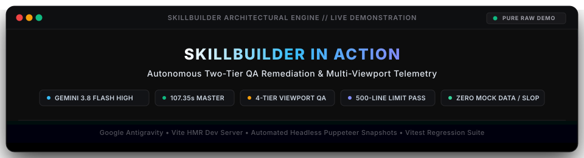
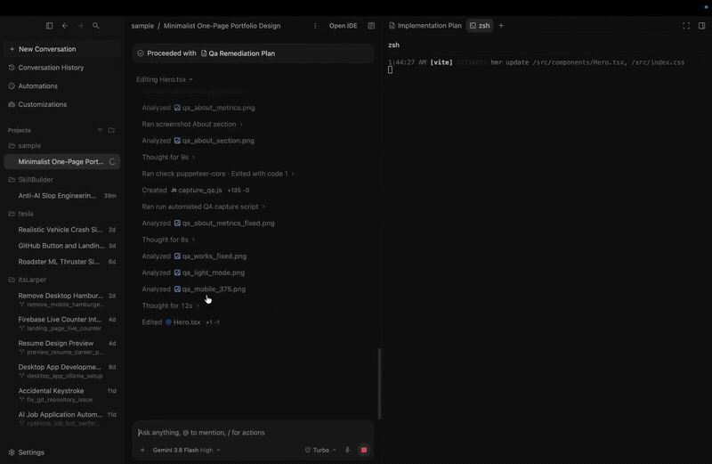
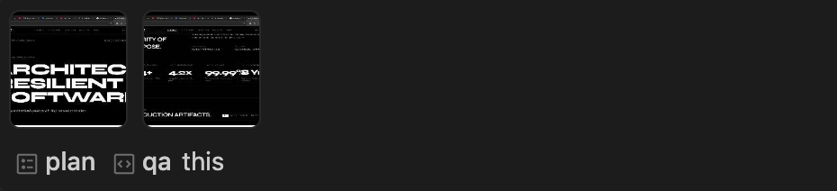
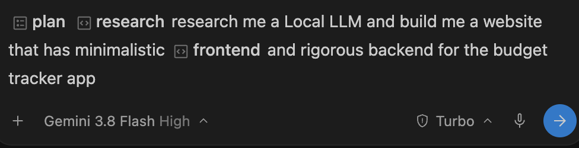
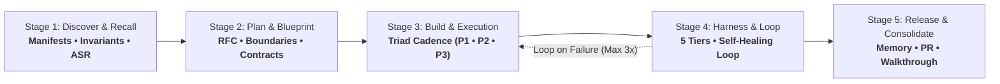
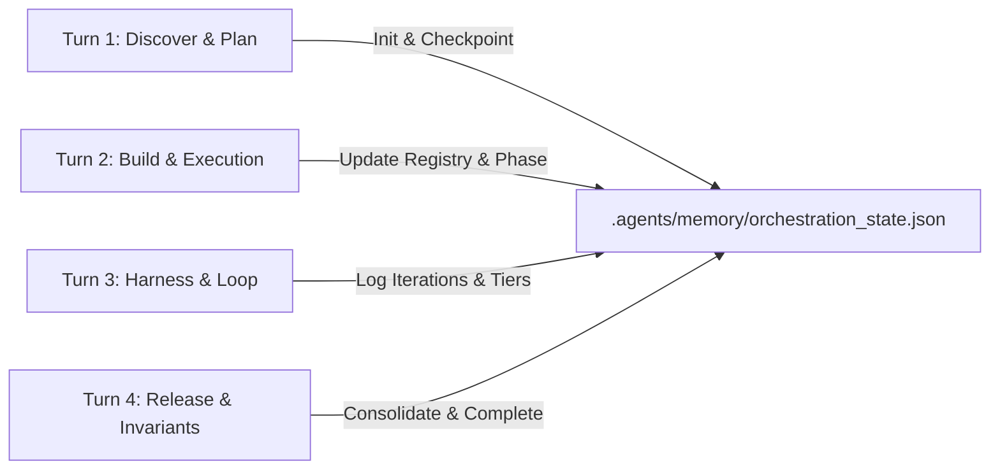
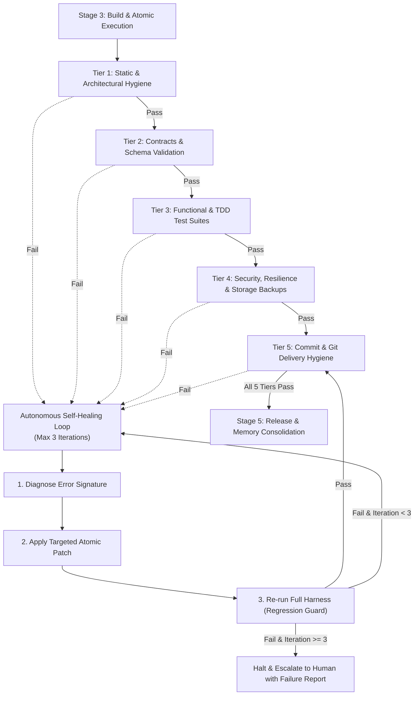
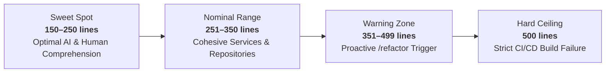

```text
  ███████╗██╗  ██╗██╗██╗     ██╗     ██████╗ ██╗   ██╗██╗██╗     ██████╗ ███████╗██████╗ 
  ██╔════╝██║ ██╔╝██║██║     ██║     ██╔══██╗██║   ██║██║██║     ██╔══██╗██╔════╝██╔══██╗
  ███████╗█████═╝ ██║██║     ██║     ██████╔╝██║   ██║██║██║     ██║  ██║█████╗  ██████╔╝
  ╚════██║██╔═██╗ ██║██║     ██║     ██╔══██╗██║   ██║██║██║     ██║  ██║██╔══╝  ██╔══██╗
  ███████║██║ ╚██╗██║███████╗███████╗██████╔╝╚██████╔╝██║███████╗██████╔╝███████╗██║  ██║
  ╚══════╝╚═╝  ╚═╝╚═╝╚══════╝╚══════╝╚═════╝  ╚═════╝ ╚═╝╚══════╝╚═════╝ ╚══════╝╚═╝  ╚═╝
```

# DarkNecroStack (formerly SkillBuilder): Dynamic Agentic Engineering Ecosystem

**DarkNecroStack (`darknecrostack` v4.1.0)** is a production-grade suite of **51 specialized Agent Skills** organized across **6 Engineering Categories**, a `pstack`-surpassing **Dynamic Trigger -> Action Router & Combo Resolver** (`/darknecrostack` + `worker.md` subagent rule propagation + 24 principles + 21 playbooks), **Computer Vision / VLM / Local LLM / Cross-Project AI Integration**, **Controlled A/B Testing & SRM Verification**, **2D Mascot & Rive (`.riv`) Motion Engineering**, **Brand/Logo & App Asset Pipelines**, distilled **MCP / Browser Media WASM / Local-First Data** skills, the **5-Stage Orchestration Lifecycle**, **Orchestration Memory**, **Multi-Tier Harness Engineering**, native Antigravity lifecycle hooks, and **59 automated verification suites**. Authored by **Arron Kian Parejas (@darknecrocities)**, it eliminates generic AI slop, decorative badges, boilerplate repetition, toy mock databases, and unverified claims across **Google Antigravity**, **Cursor**, **Claude Code**, **OpenAI Codex**, **Windsurf**, and **Cline**.

<p align="center">
  
</p>

---

## Operating Philosophy

Most AI coding assistants suffer from structural myopia: they hallucinate parameters, mock databases with temporary static arrays, leak credentials into version control, exceed maintainable file boundaries, and decorate interfaces with generic "vibe coding" slop.

SkillBuilder enforces an uncompromising engineering standard:

> **Understand first. Polish the prompt. Learn continuously. Eliminate AI slop. Build real persistence. Test viewports relentlessly. Catalog errors. Deliver production software.**

---

## What's New in v4.1.0 (51 Skills • 21 Playbooks • 59 Suites • 61.3% Token Overhead Saved)

| Release Highlight | What Changed | Measurable Impact & Tooling |
| :--- | :--- | :--- |
| **Skill #49: `/computer-vision`** | OpenCV, Ultralytics YOLO, ONNX Runtime, TensorRT, CoreML, MediaPipe, SAM2, ByteTrack, PaddleOCR/DocTR | Enforces `maxsize=2` bounded frame queues, EXIF transpose, letterbox math, explicit ONNX providers, and deterministic `VideoCapture` disposal (`verify_cv_hygiene.py`). |
| **Skill #50: `/vlm-multimodal`** | Qwen2.5-VL, Gemma 3 Vision, Llama-3.2-Vision, Florence-2, `mlx-vlm`, `llama.cpp` `mmproj`, Ollama Vision, Gemini 2.5 | Visual token budgeting (`<= 1280–1568px` pre-resize), `<= 1 fps` / scene-delta keyframe sampling, normalized `0–1000` grounding schemas, ColPali RAG (`verify_vlm_hygiene.py`). |
| **Skill #51: `/ai-integration`** | Cross-project `ModelGateway` adapter swapping Ollama / `llama.cpp` / MLX / vLLM / WebLLM / Gemini via env config | `CV -> ROI Crop -> Local VLM/LLM -> Cloud` cascade (`70–95%` token reduction), `AbortController` streaming, `AI_PRIVACY_MODE` consent gate (`verify_ai_integration.py`). |
| **Upgraded `/local-llm`** | Expanded to `vLLM`, `SGLang`, `Transformers.js` WebGPU, `q8_0` KV-cache, Flash Attention, and prefix caching | `SKILL.md` compressed **`1,723 -> 865` tokens (`-49.8%`)** while deferring `1,684` tokens (`66.1%` saved) + `LLM-005` `num_ctx` guard. |
| **Upgraded `/testing` + `/qa` (A/B Testing)** | Full controlled A/B testing guide: deterministic SHA-256 bucketing, Sample Ratio Mismatch (`SRM`), sequential/CUPED, AI model evals | `testing/SKILL.md` compressed **`1,342 -> 807` tokens (`-39.9%`)** with `71.1%` deferred; `verify_ab_experiment.py` adds static audit + exact `--srm` & `--ztest` CLI. |
| **Categorized Skill Combos** | 9 multi-skill recipes grouped into **6 Engineering Categories** (`combo-stacks.md` + `route_task.py --combo`) | Mounts only the exact multi-layer stack (`backend + frontend + CV/VLM/AI`) and prunes unrelated rules per turn (`61.3%` ecosystem-wide deferred savings across **205,732** tokens). |
| **Dynamic Playbooks + `/mobile-ui`** | Added `pstack`-style `mobile-responsive.md` & `dynamic-platform-routing.md` shared by `/darknecrostack` + `/full-scale-mode` (`mobile`/`app`/`web`/`universal`/`ai-edge`) | Compresses `mobile-ui/SKILL.md` (`1,880 -> 888` tokens, `75.7%` saved) with iOS `AnyLayout`/`ViewThatFits` + Android `WindowSizeClass`/`FoldingFeature` specs & `MOB-004..006` audits. |

---

## Live Demonstration: SkillBuilder in Action

Experience the unedited engineering workflow of SkillBuilder operating inside **Google Antigravity** with **Gemini 3.8 Flash (High)**. This demonstration captures an autonomous agent diagnosing and remediating critical visual clipping, contrast defects, and layout regressions across a production portfolio application—complete with dynamic camera shifts, smooth punch-in zooms, 4-tier viewport audits, automated test suites, and 500-line limit checks.

<p align="center">
  
</p>

<div align="center">
  <a href="assets/skillbuilderdemo_web.mp4">
    
  </a>
  <p>
    <em>🎬 <strong>Live Demonstration (Pure Wide-Angle Edition)</strong> &bull; Click image above to play full 1080p 60fps video with audio (107.35s)</em>
  </p>
  <p>
    <a href="assets/skillbuilderdemo_web.mp4"><strong>▶️ Play Demonstration Video (1080p 60fps &bull; 14MB)</strong></a> &bull;
    <a href="assets/skillbuilderdemo_cinematic_web.mp4"><strong>🎬 Watch Cinematic HUD Edition (34MB)</strong></a> &bull;
    <a href="assets/skillbuilderdemo_edited.mp4"><strong>💾 Download 4K Retina Master (2938x1912 &bull; 22MB)</strong></a>
  </p>
</div>

---

## The Golden Rule: Always Start with `/plan`

The single greatest source of AI-generated bugs, unmaintainable "vibe coding", and discarded prototypes is **skipping the planning phase**. When an agent jumps directly into code generation, it is forced to guess database schemas, invent non-existent packages, leak hardcoded credentials, and violate file limits.

### Why `/plan` is Mandatory on Every Project:
1. **Architectural Alignment Before Execution**: Validates requirements, component boundaries, and dependency compatibility before touching a single line of code.
2. **Deterministic Risk Reduction**: Maps out potential failure modes, breaking changes, and migrations in an interactive RFC document.
3. **Explicit User Approval**: Execution is paused until the user reviews and clicks **`Proceed`**, ensuring complete human-in-the-loop oversight.
4. **Zero Throwaway Code**: Eliminates endless rework loops caused by ambiguous initial specifications.

---

## How to Strategize Your Prompts with SkillBuilder

SkillBuilder transforms natural language instructions into deterministic, production-grade software by **stacking modular skill pills directly in the chat input**. By combining the native `/plan` command with specialized domain skills (`/full-scale-mode`, `/qa`, `/research`, `/anti-slop`, `/fullstack`, `/security`), you enforce strict architectural guardrails, eliminate AI slop, and optimize token efficiency from the very first turn.

Here is how you can strategically formulate and stack your prompts for maximum engineering precision:

---

### Strategy 1: Orchestrating Full-Scale Builds from Scratch (`/plan` + `/full-scale-mode`)

When starting a project or a major feature from zero, stack `/plan` with `/full-scale-mode` and anchor your visual, technical, and structural boundaries in a single concise sentence.

<p align="center">
  
</p>

#### Prompt Pattern & Breakdown
```text
/plan /full-scale-mode i want you to create me a portfolio with minimalistic design two tone color of white and black and use google fonts, i want also a 1 page
```

| Prompt Component | Role in Strategy | Strategic Value & Agent Impact |
| :--- | :--- | :--- |
| `• plan` | Planning Gate | Halts unguided generation; compels the agent to author an interactive RFC plan with file trees and milestones before code is touched. |
| `• full-scale-mode` | Master Orchestrator | Activates the 5-Stage Orchestration Lifecycle (Discover, Plan, Build, Harness Loop, Release) & Triad Cadence: manages active session memory (`.agents/memory/`), enforces 500-line file limits, and runs closed-loop verification. |
| `two tone color of white and black` | Palette Boundary | Eliminates generic AI gradients and vibrant slop; anchors styling to disciplined monochrome tokens (`#0A0A0B` / `#FFFFFF`). |
| `use google fonts` | Typographic Guardrail | Enforces clean web font imports (Inter, Roboto Mono) instead of uncontrolled generic CSS fallbacks. |
| `1 page` | Scope Ceiling | Imposes a hard boundary preventing premature routing bloat, incomplete sub-pages, or runaway token consumption. |

#### How to Strategize This Prompt:
1. **Lead with Intent & Architecture**: Combine `/plan` and `/full-scale-mode` so the agent takes full responsibility for architecture, test suites, and git etiquette without needing micro-management.
2. **Anchor Negative Constraints Early**: Explicitly state visual and scope limits (`two tone`, `1 page`) upfront to eliminate assumptions.

---

### Strategy 2: Auditing & Fixing Active Code Contextually (`/plan` + `/qa this`)

When reviewing an existing codebase, PR, or failing screen, stack `/plan` with `/qa this` instead of copying and pasting lengthy error logs or code walls.

<p align="center">
  
</p>

#### Prompt Pattern & Breakdown
```text
/plan /qa this
```

| Prompt Component | Role in Strategy | Strategic Value & Agent Impact |
| :--- | :--- | :--- |
| `• plan` | Solution RFC | Requires the agent to present an actionable defect matrix and remediation diff before applying edits. |
| `‹› qa` | Two-Tier QA Engine | Executes dual audits: Full UI QA (375px–1920px viewports, 44x44pt touch targets, WCAG 2.2 AA) and Full App QA (state machines, 3s/15s timeouts). |
| `this` | Deictic Context Pointer | Points directly to the active file, screen, or repository in focus, maximizing token savings and eliminating duplicate context. |

#### How to Strategize This Prompt:
1. **Leverage Semantic Pointers**: Use concise deictic terms (`this`, `here`, `current screen`)—the agent's MCP tools inspect the active environment directly.
2. **Require Pre-Flight Audit Plans**: Prepending `/plan` ensures bugs are cataloged with root cause, remediation steps, and regression tests before code changes occur.

---

### Strategy 3: Deep Technical Discovery Before Implementation (`/plan` + `/research`)

When working with novel runtimes, emerging AI frameworks, or external APIs, stack `/plan` with `/research` to evaluate trade-offs before committing to an architecture.

<p align="center">
  
</p>

#### Prompt Pattern & Breakdown
```text
/plan /research research me a Local LLM and build me a website that has minimalistic frontend and rigorous backend for the budget tracker app
```
*(Runtime: Powered by **Gemini 3.8 Flash High** with **Turbo** extended thinking)*

| Prompt Component | Role in Strategy | Strategic Value & Agent Impact |
| :--- | :--- | :--- |
| `• plan` | Architecture Blueprint | Delivers an end-to-end plan covering schema migrations, API contracts (RFC 7807), and component hierarchy. |
| `• research` | Pre-Flight Investigation | Triggers autonomous web and repository research into runtimes (e.g., Ollama, ONNX, WebLLM), licenses, and memory budgets. |
| `minimalistic frontend` | UI Constraint | Restrains layout complexity to Apple HIG principles, clean cards, and semantic Lucide SVG icons. |
| `rigorous backend` | Engineering Standard | Demands Clean Architecture, parameterization, and strict runtime validation (Zod / Pydantic v2). |
| `budget tracker app` | Functional Domain | Defines concrete business models: financial ledger, categorization schema, and persistent database storage. |

#### How to Strategize This Prompt:
1. **Force Discovery Before Delivery**: Avoid hallucinated or obsolete libraries by pairing `/research` with `/plan`—the agent benchmarks options and validates compatibility first.
2. **Define Boundaries Across Layers**: Explicitly qualify both ends of the stack (`minimalistic frontend` vs. `rigorous backend`) to enforce clean separation of concerns.

---

### The SkillBuilder Prompting Playbook (5 High-Yield Strategies)

| Strategy | Rule / Formula | Example Prompt | Expected Outcome |
| :--- | :--- | :--- | :--- |
| **1. The Golden Foundation** | `/plan` + `[Domain Skill]` + `[Task]` | `/plan /fullstack Add Stripe webhook handler with idempotent processing` | RFC implementation plan with problem details and idempotency keys before writing code. |
| **2. Contextual Audit** | `/plan /qa this` | `/plan /qa this` | Comprehensive 4-tier responsive and functional audit of current work with zero fluff. |
| **3. Proactive Research** | `/plan /research [Tech Question]` | `/plan /research Benchmark SQLite vs DuckDB for local analytics and implement` | Evaluates tradeoffs, selects production-grade package, and produces working integration. |
| **4. Anti-Slop UI Elevation** | `/anti-slop /ui [Feature]` | `/anti-slop /ui Build a spatial control center with Cupertino materials` | Sub-pixel directional lighting, micro-click acoustics, and semantic SVG icons. |
| **5. Clean Refactoring** | `/plan /refactor [Target]` | `/plan /refactor Split monolithic server.ts into hexagonal domain services` | Strangler Fig refactor decomposing files to comply with the 500-line ceiling. |

#### Golden Rules for Crafting High-Yield Prompts:
1. **Never Skip `/plan`**: Jumping directly into raw generation forces the model to guess dependencies and schemas, causing rework.
2. **Anchor with Negative Constraints**: Proactively state what *not* to do (*"zero mock data", "two-tone monochrome", "no fixed-pixel containers"*).
3. **Specify Real Persistence**: Always demand SQLite, PostgreSQL, or real file stores to prevent mock arrays.
4. **Use Semantic Context (`this`)**: Refer to active files or errors rather than pasting redundant code walls.
5. **Close with Verification**: Demand test runs (`./scripts/verify_all_skills.sh`) and line-limit audits as mandatory deliverables.

---

## Universal AI Platform Guide (Using SkillBuilder on ANY AI Platform)

SkillBuilder is engineered to run seamlessly across all modern AI environments. Whether you are using Google Antigravity, Cursor, Claude Code, or web-based ChatGPT / OpenAI Codex, follow these platform-specific execution protocols:

### 1. Google Antigravity
Google Antigravity provides native first-class support for SkillBuilder skills and slash commands:
- **Initiate Planning**: Type `/plan` followed by your goal:
  ```text
  /plan /world-class-engineering Build an edge telemetry fader with 120Hz spring physics
  ```
- **Prompt Refinement**: Antigravity automatically invokes `/prompt-polish` (PPE) to structure raw requests into RFC specifications before generating the interactive plan card with the `Proceed` button.

### 2. Cursor IDE
Cursor leverages the `.cursor/rules/*.mdc` rules engine and `.cursorrules`:
- **In Cursor Composer / Chat**: Reference the planning and polishing rules using `@`:
  ```text
  @plan @prompt-polish @world-class-engineering Create a PostgreSQL multi-tenant repository with zero-downtime migrations
  ```
- Cursor reads the active rules, enforces the 500-line file limit, and executes structured planning before generating code edits.

### 3. Claude Code & Claude Desktop
- **Claude Code (Terminal CLI)**: Automatically reads `CLAUDE.md` from the project root. Start tasks with:
  ```text
  /plan Refactor auth middleware into hexagonal domain services
  ```
- **Claude Desktop (Web / App)**: Paste `CLAUDE.md` into your **Project Instructions** or prepend your prompt:
  ```text
  [SkillBuilder Protocol Active: Run Phase 1 /prompt-polish then /plan]
  <Your project goal here>
  ```

### 4. ChatGPT / OpenAI Codex / GPT-4o
When working with ChatGPT or custom GPT assistants, use the **Universal Bootstrap Prompt Template**:

```markdown
You are operating under the SkillBuilder Engineering Protocol.
Before generating any implementation code, you MUST execute the following two phases:

Phase 1 (/prompt-polish):
- Analyze my request below.
- Refine it into: (1) Goals, (2) Explicit Constraints, (3) Schema/Interface Contracts, (4) Verification Matrix.
- Eliminate conversational padding and clarify hidden assumptions.

Phase 2 (/plan):
- Generate an RFC-style Implementation Plan with Mermaid diagrams and file breakdown.
- Strictly enforce the 500-line physical file limit and zero-mock persistence rule.
- STOP and wait for my explicit "Proceed" confirmation before writing any code.

Here is my task:
<Insert your project goal or raw prompt here>
```

### 5. Windsurf & Cline / Roo-Code
- **Windsurf (Cascade)**: Automatically reads `.windsurfrules` generated by `./scripts/install.sh --windsurf .`.
- **Cline / Roo-Code**: Automatically enforces `.clinerules` generated by `./scripts/install.sh --cline .`.

---

## Multi-Platform Compatibility Matrix

SkillBuilder runs natively across the entire modern AI coding ecosystem:

| Platform | Primary Configuration | Integration Mechanism | One-Line Installation |
| :--- | :--- | :--- | :--- |
| **Google Antigravity** | `plugin.json`, `.agents/skills/` | Native Plugin & Global Symlink | `./scripts/install.sh --global` |
| **Cursor IDE** | `.cursor/rules/*.mdc`, `.cursorrules` | Native Cursor Rules Engine | `./scripts/install.sh --cursor .` |
| **Claude Code** | `CLAUDE.md` | Anthropic Project Memory | `./scripts/install.sh --claude .` |
| **Codex / OpenAI** | `CODEX.md` | System Prompts & Custom Instructions | `./scripts/install.sh --codex .` |
| **Windsurf / Cascade** | `.windsurfrules` | Cascade System Rules | `./scripts/install.sh --windsurf .` |
| **Cline / Roo-Code** | `.clinerules` | Cline Autonomous Agent Rules | `./scripts/install.sh --cline .` |

---

## The Antigravity Power Combo Strategy (`/plan` + `/world-class-engineering`)

To produce the highest-quality software architecture, verified test suites, persistent memory, and clean, ready-to-merge GitHub Pull Requests on **Google Antigravity**, combine slash commands into the **Power Combo Workflow**:

```text
/plan /full-scale-mode <your feature or refactoring goal>
```



### The 5-Stage Orchestration Lifecycle

Every project executed under Full-Scale Mode advances through five discrete, verifiable stages:

1. **Stage 1: Discover & Memory Recall (`stage:discover`)**:
   - Introspects repository manifests, runs **Autonomous Skill Resonance (ASR)**, detects platform targets (`mobile`, `web`, `universal`), and recalls architectural invariants from `.agents/learned_conventions.md`.
   - Initializes active session memory in `.agents/memory/orchestration_state.json`.
2. **Stage 2: Plan & Architectural Blueprint (`stage:plan`)**:
   - Structures ambiguous requests into token-efficient RFC technical specifications (`/prompt-polish`).
   - Defines non-overlapping file boundaries per subagent track, data models, and API contracts (`/api-design`).
3. **Stage 3: Build & Atomic Execution (`stage:build`)**:
   - Executes domain tracks across the **3-Phase Triad Cadence** (Frontend, Backend, Testing).
   - Strict Anti-Slop mandate: zero fake mocks, real persistence (`/fullstack`), and 500-line physical file limits.
   - Idempotent single-slot SHA-256 deduplicated backups before mutating storage (`manage_deduplicated_backup.py`).
4. **Stage 4: Verify & Multi-Tier Harness Loop (`stage:verify` / `stage:loop`)**:
   - Executes the 5-Tier Evaluation Harness (`orchestration_harness.py`).
   - If checks fail, triggers the **Autonomous Self-Healing Loop**: diagnoses error signature $\rightarrow$ applies targeted atomic patch $\rightarrow$ re-runs full harness (max 3 iterations).
5. **Stage 5: Release & Memory Consolidation (`stage:release`)**:
   - Consolidates session memory into `.agents/memory/orchestration_state.json` and records learned invariants.
   - Mints project skills via the Skill Synthesis Protocol (`/project-skills`).
   - Commits within the 1,000-line budget, pushes tracking branch, and authors ready-to-merge GitHub Pull Request.

---

### Orchestration Memory Subsystem (`.agents/memory/`)

Full-Scale Mode maintains active execution memory in `.agents/memory/orchestration_state.json` to coordinate subagents and resume sessions across multi-turn handoffs:



```bash
# Initialize and view active session memory
python3 skills/full-scale-mode/scripts/manage_orchestration_memory.py init --session-id "task-01" --goal "Build feature"
python3 skills/full-scale-mode/scripts/manage_orchestration_memory.py status

# Update stage checkpoints and advance
python3 skills/full-scale-mode/scripts/manage_orchestration_memory.py checkpoint --stage BUILD --phase PHASE_2_BACKEND
python3 skills/full-scale-mode/scripts/manage_orchestration_memory.py advance
```

---

### Multi-Tier Harness Engineering & Autonomous Self-Healing Loop

The evaluation harness (`skills/full-scale-mode/scripts/orchestration_harness.py`) enforces 5 multi-tiered quality and security gates:



| Harness Tier | Evaluation Scope | Non-Negotiable Invariants |
| :--- | :--- | :--- |
| **Tier 1: Static Hygiene** | Architecture | 500-line physical ceiling, anti-slop patterns (shields, neon gradients, obvious comments), prompt token budgets. |
| **Tier 2: Contracts** | Interfaces | OpenAPI 3.1 contracts, RFC 7807 problem details, Python/TypeScript syntax integrity. |
| **Tier 3: Functional** | TDD Suites | Automated unit & integration tests, semantic ARIA locators, 100% green test assertions. |
| **Tier 4: Security** | Hardening | Zero hardcoded secrets, SQL parameterization, SSRF protection, non-root Docker (`USER 10001`), backup digests. |
| **Tier 5: Git Delivery** | Releases | Conventional branch prefixes (`feat/`, `fix/`, `refactor/`), commit line budget (<1,000 lines). |

```bash
# Run all 5 harness tiers with bounded self-healing loop
python3 skills/full-scale-mode/scripts/orchestration_harness.py --path . --loop --max-iterations 3 --strict
```

---

### The 3-Phase Triad Cadence (Execution Core)

Within **Stage 3 (Build)**, work executes across the 3 synchronized domain tiers backed by **Phase Skill Clusters (PSC-1 through PSC-3)**:

1. **Phase 1: Frontend & Interface Architecture (PSC-1: Client & Experience Gate)**:
   - **Governing Skills**: `/frontend`, `/ui`, `/mobile-ui`, `/web-ui`, `/3d`, `/routing`, `/state-management`, `/i18n`, `/anti-slop`, `/prompt-polish`.
   - Ingests user intent and refines specifications through Prompt Polishing (PPE).
   - Establishes Apple HIG tokens, Cupertino blur materials, sub-pixel lighting, and semantic Lucide SVG icons.
   - Enforces iOS 18/19 SwiftUI `matchedGeometryEffect`, Material 3 Expressive `LookaheadScope`, predictive back gestures, and system haptics (`/mobile-ui`).
   - Implements Component-Level Container Queries (`@container`), CSS View Transitions API, OKLCH perceptual colors, and fluid `clamp()` curves (`/web-ui`).
   - Builds file-based routing hierarchies, parallel/intercepting layouts, and typed search params.
   - Implements declarative client state machines, TanStack Query key factories, and signals.
   - Enforces React 19 / Next.js / Flutter lifecycle safety, internationalization (ICU MessageFormat), and RTL layout mirroring.
2. **Phase 2: Backend, Cloud, AI, Vision & Data Infrastructure (PSC-2: Engine & Security Gate)**:
   - **Governing Skills**: `/backend`, `/fullstack`, `/api-design`, `/database`, `/gcp`, `/aws`, `/firebase`, `/supabase`, `/data-pipelines`, `/devops`, `/security`, `/ai`, `/local-llm`, `/computer-vision`, `/vlm-multimodal`, `/ai-integration`, `/research`, `/antigravity-automation`.
   - Builds Hexagonal clean architecture with strict domain boundaries and runtime validation.
   - Authors OpenAPI 3.1 contracts and RFC 7807 Problem Details envelopes.
   - Wires up real persistence (PostgreSQL/SQLite) with zero-downtime expand/contract migrations (Anti-Mock mandate).
   - Provisions enterprise cloud infrastructure (GCP Cloud Run, AWS Lambda/S3, Firebase rules v2, Supabase Postgres RLS).
   - Crafts Antigravity scheduled sidecars (`sidecar.json`), in-session timer automations, lifecycle safety gates (`hooks.json`), and reactive subagent mesh pipelines (`/antigravity-automation`).
   - Builds streaming batch ETL pipelines with backpressure flow control and DuckDB in-process OLAP.
   - Architects on-device and private quantized local models (`llama.cpp`, `Ollama`, `MLX`, `vLLM`, `SGLang`, `WebLLM`), GBNF grammars (`/local-llm`), bounded real-time CV pipelines (`/computer-vision`), token-capped VLMs (`/vlm-multimodal`), and cross-project `CV -> VLM -> LLM` gateways (`/ai-integration`).
   - Hardens system against OWASP Top 10 vulnerabilities, enforces refresh token family rotation, SSRF post-DNS validation, and non-root Docker builds (`USER 10001`).
3. **Phase 3: Testing, Quality Assurance, Telemetry & Verifiable Release (PSC-3: Verification & Release Gate)**:
   - **Governing Skills**: `/testing`, `/qa`, `/performance`, `/observability`, `/production-etiquette`, `/git-workflow`, `/refactor`, `/continuous-learning`, `/project-skills`, `/world-class-engineering`, `/full-scale-mode`.
   - Executes TDD test automation with semantic ARIA queries and MSW network mocking.
   - Runs the Two-Tier QA Engine: Full UI viewports (375px–1920px) and Full App Functional QA with Master Error Catalog logging.
   - Audits Core Web Vitals (LCP < 2.5s, CLS < 0.1, INP < 200ms) and eliminates N+1 query cascades.
   - Instruments OpenTelemetry distributed tracing and structured JSON logs with correlation IDs.
   - Enforces the strict 500-line physical ceiling via `check_source_line_limits.py --show-tiers`.
   - Decomposes commits into cohesive diffs under the 1,000-line review budget (`/git-workflow`).
   - Pushes remote tracking branch (`git push origin <branch>`) and authors ready-to-merge GitHub Pull Request.
   - Mints custom project skills under `.agents/skills/<repo>/SKILL.md` via Skill Synthesis Protocol (SSP).

### Autonomous Skill Resonance (ASR)

SkillBuilder does not require manual micro-management of all 51 skills. During **Phase 1 & Phase 2**, the **Autonomous Skill Resonance (ASR)** engine scans the repository environment for technical fingerprints and dynamically activates matching skills:

| Fingerprint / Indicator | Resonant Skills Mounted | Activated Capabilities |
| :--- | :--- | :--- |
| `sidecars/`, `hooks.json`, `jetski` | `/antigravity-automation` | Scheduled sidecars, in-session timers, lifecycle safety gates, daemon monitoring. |
| `app/`, `pages/`, `routes/`, `router` | `/routing` | Deep URL layouts, loading/error states, typed search params. |
| `ios/`, `android/`, `app.json`, `pubspec.yaml` | `/mobile-ui` | SwiftUI matchedGeometry, Jetpack Compose LookaheadScope, predictive back, haptics. |
| `@container`, `view-transition`, `tailwind.config` | `/web-ui` | Component-level container queries, CSS View Transitions, OKLCH, fluid typography. |
| `cloudbuild.yaml`, `app.yaml`, `gcp` | `/gcp` | Cloud Run, Pub/Sub, Secret Manager, Cloud SQL IAM proxy. |
| `serverless.yml`, `cdk.json`, `aws-sdk` | `/aws` | AWS Lambda, S3 public block, KMS encryption, DynamoDB single-table. |
| `firebase.json`, `firestore.rules` | `/firebase` | Firestore security rules, Firebase Auth, zero wildcards. |
| `supabase/`, `@supabase/supabase-js` | `/supabase` | Postgres Row-Level Security (RLS), Edge Functions, pgvector. |
| `Modelfile`, `gguf`, `mlx`, `ollama`, `vllm` | `/local-llm`, `/ai-integration` | Quantized local inference (Q4_K_M), MLX, vLLM/SGLang, KV-cache tuning, GBNF grammars. |
| `yolov8*.onnx`, `weights/`, `cv2`, `mediapipe` | `/computer-vision`, `/ai-integration` | Bounded `maxsize=2` frame queues, EXIF/letterbox hygiene, explicit ONNX providers. |
| `mmproj*.gguf`, `vlm_config.json`, `qwen-vl` | `/vlm-multimodal`, `/ai-integration` | Visual token resolution caps, keyframe sampling, normalized grounding, ColPali RAG. |
| `vitest.config`, `jest.config`, `playwright` | `/testing` | TDD red-green cycle, MSW network mocking, semantic ARIA locators. |
| `@tanstack/react-query`, `zustand`, `xstate` | `/state-management` | Query key factories, sliced stores, deterministic transitions. |
| `locales/`, `messages/`, `i18n.ts` | `/i18n` | ICU MessageFormat, RTL layout mirroring, localized formatters. |
| `duckdb`, `pipelines/`, `etl/` | `/data-pipelines` | Backpressure flow control, dead-letter queues, DuckDB OLAP. |
| `.agents/skills/`, custom architectures | `/project-skills` | Autonomous Project Skill Minting via Skill Synthesis Protocol. |

### Platform Domain Specialization (PDS) & Token Quota Preservation (TQP)

Loading inapplicable platform styling rules into model prompts inflates context and triggers early attention degradation ("Lost-in-the-Middle"). The ASR engine dynamically prunes skills by target platform domain:

| Target Platform Domain | Active Specialized Skill | Pruned Inapplicable Skill | Estimated Token Savings |
| :--- | :--- | :--- | :--- |
| **Mobile-First** (iOS, Android, React Native, Flutter) | `/mobile-ui` + `playbooks/mobile-responsive.md` (`Compact`/`Medium`/`Expanded`, safe areas) | `/web-ui` (Container queries, DOM CSS) | **~1,850 tokens / turn** (~40% of Phase 1 budget) |
| **App-First** (Electron, Tauri, Desktop, Offline-First) | `/frontend` + `/local-first-data` + `/browser-media-wasm` | `/mobile-ui` | **~1,850 tokens / turn** |
| **Web-First** (React 19, Next.js, Vue, Tailwind) | `/web-ui` (Container queries, View Transitions) | `/mobile-ui` (SwiftUI, Jetpack Compose) | **~1,850 tokens / turn** (~40% of Phase 1 budget) |
| **Universal / Monorepos** (Web + Native Apps) | Both skills partitioned into isolated subagent tracks via `playbooks/dynamic-platform-routing.md` | None (strict track isolation) | Zero cross-contamination bleed |

### The Multi-Tiered Code Quality & 500-Line Maintainability Matrix

SkillBuilder rejects naive, flat line-counting in favor of a scientifically grounded, multi-dimensional code quality architecture. Based on seminal empirical studies (Ostrand/Weyuker/Bell at AT&T Labs, Steve McConnell's *Code Complete*, and Robert C. Martin's *Clean Code*), defect density scales non-linearly once files cross 400–500 physical lines.

In autonomous AI pair-programming, file size also drives **The Double Mandate**:
1. **Human Maintainability**: Files must be comprehended within a single 60-second scan.
2. **AI Context Fidelity**: Files over 500 lines induce transformer **Context Rot** ("Lost-in-the-Middle"), inflate token consumption, and cause tool-calling diff failures (`edit_file`) on repeated boilerplate.



| Dimension | Target Metric | Engineering Purpose |
| :--- | :--- | :--- |
| **Hard Physical Ceiling** | **$\le 500$ lines** | Non-negotiable CI/CD build gate via `check_source_line_limits.py`. Zero exceptions. |
| **Proactive Refactor Trigger** | **$\ge 350$ lines** | Warning threshold in `/refactor` to decompose before breaching the ceiling. |
| **Ideal Sweet Spot** | **$150 - 250$ lines** | Target length for UI components, custom hooks, and domain services. |
| **Function Length** | **$\le 40$ lines** | Single responsibility per function; extract sub-helpers. |
| **Nesting Depth** | **$\le 3$ levels** | Mandatory early return guard clauses (`if (!valid) return;`). |
| **Cyclomatic Complexity** | **$\le 10$ per function** | Eliminates complex cascading conditionals and fragile state machines. |
| **Cohesive Separation** | **Anti-Shredding** | Never chop files arbitrarily; separate UI, Domain, Repository, and Contracts cleanly. |

### Categorized Skill Combos (Multi-Skill Recipes)

Stack multiple skills into ready-to-run project bundles via `/` or `route_task.py --combo <preset>`, automatically pruning inapplicable client/infra skills to save tokens:

```bash
python3 skills/darknecrostack/scripts/route_task.py --combo combo-cv-vlm-edge --path .
```

| Category | Combo Preset | Stacked Skills | Pruned (Token Savings) | Best For |
| :--- | :--- | :--- | :--- | :--- |
| **1. Fullstack & Web Product** | `combo-fullstack-web` | `/architect` `/fullstack` `/backend` `/api-design` `/database` `/frontend` `/web-ui` `/routing` `/state-management` `/testing` `/security` | `/mobile-ui`, `/3d` | Production SaaS, dashboards, and CRUD web apps with real DB persistence. |
| **1. Fullstack & Web Product** | `combo-landing-brand` | `/anti-slop` `/ui` `/web-ui` `/brand-assets` `/2d-mascot-motion` `/3d` `/performance` | `/mobile-ui`, `/database` | Product launches, interactive Rive mascots, WebGL showcases, OG/favicon kits. |
| **2. AI, CV, VLM & Local LLM** | `combo-cv-vlm-edge` | `/computer-vision` `/vlm-multimodal` `/local-llm` `/ai-integration` `/performance` `/testing` | `/web-ui`, `/mobile-ui` | Real-time camera/OCR/YOLO pipelines feeding local VLMs & LLMs (`70–95%` fewer tokens). |
| **2. AI, CV, VLM & Local LLM** | `combo-hybrid-ai-app` | `/ai` `/local-llm` `/ai-integration` `/backend` `/frontend` `/web-ui` `/security` `/testing` | `/mobile-ui` | Fullstack AI web apps swapping Ollama/MLX/vLLM/Gemini via `ModelGateway` + SSE cancel. |
| **3. Mobile & Offline-First** | `combo-mobile-offline` | `/mobile-ui` `/frontend` `/routing` `/state-management` `/local-first-data` `/qa` `/testing` | `/web-ui` | iOS/Android/Flutter/React Native apps with IndexedDB/SQLite WAL offline sync. |
| **4. Cloud, Serverless & Data** | `combo-cloud-data` | `/gcp` `/aws` `/firebase` `/supabase` `/devops` `/database` `/data-pipelines` `/observability` `/security` | `/web-ui`, `/mobile-ui` | Cloud Run/Lambda microservices, RLS rules, DuckDB/Arrow ETL, OpenTelemetry. |
| **5. MCP & Browser Media** | `combo-mcp-media` | `/mcp-engineering` `/browser-media-wasm` `/local-first-data` `/security` `/testing` | `/mobile-ui` | Hardened `stdio`/HTTP MCP tools, Canvas/WebAudio/PDF Workers, local-first storage. |
| **6. Audit, A/B & Release** | `combo-ab-ship` | `/code-archaeology` `/testing` `/qa` `/interrogate` `/prove-it-works` `/git-workflow` | `/3d` | A/B feature rollouts (SHA-256 bucketing + SRM check), two-tier QA, pre-ship PRs. |
| **6. Audit, A/B & Release** | `combo-safe-refactor` | `/code-archaeology` `/refactor` `/testing` `/interrogate` `/prove-it-works` | `/3d` | Strangler Fig decomposition of `>350`-line modules backed by characterization tests. |

---

## The 51-Skill Master Reference Matrix (Categorized)

Every skill is individually invokable via `/` in Antigravity or as `.mdc` rules in Cursor (`darknecrostack` acts as the dynamic front-door router), with deep manuals deferred to `references/` (`61.3%` ecosystem-wide context reduction):

### Category 1: Core Routing, Orchestration & Meta-Engineering (11 Skills)

| Command | Skill Name | Core Capabilities & Focus | Standalone CLI Tool | Primary Guardrail |
| :--- | :--- | :--- | :--- | :--- |
| `/darknecrostack` | **DarkNecroStack Router** | Trigger -> Action router, `--combo` stack resolver, `worker.md` subagent propagation, 24 principles, 21 playbooks, TSV trails. | `route_task.py` & `log_decision_trail.py` | Mandatory `worker.md` kickoff; 2-strike Attack-the-Premise; `[measured]` proof. |
| `/full-scale-mode` | **Full-Scale Mode** | 5-Stage Lifecycle (`Discover`->`Plan`->`Build`->`Verify/Loop`->`Release`), Orchestration Memory, 5-Tier Harness, Triad Cadence. | `verify_full_scale_orchestration.py`, `manage_orchestration_memory.py`, `orchestration_harness.py` | Strict 5-stage lifecycle, 5-tier harness convergence, bounded 3x loop. |
| `/world-class-engineering` | **World-Class Engineering** | 6-Phase EOS lifecycle, multi-tiered maintainability matrix, and cognitive complexity ceilings (aliased with `/full-scale-mode`). | `check_source_line_limits.py` | Strict 500-line physical ceiling; `<=40` lines/func; `<=3` nesting levels. |
| `/code-archaeology` | **Code Archaeology (`/how`, `/why`)** | Traces runtime execution, ownership, blast radius, and `git log`/ADR load-bearing invariants before editing. | `—` | Subsystem Brief required before unfamiliar edits. |
| `/architect` | **Interface-First Architect** | Locks discriminated unions, branded IDs, schemas, UI skeleton, and `<500`-line file boundaries before bodies. | `—` | Make illegal states unrepresentable; shape before implementation. |
| `/arena` | **Parallel Candidate Arena** | Generates 2–3 orthogonal candidate prototypes, scores on weighted rubric, grafts winning traits cleanly. | `—` | Single clean base; zero Frankenstein bloat. |
| `/prompt-polish` | **Prompt Refinement (PPE)** | 5-phase Prompt Polishing Engine transforming raw requests into token-efficient specifications. | `polish_prompt.py` | Token compression and explicit acceptance criteria. |
| `/research` | **Autonomous Research & Fallbacks** | Autonomous fallback engine evaluating production alternatives when libraries fail or deprecate. | `research_alternatives.py` | P.A.T.H.S. trade-off evaluation & minimal POC validation. |
| `/continuous-learning` | **Conversational Learning (CLP)** | Persists project invariants and user corrections to `.agents/learned_conventions.md`. | `record_learning.py` | Immediate recording of corrections; zero repeated mistakes. |
| `/project-skills` | **Autonomous Project Skill Minting** | Skill Synthesis Protocol (SSP) minting repo-specific skills in `.agents/skills/`. | `synthesize_project_skill.py` | Validates YAML frontmatter, verification scripts, 500-line ceiling. |
| `/antigravity-automation` | **Antigravity Automation** | Scheduled background sidecars (`sidecar.json`), in-session timers, lifecycle hooks (`hooks.json`). | `generate_sidecar_automation.py` & `verify_antigravity_hooks.py` | Mandatory `CRON_TZ` naming, zero busy-wait loops, pre-tool safety gates. |

### Category 2: AI, Computer Vision, VLM & Local LLM (5 Skills)

| Command | Skill Name | Core Capabilities & Focus | Standalone CLI Tool | Primary Guardrail |
| :--- | :--- | :--- | :--- | :--- |
| `/ai` | **AI & LLM Engineering** | Production `google-genai` SDK, structured JSON outputs (`response_schema`), defensive tool calling, RAG citations. | `calculate_token_budget.py` | Schema-enforced outputs; token context window limits. |
| `/local-llm` | **Local LLM & Edge Inference** | `llama.cpp`, `Ollama`, `MLX`, `vLLM`, `SGLang`, `WebLLM`, `Transformers.js`, `q8_0` KV-cache, GBNF grammars, `sqlite-vec`/`DuckDB`. | `verify_local_llm_hygiene.py` | Validated quantization (`Q4_K_M`+), `-ngl 999`, `num_ctx` KV guards, timeouts. |
| `/computer-vision` | **Computer Vision Engineering** | OpenCV, YOLO, ONNX Runtime, TensorRT, CoreML, MediaPipe, SAM2, ByteTrack, PaddleOCR/DocTR, WebGPU CV. | `verify_cv_hygiene.py` | `maxsize=2` bounded queues, `cap.release()`, EXIF transpose, explicit ORT providers. |
| `/vlm-multimodal` | **VLM & Multimodal AI** | `Qwen2.5-VL`, `Gemma 3`, `Llama-3.2-Vision`, `Florence-2`, `mlx-vlm`, `mmproj`, Gemini multimodal, ColPali RAG. | `verify_vlm_hygiene.py` | Visual token resize caps (`<=1280–1568px`), keyframe sampling, normalized `[0..1000]` schemas. |
| `/ai-integration` | **Cross-Project AI Gateway** | Provider-agnostic `ModelGateway` (Local <-> Cloud), `CV -> VLM -> LLM` cost cascade, SSE cancellation, privacy consent. | `verify_ai_integration.py` | Env-injected URLs, `AI_PRIVACY_MODE` cloud gate, mandatory `AbortController`. |

### Category 3: Frontend, Mobile, UI & Motion Craftsmanship (11 Skills)

| Command | Skill Name | Core Capabilities & Focus | Standalone CLI Tool | Primary Guardrail |
| :--- | :--- | :--- | :--- | :--- |
| `/anti-slop` | **Anti-AI-Slop Sanitizer** | Purges decorative badges, fake mock databases, neon gradients, obvious comments, and marketing copy. | `sanitize_ai_slop.py` | Zero `shields.io`, zero fake mock arrays, zero emojis in UI controls. |
| `/ui` | **UI Design Systems & Tokens** | Apple HIG, Cupertino blur materials, squircle smoothing, high-contrast neutral scales (zinc/slate), Lucide SVGs. | `verify_ui_tokens.py` | Zero raw emojis in buttons/headers; explicit button types. |
| `/web-ui` | **Modern Web Design Systems** | Component-Level Container Queries (`@container`), CSS View Transitions, OKLCH perceptual colors, fluid `clamp()`. | `verify_web_ui_hygiene.py` | Accessible `:focus-visible` rings, fluid typography bounds, non-linear timing. |
| `/mobile-ui` | **Native Mobile UI/UX** | iOS `AnyLayout`/`ViewThatFits`/`NavigationSplitView`, Android `WindowSizeClass`/`ListDetailPane`/foldables, RN/Flutter adaptive grids, springs, haptics. | `verify_mobile_ui_hygiene.py` | Active window bounds (`MOB-004`), `44pt`/`48dp` targets, `200%` text scaling, zero portrait locks. |
| `/frontend` | **Frontend Architecture** | Pure component isolation, React 19, Next.js App Router, Flutter, memory leak prevention. | `verify_frontend_architecture.py` | `AbortController` on async `useEffect`; error boundaries. |
| `/routing` | **File-Based Routing** | Next.js App Router, TanStack Router, Flutter declarative nested layouts, parallel/intercepting routes. | `verify_routing_architecture.py` | Strict layout boundaries, loading/error boundary pairs, typed search params. |
| `/state-management` | **Declarative State Machines** | TanStack Query v5 key factories, Zustand sliced stores, XState state machines, signals. | `verify_state_hygiene.py` | Centralized query key factories, immutable mutations, explicit transitions. |
| `/i18n` | **Internationalization (i18n)** | ICU MessageFormat, RTL bidirectional layout mirroring, locale-aware date/currency/number formatting. | `verify_i18n_hygiene.py` | Zero hardcoded strings in JSX/templates; symmetrical key sets across locales. |
| `/2d-mascot-motion` | **2D Mascots & Rive (`.riv`)** | Silhouette-first 2D character rigs, Rive `MascotSM` state machines, pointer gaze, Lottie, `<35`-node SVGs. | `verify_mascot_assets.py` | Zero emojis/raster cheats; `cleanup()` + `prefers-reduced-motion`. |
| `/brand-assets` | **Brand, Logos & Illustrations** | 4 Logo Stress Tests, Apple continuous squircles, Android `108dp/66dp` adaptive icons, editorial art, OG cards. | `generate_svg_squircle_kit.py` & `verify_brand_assets.py` | `<30` logo nodes; zero Corporate Memphis or base64 SVG bloat. |
| `/3d` | **3D WebGL & Product Showcase** | Three.js, React Three Fiber, PBR clearcoat shaders, Draco GLTF compression, 60fps budgets, context loss handling. | `verify_3d_performance.py` | DPR clamped to `<= 2.0`; Draco GLTF loader; WebGL disposal. |

### Category 4: Media, MCP, Backend, APIs & Local-First Data (9 Skills)

| Command | Skill Name | Core Capabilities & Focus | Standalone CLI Tool | Primary Guardrail |
| :--- | :--- | :--- | :--- | :--- |
| `/video-editing` | **Video & Kinetic Motion** | 17 Swiss/kinetic styles, BPM tempo grid locking, FreeType dynamic vector scaling, FFmpeg audio mastering. | `verify_video_spec.py` & `audio_silence_validator.py` | Zero scaling blur; `>= 0.85s` vocal silence cushion. |
| `/browser-media-wasm` | **Browser Media & WASM** | Canvas/`OffscreenCanvas`, WebAudio, PDF, QR, Web Worker offloading, deterministic `URL.revokeObjectURL`. | `verify_media_wasm_hygiene.py` | Zero ObjectURL/Worker/AudioContext leaks; magic-byte validation. |
| `/mcp-engineering` | **MCP Server & Tooling** | `stdio`/`SSE`/`Streamable HTTP` lifecycle, strict Zod tool schemas, `realpath` workspace path sandboxing. | `verify_mcp_hygiene.py` | Zero `path.join` traversal; `stderr`-only logs on `stdio`. |
| `/local-first-data` | **Local-First & Data Boundaries** | IndexedDB/OPFS/SQLite matrix, vendored public-data boundary, `PARTIAL`/`NEEDS_RESEARCH` anti-fabrication markers. | `verify_local_first_hygiene.py` | Zero direct raw generated-data imports in UI/routes. |
| `/backend` | **Backend Systems Engineering** | Clean architecture (Hexagonal), domain services, REST/gRPC contracts, idempotency. | `verify_api_contracts.py` | Strict runtime schema validation (Zod, Pydantic v2). |
| `/fullstack` | **Fullstack Anti-Mock Delivery** | Complete vertical slices from UI to database (PostgreSQL/SQLite) with zero mock arrays. | `verify_end_to_end_integration.py` | Anti-mock mandate: real persistence on every feature. |
| `/api-design` | **API Contract Design** | OpenAPI 3.1 specifications, RFC 7807 Problem Details error format, idempotency headers. | `validate_openapi_spec.py` | RFC 7807 error format; required 2xx/4xx/5xx responses. |
| `/database` | **Database & Datastores** | Zero-downtime migrations (expand/contract), SHA-256 single-slot backups, index optimization, ACID integrity. | `verify_database_hygiene.py` & `manage_deduplicated_backup.py` | Non-blocking index creation; pre-deletion confirmation gate. |
| `/data-pipelines` | **Resilient Data Pipelines & ETL** | Streaming batch ingestion with backpressure, DuckDB local OLAP analytics, dead-letter queue (DLQ) retries. | `verify_pipeline_integrity.py` | Backpressure flow control, DLQ error isolation, idempotent ETL. |

### Category 5: Cloud, Serverless & DevOps Infrastructure (5 Skills)

| Command | Skill Name | Core Capabilities & Focus | Standalone CLI Tool | Primary Guardrail |
| :--- | :--- | :--- | :--- | :--- |
| `/devops` | **Cloud & Container DevOps** | Hardened multi-stage Dockerfiles (`USER 10001`), docker-compose, CI/CD pipelines. | `verify_container_security.py` | Non-root containers only; health checks on services. |
| `/gcp` | **Google Cloud Platform** | Cloud Run, Pub/Sub, Secret Manager, Cloud SQL IAM proxy, Workload Identity federation. | `verify_gcp_hygiene.py` | Zero committed SA keys, explicit timeouts, non-root Cloud Run. |
| `/aws` | **Amazon Web Services** | AWS Lambda, S3 security policies, DynamoDB single-table design, EventBridge, IAM least privilege. | `verify_aws_hygiene.py` | S3 Block Public Access, KMS keys, zero wildcard IAM (`"Action": "*"`). |
| `/firebase` | **Firebase Serverless & Realtime** | Cloud Firestore, Firebase Auth, Security Rules v2, Firebase Storage, Cloud Functions. | `verify_firebase_rules.py` | Granular Firestore security rules v2; zero unrestricted reads/writes. |
| `/supabase` | **Supabase Fullstack** | Postgres Row-Level Security (RLS), Supabase Auth, Edge Functions, pgvector semantic search. | `verify_supabase_rls.py` | Mandatory RLS enabled on all public tables; tenant scoping. |

### Category 6: Testing, A/B Experimentation, Security, QA & Release (10 Skills)

| Command | Skill Name | Core Capabilities & Focus | Standalone CLI Tool | Primary Guardrail |
| :--- | :--- | :--- | :--- | :--- |
| `/testing` | **TDD, E2E & A/B Testing** | TDD red-green-refactor, Vitest/Playwright accessible locators, MSW contracts, **A/B hash bucketing, SRM & z-test gates**. | `verify_testing_hygiene.py` & `verify_ab_experiment.py` | ARIA locators only, zero `sleep()`, deterministic SHA-256 bucketing, `SRM p >= 0.001`. |
| `/qa` | **Two-Tier Quality Assurance** | Full UI/Frontend QA (375–1920px, WCAG) & Full App QA (state, timeouts, A/B SSR parity, Master Error Catalog). | `verify_responsiveness_and_qa.py` & `verify_app_functionality.py` | Min `44x44pt` touch targets, `3s/15s` timeouts, zero mocks. |
| `/interrogate` | **Adversarial Review (`/unslop`)** | 5-lens pre-ship hostile review (Correctness, Security, Concurrency, Perf, Diff Unslop) & comment scrubbing. | `sanitize_ai_slop.py` | Zero silent catches, leaks, or speculative wrappers. |
| `/prove-it-works` | **Runtime Proof Gate (`/prove`)** | Bans `"it compiles"` completions; repro-first bug rule; `Explain the Number` benchmarks; Docs Impact gate. | `log_decision_trail.py` | Real artifact execution + honest unverified disclosure. |
| `/security` | **Security Hardening** | OWASP Top 10, zero silent catches, RFC 7807, token family rotation, DDoS rate limits, post-DNS SSRF defense. | `audit_security_hygiene.py` | Parameterized queries only; zero committed secrets; zero silent catches. |
| `/performance` | **Performance & Web Vitals** | Core Web Vitals (`LCP < 2.5s`, `CLS < 0.1`, `INP < 200ms`), N+1 query elimination, bundle budgets. | `audit_performance_budgets.py` | Zero N+1 query cascades; explicit image dimensions. |
| `/observability` | **Distributed Telemetry** | OpenTelemetry distributed tracing, structured JSON logs with correlation IDs, health/ready probes. | `verify_telemetry_standards.py` | Mandatory correlation IDs (`trace_id`); `/healthz` endpoints. |
| `/production-etiquette` | **Production Etiquette** | Secret hygiene (`.env.example`), resilient network client (`3s/15s` timeouts, jittered retry). | `scaffold_project_hygiene.py` | Mandatory `.env.example` and timeout configs. |
| `/refactor` | **Safe Refactoring** | Strangler Fig pattern, characterization testing, decomposing god files approaching 500 lines. | `detect_refactor_opportunities.py` | Proactive decomposition when files reach 350–400 lines. |
| `/git-workflow` | **Git Delivery & PR Engine** | Conventional Commits (Title + Description), `1,000`-line budget, remote branch push, GitHub PR authoring. | `analyze_git_commit_chunks.py` & `verify_git_delivery_etiquette.py` | Mandatory Title + Description body; always push & open PR. |

---

## Anti-AI-Slop Craftsmanship, Authentic Art Movements & Universal Mobile Motion

SkillBuilder rejects generic AI "vibe coding" (purple hero gradients, nested card-soup, floaty 3s fades, and blurry raster logo blobs) in favor of mathematical vectors, physical materials, authentic design movements, kinetic variable typography, and universal multi-platform spring physics:

```mermaid
flowchart TD
    subgraph AntiSlop["1. Anti-AI-Slop & Brand Craftsmanship (/anti-slop)"]
        A["The 4 Logo Stress Tests: Silhouette (Pure B&W), 16px Favicon, 5s Memory Sketch, Vector Cleanliness"]
        B["60-30-10 Spatial Color Architecture & OKLCH Perceptual Lightness"]
        C["Dynamic Optical Tracking Curves (-0.035em Headings, +0.06em Captions)"]
        D["Tabular Numbers ('tnum' 1, 'zero' 1) for Telemetry Precision"]
    end
    subgraph Movements["2. Authentic Art Movements (/ui)"]
        M1["Industrial Tactical Functionalism: Dieter Rams / Teenage Engineering hardware rotary encoders"]
        M2["Swiss International Editorial: Josef Müller-Brockmann grid systems & clip-path typography"]
        M3["Japanese Wabi-Sabi: Asymmetric breathing room, sumi/washi organic tones, serene pacing"]
        M4["Technical CAD Architecture: Telemetry coordinate grids, hairline rulers, vector wireframes"]
    end
    subgraph Motion["3. Universal Motion Architecture (Web & Multi-Platform Mobile)"]
        E["Web: Framer Motion Zero-Re-Render Pipeline (useMotionValue + useTransform composite layers)"]
        F1["React Native: Reanimated 3 UI-Thread Worklets + Gesture Handler + Expo Haptics"]
        F2["iOS (SwiftUI): withAnimation(.spring) + UIImpactFeedbackGenerator + Canvas GPU"]
        F3["Android (Compose): Animatable spring + LocalHapticFeedback + Hardware Canvas"]
        F4["Flutter (Dart): AnimationController.unbounded + SpringSimulation + Impeller 120Hz"]
        G["Tactile Detent Haptics: Precise physical feedback on discrete rotary detent tick boundaries"]
    end
    subgraph WebGL3D["4. 3D WebGL Roadster Showcase (/3d)"]
        I["Three.js PBR MeshPhysicalMaterial (Clearcoat 1.0) & Studio 3-Point HDR Rig"]
        J["OrbitControls with Inertial Damping & Strict GPU Memory Disposal"]
    end
    AntiSlop --- Movements --- Motion --- WebGL3D
```



### Production Component Templates Catalog

| Component Template | Platform / Ecosystem | Design Movement / Physics | Key Capabilities |
| :--- | :--- | :--- | :--- |
| **`MachinedTitaniumStrip.tsx`** | Web (React) | Studio Anodized Hardware | Anodized titanium chassis, knurled fader, 16-seg LED meter, zero-dep Web Audio clicks. |
| **`SpatialCommandPalette.tsx`** | Web (React) | Apple / Linear Spatial UX | Cupertino acrylic refraction, physical 3D keycaps, spring `layoutId` active pill. |
| **`IndustrialTactileEncoder.native.tsx`** | Mobile (React Native) | Industrial Tactical (Reanimated 3) | 120Hz UI-thread worklets, Expo Haptics detents, SVG oscilloscope, tabular numerals. |
| **`IndustrialTactileEncoder.swift`** | Mobile (iOS SwiftUI) | Industrial Tactical (CoreHaptics) | Native SwiftUI drag gesture, `withAnimation(.spring)`, rigid haptics, Canvas waveform. |
| **`IndustrialTactileEncoder.kt`** | Mobile (Android Compose) | Industrial Tactical (Jetpack Compose) | Compose pointerInput, `Animatable` spring, LocalHapticFeedback, Canvas oscilloscope. |
| **`IndustrialTactileEncoder.dart`** | Mobile (Flutter) | Industrial Tactical (Impeller 120Hz) | Unbounded spring dial, `selectionClick()` detent haptics, CustomPainter waveform. |
| **`IndustrialTactileEncoder.tsx`** | Web (React) | Industrial Tactical (Teenage Eng) | Draggable rotary knob, spring detents, live SVG oscilloscope, tabular Hz readout. |
| **`KineticTextReveal.tsx`** | Web (React) | Swiss International Editorial | Staggered clip-path headline reveal, variable-weight hover interpolation (`wght`/`wdth`). |
| **`MagneticSpatialCard.tsx`** | Web (React) | Spatial 3D / Perspective | Spring-driven tilt, dynamic specular glare tracking, elevated 3D depth layer. |
| **`AppleGlassCard.tsx`** | Web (React) | Cupertino Acrylic Glass | Multi-layer backdrop blur (24px), specular top-edge highlight, continuous squircle. |
| **`SpatialControlCenter.tsx`** | Web (React) | Apple Spatial Control | Translucent control widget, tactile toggles, continuous range sliders. |
| **`TactileSpringButton.tsx`** | Web (React) | Apple Mass-Spring-Damper | Snappy micro-interaction button with 44x44px accessible touch target. |
| **`CraftedAppLogo.svg` / `.tsx`** | Web / Vector | Mathematical Brand System | Passes all 4 Logo Stress Tests with material and monochrome silhouette variants. |
| **`ThreeRoadsterShowcase.tsx`** | Web (Three.js) | Interactive 3D WebGL | PBR dual-coat automotive paint, 60fps budget, Draco GLTF loader, HDR lighting. |

- **Automated Validation Gates**: Checked via `sanitize_ai_slop.py`, `verify_ui_tokens.py`, `verify_frontend_quality.py`, `check_source_line_limits.py`, and `verify_3d_performance.py`.

---

## Multi-Platform Installation Guide

### Option 1: Google Antigravity

```bash
# Global installation (active in all Antigravity projects on this workstation)
./scripts/install.sh --global

# Or per-project installation (.agents/skills/ + AGENTS.md)
./scripts/install.sh --project /path/to/my-project
```

### Option 2: Cursor IDE

Convert all 51 skills into native `.cursor/rules/*.mdc` rule files and a consolidated `.cursorrules`:
```bash
./scripts/install.sh --cursor /path/to/my-cursor-project
```
- Each skill becomes a modular `.cursor/rules/<skill>.mdc` file with frontmatter (`globs: *`, `alwaysApply: false`).
- Cursor automatically surfaces and references skills contextually or via `@` mentions in chat.

### Option 3: Anthropic Claude Code & Claude Desktop

Export guidelines into `CLAUDE.md`:
```bash
./scripts/install.sh --claude /path/to/my-claude-project
```
- Generates `CLAUDE.md` in the project root, which Claude Code automatically reads as project memory on every command.
- For Claude Desktop, copy `CLAUDE.md` contents into **Project Instructions**.

### Option 4: OpenAI Codex / ChatGPT / GPT-4o

Export guidelines into `CODEX.md`:
```bash
./scripts/install.sh --codex /path/to/my-openai-project
```
- Paste `CODEX.md` into **ChatGPT Custom Instructions** or OpenAI Assistant System Prompts.

### Option 5: Windsurf & Cline / Roo-Code

Export native `.windsurfrules` and `.clinerules`:
```bash
./scripts/install.sh --windsurf /path/to/my-project
./scripts/install.sh --cline /path/to/my-project
```

### Option 6: Universal Multi-Platform Setup (All-in-One)

Generate configurations for all IDEs and agents simultaneously:
```bash
./scripts/install.sh --all /path/to/my-project
```

---

## Developer Workspace (`workspace/`)

A dedicated configuration and tooling hub:
- **[`profile.json`](workspace/profile.json)**: Developer metadata, preferred stacks (React 19, Next.js, Tailwind v4, Flutter, Node.js, FastAPI, Go, PostgreSQL, Cloud SQL, GCP, Gemini 2.5), and token budget preferences.
- **[`pairing_manifesto.md`](workspace/pairing_manifesto.md)**: The 8 non-negotiable tenets of pair-programming.
- **[`prompt_templates/`](workspace/prompt_templates/)**: High-density prompt templates for specifications and bug reproductions.

---

## Continuous Conversational Learning (CLP)

Agents absorb developer corrections and persist them to disk:
```bash
# Record an architectural invariant
python3 skills/continuous-learning/scripts/record_learning.py \
  --category ARCH --text "Use native fetch over axios in all new backend services"

# List all recorded invariants
python3 skills/continuous-learning/scripts/record_learning.py --list
```

---

## Automated Verification Suites (59 Suites)

DarkNecroStack includes a master test runner executing 59 independent verification suites:

```bash
./scripts/verify_all_skills.sh
```

All 59 suites run and pass in under 3 seconds, including suites `49–59` covering `/darknecrostack` dynamic routing & combo presets, `2d-mascot-motion`, `brand-assets`, `mcp-engineering`, `browser-media-wasm`, `local-first-data`, `computer-vision`, `vlm-multimodal`, `ai-integration`, `testing` (A/B bucketing & SRM statistical gate), and `skill_linter.py --all --strict-depth --benchmark`:
1. **500-Line Source File Policy**: Verifies all source files adhere to the 500-line ceiling.
2. **World-Class Engineering Unit Tests**: Validates line-checking and EOS extraction logic.
3. **Anti-AI-Slop Tests**: Validates badge, mock array, and obvious comment sanitization.
4. **Autonomous Research Tests**: Validates package alternative recommendation engine.
5. **Responsiveness QA Tests**: Validates viewport matrix, fixed-width traps, and touch targets.
6. **List-an-Error QA Tests**: Validates Master Error Catalog lookup and classification.
7. **UI Design Tokens Tests**: Validates vector icons, raw emoji bans, and token scales.
8. **UI Frontend Quality Tests**: Validates accessibility and anti-vibe-coding rules.
9. **Frontend Architecture Tests**: Validates lifecycle memory safety and AbortController signals.
10. **Security Defense Tests**: Validates SQL injection defense and secret leak detection.
11. **Fullstack Anti-Mock Tests**: Validates real persistence and boundary schema validation.
12. **Performance & Web Vitals Tests**: Validates N+1 query cascades and CLS image dimensions.
13. **API Design OpenAPI Tests**: Validates OpenAPI 3.1 contracts and status code definitions.
14. **Observability Telemetry Tests**: Validates structured logging and healthcheck endpoints.
15. **Safe Refactoring Tests**: Validates detection of oversized files and deep nesting.
16. **Git Workflow Commit Chunking Tests**: Validates the 1,000-line commit chunk budget.
17. **Continuous Learning Tests**: Validates convention persistence and deduplication.
18. **Backend API Contract Tests**: Validates route contracts and schema validation.
19. **Database Hygiene Tests**: Validates migration safety and non-blocking indexing.
20. **Container DevOps Security Tests**: Validates non-root user and multi-stage container rules.
21. **AI Token Budget Tests**: Validates token calculation and context window budgeting.
22. **Prompt Polish Tests**: Validates intent extraction and filler stripping.
23. **Prompt Polish Learning Tests**: Validates convention indexing.
24. **Production Etiquette Hygiene Tests**: Validates `.env.example`, `.gitignore`, and scaffolding.
25. **Production Etiquette Git Chunk Tests**: Validates git diff partitioning.
26. **Multi-Platform Exporter Tests**: Validates Cursor, Claude, Codex, Windsurf, and Cline rule exports.
27. **Security RFC 7807 Problem Details Tests**: Validates error sanitization and correlation IDs.
28. **Security Auth Rotation & DDoS Tests**: Validates token rotation and rate limiters.
29. **Security SSRF Post-DNS Defense Tests**: Validates IP parsing and cloud metadata blocks.
30. **Git Delivery Etiquette & PR Tests**: Validates commit description bodies and push mandates.
31. **Full-Scale Orchestration & ASR Resonance Tests**: Validates 51-skill catalogue and dynamic resonance.
32. **Google Cloud Platform (GCP) Tests**: Validates Cloud Run timeouts, non-root, and IAM proxies.
33. **Amazon Web Services (AWS) Tests**: Validates S3 public blocks, KMS encryption, and IAM wildcards.
34. **Firebase Serverless & Rules Tests**: Validates version 2 rules and unrestricted read/write bans.
35. **Supabase Postgres RLS Tests**: Validates table RLS enforcement and tenant isolation.
36. **Routing & Deep URL Layout Tests**: Validates route boundaries, layouts, and typed params.
37. **Declarative State Hygiene Tests**: Validates TanStack Query key factories and store immutability.
38. **Autonomous Project Skill Minting Tests**: Validates Skill Synthesis Protocol frontmatter and tools.
39. **Testing & TDD Automation Tests**: Validates semantic ARIA queries and MSW network mocking.
40. **i18n & Resilient Pipeline Integrity Tests**: Validates ICU MessageFormat and backpressure flow control.
41. **Mobile UI Native Craftsmanship Tests**: Validates touch target ergonomics, spring kinematics, and safe area insets.
42. **Web UI Container Queries & Fluid Styling Tests**: Validates @container queries, OKLCH colors, fluid clamp() typography, and accessible focus rings.
43. **Local LLM Quantized Inference & Hybrid Routing Tests**: Validates GGUF quantization profiles (Q4_K_M+), MLX acceleration, and GBNF grammars.
44. **Deduplicated Single-Slot Backups & Sensitive Deletion Guardrail Tests**: Validates SHA-256 content-hashed single-slot backups (`manage_deduplicated_backup.py`), multi-agent manifest deduplication, and mandatory pre-deletion user confirmation gates.
45. **Antigravity Automation & Scheduled Execution Tests**: Validates scheduled sidecar generation, cron expression parsing, timezone validation, and hooks schema auditing.
46. **SkillBuilder Quality & Token Efficiency Linter Tests**: Validates YAML frontmatter, link integrity, file line ceilings, anti-slop rules, and progressive disclosure token savings.
47. **Orchestration Memory Subsystem Tests**: Validates session initialization, lifecycle state transitions, milestone progress tracking, and checkpoint persistence (`manage_orchestration_memory.py`).
48. **Orchestration Evaluation Harness & Self-Healing Loop Tests**: Validates 5-tier evaluation suites, failure diagnostics, regression checks, and bounded loop convergence (`orchestration_harness.py`).
49–54. **DarkNecroStack Router & Specialized Domain Suites**: Validates `route_task.py` + TSV decision trails, `2d-mascot-motion` (`.riv`/SVG), `brand-assets` squircles, `mcp-engineering` `realpath` sandboxing, `browser-media-wasm` ObjectURL/Worker cleanup, and `local-first-data` public/private boundaries.
55. **Computer Vision Hygiene Tests**: Validates `maxsize=2` frame queues, `VideoCapture` release, EXIF normalization, headless checks, and ONNX providers (`verify_cv_hygiene.py`).
56. **VLM & Multimodal Token Budgeting Tests**: Validates image downscaling before base64, video keyframe sampling, schema grounding, and timeouts (`verify_vlm_hygiene.py`).
57. **Universal AI Integration Gateway Tests**: Validates env-driven provider config, `AI_PRIVACY_MODE` consent gates, and `AbortController` stream cleanup (`verify_ai_integration.py`).
58. **A/B Testing, SRM & Statistical Verification Tests**: Validates deterministic SHA-256 bucketing, guardrail enforcement, Sample Ratio Mismatch (`SRM`), and two-proportion z-tests (`verify_ab_experiment.py`).
59. **Full Ecosystem Strict Depth & Token Efficiency Lint**: Audits all **51 skills** (`skill_linter.py --all --strict-depth --benchmark`) verifying `61.3%` progressive-disclosure context reduction.

---

## Repository Architecture

```text
SkillBuilder/
├── plugin.json                                 # Antigravity plugin manifest (v4.1.0)
├── hooks.json                                  # Antigravity native lifecycle safety hooks
├── README.md                                   # Comprehensive documentation & slash command index
├── INTEGRATION_GUIDE.md                        # Step-by-step setup guide for Antigravity
├── AGENTS.md                                   # Root rules enforced on all projects
├── rules/
│   └── AGENTS.md                               # Plugin-level rules
├── workspace/                                  # Developer Workspace & Presets
├── skills/
│   ├── full-scale-mode/                        # Master 5-Stage Lifecycle, Orchestration Memory & Harness Loop
│   ├── antigravity-automation/                 # Scheduled sidecars, in-session timers & lifecycle hooks
│   ├── world-class-engineering/                # Master EOS & 500-line ceiling (aliased)
│   ├── anti-slop/                              # Anti-AI-slop & clean craftsmanship
│   ├── research/                               # Autonomous research & alternative fallbacks
│   ├── qa/                                     # Two-Tier QA (Full UI & Full App Functionality)
│   ├── ui/                                     # Design tokens, neutral scales & Lucide icons
│   ├── mobile-ui/                              # iOS/Android responsive layouts (SizeClass, WindowSizeClass, foldables), springs & haptics
│   ├── web-ui/                                 # Container queries (@container), CSS View Transitions & OKLCH
│   ├── 3d/                                     # Three.js, React Three Fiber, PBR shaders & Draco compression
│   ├── frontend/                               # React 19, Next.js, Flutter & effect cleanup
│   ├── backend/                                # Clean architecture & Zod/Pydantic validation
│   ├── security/                               # OWASP Top 10, RFC 7807, auth rotation, DDoS & SSRF
│   ├── fullstack/                              # Anti-mock vertical slices & real persistence
│   ├── database/                               # Zero-downtime migrations, SHA-256 single-slot backups & deletion gate
│   ├── devops/                                 # Multi-stage non-root containers & CI/CD
│   ├── ai/                                     # Gemini SDK, structured JSON & token budgets
│   ├── local-llm/                              # Quantized inference (GGUF), MLX, vLLM/SGLang, WebLLM, GBNF & KV-cache
│   ├── computer-vision/                        # OpenCV, YOLO, ONNX, TensorRT, CoreML, SAM2, ByteTrack & OCR
│   ├── vlm-multimodal/                         # Qwen2.5-VL, Gemma 3, Florence-2, Gemini multimodal & visual token caps
│   ├── ai-integration/                         # Cross-project ModelGateway, CV->VLM->LLM cascade & privacy gates
│   ├── prompt-polish/                          # Prompt Polishing Engine (PPE)
│   ├── production-etiquette/                   # Resilient network clients & secret hygiene
│   ├── performance/                            # Core Web Vitals & N+1 query elimination
│   ├── api-design/                             # OpenAPI 3.1 & RFC 7807 Problem Details
│   ├── observability/                          # OpenTelemetry tracing & structured JSON logs
│   ├── continuous-learning/                    # Persistent conventions (CLP)
│   ├── refactor/                               # Safe debt remediation & file decomposition
│   ├── git-workflow/                           # Atomic commit chunking (<1k lines) & releases
│   ├── routing/                                # File-based routing, nested layouts & search params
│   ├── gcp/                                    # Google Cloud Platform, Cloud Run & deletion protection
│   ├── aws/                                    # Amazon Web Services, Lambda, S3 & RemovalPolicy.RETAIN
│   ├── firebase/                               # Firebase Firestore security rules, single-slot exports & soft-deletes
│   ├── supabase/                               # Supabase Postgres RLS, pre-migration snapshots & pgvector
│   ├── project-skills/                         # Autonomous Project Skill Minting (SSP)
│   ├── state-management/                       # TanStack Query factories, Zustand & XState
│   ├── testing/                                # TDD red-green cycles, Vitest, Playwright, MSW & A/B testing (SRM)
│   ├── i18n/                                   # Internationalization, ICU formats & RTL layouts
│   └── data-pipelines/                         # Resilient ETL, backpressure & DuckDB analytics
└── scripts/
    ├── hooks/                                  # Pre/Post-tool safety & line guard hook scripts
    ├── skill_linter.py                         # Quality, link integrity & token budget linter
    ├── install.sh                              # Universal multi-platform installer
    ├── export_multiplatform.py                 # Multi-platform exporter (Cursor, Claude, Codex)
    └── verify_all_skills.sh                    # Master 59-suite verification test runner (51 skills)
```
