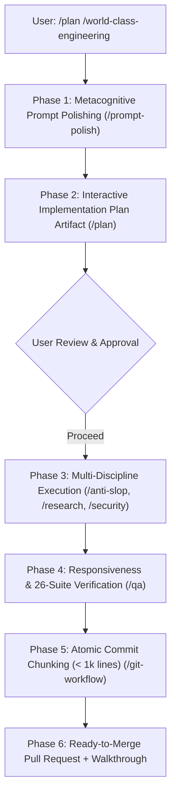

```text
  ███████╗██╗  ██╗██╗██╗     ██╗     ██████╗ ██╗   ██╗██╗██╗     ██████╗ ███████╗██████╗ 
  ██╔════╝██║ ██╔╝██║██║     ██║     ██╔══██╗██║   ██║██║██║     ██╔══██╗██╔════╝██╔══██╗
  ███████╗█████═╝ ██║██║     ██║     ██████╔╝██║   ██║██║██║     ██║  ██║█████╗  ██████╔╝
  ╚════██║██╔═██╗ ██║██║     ██║     ██╔══██╗██║   ██║██║██║     ██║  ██║██╔══╝  ██╔══██╗
  ███████║██║ ╚██╗██║███████╗███████╗██████╔╝╚██████╔╝██║███████╗██████╔╝███████╗██║  ██║
  ╚══════╝╚═╝  ╚═╝╚═╝╚══════╝╚══════╝╚═════╝  ╚═════╝ ╚═╝╚══════╝╚═════╝ ╚══════╝╚═╝  ╚═╝
```

# SkillBuilder: Anti-AI-Slop Dynamic Engineering Ecosystem

SkillBuilder is a production-grade suite of **20 specialized Agent Skills**, architectural guardrails, and automated CLI validators. Authored by **Arron Kian Parejas (@darknecrocities)**, it eliminates generic AI slop, decorative badges, toy mock databases, and overengineered buzzwords—transforming AI assistants into disciplined senior architects and pair programmers across **Google Antigravity**, **Cursor**, **Claude Code**, **OpenAI Codex**, **Windsurf**, and **Cline**.

---

## Operating Philosophy

Most AI coding assistants suffer from structural myopia: they hallucinate parameters, mock databases with temporary static arrays, leak credentials into version control, exceed maintainable file boundaries, and decorate interfaces with generic "vibe coding" slop.

SkillBuilder enforces an uncompromising engineering standard:

> **Understand first. Polish the prompt. Learn continuously. Eliminate AI slop. Build real persistence. Test viewports relentlessly. Catalog errors. Deliver production software.**

---

## Multi-Platform Compatibility Matrix

SkillBuilder runs natively across the entire modern AI coding ecosystem:

| Platform | Primary Configuration | Integration Mechanism | One-Line Installation |
| :--- | :--- | :--- | :--- |
| **Google Antigravity** | `plugin.json`, `.agents/skills/` | Native Plugin & Global Symlink | `./scripts/install.sh --global` |
| **Cursor IDE** | `.cursor/rules/*.mdc`, `.cursorrules` | Native Cursor Rules Engine | `./scripts/install.sh --cursor .` |
| **Claude Code** | `CLAUDE.md` | Anthropic Project Memory | `./scripts/install.sh --claude .` |
| **Codex / OpenAI** | `CODEX.md` | System Prompts & Custom Instructions | `./scripts/install.sh --codex .` |
| **Windsurf / Cascade** | `.windsurfrules` | Cascade System Rules | `./scripts/install.sh --windsurf .` |
| **Cline / Roo-Code** | `.clinerules` | Cline Autonomous Agent Rules | `./scripts/install.sh --cline .` |

---

## The Antigravity Power Combo Strategy (`/plan` + `/world-class-engineering`)

To produce the highest-quality software architecture, verified test suites, and clean, ready-to-merge GitHub Pull Requests on **Google Antigravity**, combine slash commands into the **Power Combo Workflow**:

```text
/plan /world-class-engineering <your feature or refactoring goal>
```



### The 6-Stage Power Delivery Lifecycle

1. **Metacognitive Ingestion & Prompt Polishing (`/prompt-polish`)**:
   - Ingests user intent and checks `.agents/learned_conventions.md` to prevent repeating previously corrected mistakes.
   - Extracts hidden assumptions, strips conversational padding, and structures requirements into an RFC-style specification matrix.
2. **Interactive Design Artifact (`/plan`)**:
   - Generates a formal technical implementation plan artifact in the Antigravity conversation directory.
   - Maps out component boundaries, data flows, database schemas, and verification strategies with mermaid diagrams.
   - Halts execution and presents an interactive **Proceed** button for user review.
3. **Anti-Slop Sanitized Implementation (`/anti-slop` & `/fullstack`)**:
   - Zero decorative badges (`shields.io`), zero obvious comments (`// set loading to true`), zero fake mock arrays.
   - Builds complete vertical slices wired to real persistence (SQLite, PostgreSQL, Cloud SQL) with strict Zod/Pydantic validation.
   - Enforces the disciplined neutral palette (zinc/slate) and semantic Lucide SVG vector icons (zero raw emojis in UI buttons).
4. **Autonomous Fallback Pivots (`/research`)**:
   - If any library, build tool, or dependency fails to install or is deprecated, autonomously discovers and benchmarks production-grade replacements using the P.A.T.H.S. criteria (Performance, Activity, Type safety, Hygiene, Size).
5. **Continuous Verification & 500-Line Ceiling (`/world-class-engineering` & `/qa`)**:
   - Audits all source files against the strict **500-line physical limit** (`check_source_line_limits.py`).
   - Audits mobile (375px), tablet (768px), desktop (1280px), and widescreen viewports for touch targets (>=44px), focus visibility, and fluid layout scaling.
   - Executes the master 26-suite verification test runner.
6. **Atomic Commit Chunking & Ready-to-Review PR (`/git-workflow`)**:
   - Automatically clusters diffs into cohesive commits strictly below the **1,000-line push budget**.
   - Uses Conventional Commits (`feat:`, `fix:`, `refactor:`, `test:`).
   - Authors a complete GitHub Pull Request via `gh pr create` with test receipts, walkthrough diffs, and semantic release tags.

### Specialized Slash Command Combos

| Intent | Recommended Command Combination | Outcome |
| :--- | :--- | :--- |
| **Enterprise Feature Delivery** | `/plan /world-class-engineering <goal>` | Full technical design doc, multi-discipline implementation, automated testing, and chunked PR. |
| **Fullstack Vertical Slice** | `/plan /fullstack <goal>` | Real database migration, ORM repository, validated API route, and responsive UI without mocks. |
| **Safe Refactoring** | `/plan /refactor <module>` | Characterization testing, Strangler Fig pattern, and decomposing files approaching 500 lines. |
| **Multi-Device Viewport QA** | `/plan /qa <viewports>` | 4-tier viewport matrix audit, touch target verification, a11y checks, and sub-agent test execution. |
| **Security Hardening** | `/plan /security <surface>` | OWASP Top 10 remediation, SQL query parameterization, and secret scanning. |

---

## The 20-Skill Master Reference Matrix

Every skill is individually invokable via `/` in Antigravity or as `.mdc` rules in Cursor:

| Command | Skill Name | Domain | Core Capabilities & Focus | Standalone CLI Tool | Primary Guardrail |
| :--- | :--- | :--- | :--- | :--- | :--- |
| `/world-class-engineering` | **World-Class Engineering** | Architecture | 6-Phase EOS lifecycle (Understand -> Define -> Plan -> Implement -> Verify -> Deliver). | `check_source_line_limits.py` | Strict 500-line physical source file limit. |
| `/anti-slop` | **Anti-AI-Slop Sanitizer** | Clean Code | Purges decorative badges, fake mock databases, neon gradients, obvious comments, and marketing copy. | `sanitize_ai_slop.py` | Zero `shields.io`, zero fake mock arrays, zero emojis in UI controls. |
| `/research` | **Autonomous Research & Fallbacks** | Discovery | Autonomous fallback engine; researches alternatives when packages fail or deprecate. | `research_alternatives.py` | P.A.T.H.S. trade-off evaluation & minimal POC validation. |
| `/qa` | **Responsiveness QA & Sub-Agents** | Quality | 4-tier viewport matrix (375px/768px/1280px+), a11y (WCAG AA), touch targets, Master Error Catalog. | `verify_responsiveness_and_qa.py` | Min 44x44px touch targets, zero fixed-pixel containers. |
| `/ui` | **UI Design Systems & Tokens** | UI/UX | High-contrast neutral scales (zinc/slate), fluid typography, Lucide SVG icons. | `verify_ui_tokens.py` | Zero raw emojis in buttons/headers; explicit button types. |
| `/frontend` | **Frontend Architecture** | Frontend | Pure component isolation, React 19, Next.js App Router, Flutter, memory leak prevention. | `verify_frontend_architecture.py` | AbortController on async `useEffect`; error boundaries. |
| `/backend` | **Backend Systems Engineering** | Backend | Clean architecture (Hexagonal), domain services, REST/gRPC contracts, idempotency. | `verify_api_contracts.py` | Strict runtime schema validation (Zod, Pydantic v2). |
| `/security` | **Security Hardening** | Security | OWASP Top 10 defenses, zero hardcoded secrets, SQL injection defense, CORS/CSP policies. | `audit_security_hygiene.py` | Parameterized queries only; zero committed API credentials. |
| `/fullstack` | **Fullstack Anti-Mock Delivery** | Fullstack | Complete vertical slices from UI to database (PostgreSQL/SQLite) with zero mock arrays. | `verify_end_to_end_integration.py` | Anti-mock mandate: real persistence on every feature. |
| `/database` | **Database & Datastores** | Data | Zero-downtime migrations (expand/contract), index optimization, ACID transactional integrity. | `verify_database_hygiene.py` | Non-blocking index creation; reversible migrations. |
| `/devops` | **Cloud & Container DevOps** | DevOps | Hardened multi-stage Dockerfiles (`USER 10001`), docker-compose, CI/CD pipelines. | `verify_container_security.py` | Non-root containers only; health checks on services. |
| `/ai` | **AI & LLM Engineering** | AI / GenAI | Production Gemini SDK, structured JSON outputs (`response_schema`), defensive tool calling. | `calculate_token_budget.py` | Schema-enforced outputs; token context window limits. |
| `/prompt-polish` | **Prompt Refinement (PPE)** | Metacognition | 5-phase Prompt Polishing Engine transforming raw requests into token-efficient specifications. | `polish_prompt.py` | Token compression and explicit acceptance criteria. |
| `/production-etiquette` | **Production Etiquette** | Reliability | Secret hygiene (`.env.example`), resilient network client (timeouts 3s/15s, retry with jitter). | `scaffold_project_hygiene.py` | Mandatory `.env.example` and timeout configs. |
| `/performance` | **Performance & Web Vitals** | Optimization | Core Web Vitals (LCP < 2.5s, CLS < 0.1, INP < 200ms), N+1 query elimination, bundle budgets. | `audit_performance_budgets.py` | Zero N+1 query cascades; explicit image dimensions. |
| `/api-design` | **API Contract Design** | API | OpenAPI 3.1 specifications, RFC 7807 Problem Details error format, idempotency headers. | `validate_openapi_spec.py` | RFC 7807 error format; required 2xx/4xx/5xx responses. |
| `/observability` | **Distributed Telemetry** | SRE | OpenTelemetry distributed tracing, structured JSON logs with correlation IDs, health/ready probes. | `verify_telemetry_standards.py` | Mandatory correlation IDs (`trace_id`); `/healthz` endpoints. |
| `/continuous-learning` | **Conversational Learning (CLP)** | Memory | Persists project invariants to `.agents/learned_conventions.md` to prevent repeated errors. | `record_learning.py` | Immediate recording of corrections; zero repeated mistakes. |
| `/refactor` | **Safe Refactoring** | Refactoring | Strangler Fig pattern, characterization testing, decomposing god files approaching 500 lines. | `detect_refactor_opportunities.py` | Proactive decomposition when files reach 350-400 lines. |
| `/git-workflow` | **Git Workflow & Releases** | Git / VCS | Git branching, commit chunking (< 1,000 lines), Conventional Commits, release tagging. | `analyze_git_commit_chunks.py` | Strict 1,000-line change budget per commit chunk. |

---

## Multi-Platform Installation Guide

### Option 1: Google Antigravity

```bash
# Global installation (active in all Antigravity projects on this workstation)
./scripts/install.sh --global

# Or per-project installation (.agents/skills/ + AGENTS.md)
./scripts/install.sh --project /path/to/my-project
```

### Option 2: Cursor IDE

Convert all 20 skills into native `.cursor/rules/*.mdc` rule files and a consolidated `.cursorrules`:
```bash
./scripts/install.sh --cursor /path/to/my-cursor-project
```
- Each skill becomes a modular `.cursor/rules/<skill>.mdc` file with frontmatter (`globs: *`, `alwaysApply: false`).
- Cursor automatically surfaces and references skills contextually or via `@` mentions in chat.

### Option 3: Anthropic Claude Code & Claude Desktop

Export guidelines into `CLAUDE.md`:
```bash
./scripts/install.sh --claude /path/to/my-claude-project
```
- Generates `CLAUDE.md` in the project root, which Claude Code automatically reads as project memory on every command.
- For Claude Desktop, copy `CLAUDE.md` contents into **Project Instructions**.

### Option 4: OpenAI Codex / ChatGPT / GPT-4o

Export guidelines into `CODEX.md`:
```bash
./scripts/install.sh --codex /path/to/my-openai-project
```
- Paste `CODEX.md` into **ChatGPT Custom Instructions** or OpenAI Assistant System Prompts.

### Option 5: Windsurf & Cline / Roo-Code

Export native `.windsurfrules` and `.clinerules`:
```bash
./scripts/install.sh --windsurf /path/to/my-project
./scripts/install.sh --cline /path/to/my-project
```

### Option 6: Universal Multi-Platform Setup (All-in-One)

Generate configurations for all IDEs and agents simultaneously:
```bash
./scripts/install.sh --all /path/to/my-project
```

---

## Developer Workspace (`workspace/`)

A dedicated configuration and tooling hub:
- **[`profile.json`](workspace/profile.json)**: Developer metadata, preferred stacks (React 19, Next.js, Tailwind v4, Flutter, Node.js, FastAPI, Go, PostgreSQL, Cloud SQL, GCP, Gemini 2.5), and token budget preferences.
- **[`pairing_manifesto.md`](workspace/pairing_manifesto.md)**: The 8 non-negotiable tenets of pair-programming.
- **[`prompt_templates/`](workspace/prompt_templates/)**: High-density prompt templates for specifications and bug reproductions.

---

## Continuous Conversational Learning (CLP)

Agents absorb developer corrections and persist them to disk:
```bash
# Record an architectural invariant
python3 skills/continuous-learning/scripts/record_learning.py \
  --category ARCH --text "Use native fetch over axios in all new backend services"

# List all recorded invariants
python3 skills/continuous-learning/scripts/record_learning.py --list
```

---

## Automated Verification Suites (26 Suites)

SkillBuilder includes a master test runner executing 26 independent verification suites:

```bash
./scripts/verify_all_skills.sh
```

All 26 suites run and pass in under 0.5s:
1. **500-Line Source File Policy**: Verifies all source files adhere to the 500-line ceiling.
2. **World-Class Engineering Unit Tests**: Validates line-checking and EOS extraction logic.
3. **Anti-AI-Slop Tests**: Validates badge, mock array, and obvious comment sanitization.
4. **Autonomous Research Tests**: Validates package alternative recommendation engine.
5. **Responsiveness QA Tests**: Validates viewport matrix, fixed-width traps, and touch targets.
6. **List-an-Error QA Tests**: Validates Master Error Catalog lookup and classification.
7. **UI Design Tokens Tests**: Validates vector icons, raw emoji bans, and token scales.
8. **UI Frontend Quality Tests**: Validates accessibility and anti-vibe-coding rules.
9. **Frontend Architecture Tests**: Validates lifecycle memory safety and AbortController signals.
10. **Security Defense Tests**: Validates SQL injection defense and secret leak detection.
11. **Fullstack Anti-Mock Tests**: Validates real persistence and boundary schema validation.
12. **Performance & Web Vitals Tests**: Validates N+1 query cascades and CLS image dimensions.
13. **API Design OpenAPI Tests**: Validates OpenAPI 3.1 contracts and status code definitions.
14. **Observability Telemetry Tests**: Validates structured logging and healthcheck endpoints.
15. **Safe Refactoring Tests**: Validates detection of oversized files and deep nesting.
16. **Git Workflow Commit Chunking Tests**: Validates the 1,000-line commit chunk budget.
17. **Continuous Learning Tests**: Validates convention persistence and deduplication.
18. **Backend API Contract Tests**: Validates route contracts and schema validation.
19. **Database Hygiene Tests**: Validates migration safety and non-blocking indexing.
20. **Container DevOps Security Tests**: Validates non-root user and multi-stage container rules.
21. **AI Token Budget Tests**: Validates token calculation and context window budgeting.
22. **Prompt Polish Tests**: Validates intent extraction and filler stripping.
23. **Prompt Polish Learning Tests**: Validates convention indexing.
24. **Production Etiquette Hygiene Tests**: Validates `.env.example`, `.gitignore`, and scaffolding.
25. **Production Etiquette Git Chunk Tests**: Validates git diff partitioning.
26. **Multi-Platform Exporter Tests**: Validates Cursor, Claude, Codex, Windsurf, and Cline rule exports.

---

## Repository Architecture

```text
SkillBuilder/
├── plugin.json                                 # Antigravity plugin manifest (v3.0.0)
├── README.md                                   # Comprehensive documentation & slash command index
├── INTEGRATION_GUIDE.md                        # Step-by-step setup guide for Antigravity
├── AGENTS.md                                   # Root rules enforced on all projects
├── rules/
│   └── AGENTS.md                               # Plugin-level rules
├── workspace/                                  # Developer Workspace & Presets
├── skills/
│   ├── world-class-engineering/                # Master EOS & 500-line ceiling
│   ├── anti-slop/                              # Anti-AI-slop & clean craftsmanship
│   ├── research/                               # Autonomous research & alternative fallbacks
│   ├── qa/                                     # Viewport responsiveness & Master Error Catalog
│   ├── ui/                                     # Design tokens, neutral scales & Lucide icons
│   ├── frontend/                               # React 19, Next.js, Flutter & effect cleanup
│   ├── backend/                                # Clean architecture & Zod/Pydantic validation
│   ├── security/                               # OWASP Top 10, SQL parameterization & secrets
│   ├── fullstack/                              # Anti-mock vertical slices & real persistence
│   ├── database/                               # Zero-downtime migrations & ACID integrity
│   ├── devops/                                 # Multi-stage non-root containers & CI/CD
│   ├── ai/                                     # Gemini SDK, structured JSON & token budgets
│   ├── prompt-polish/                          # Prompt Polishing Engine (PPE)
│   ├── production-etiquette/                   # Resilient network clients & secret hygiene
│   ├── performance/                            # Core Web Vitals & N+1 query elimination
│   ├── api-design/                             # OpenAPI 3.1 & RFC 7807 Problem Details
│   ├── observability/                          # OpenTelemetry tracing & structured JSON logs
│   ├── continuous-learning/                    # Persistent conventions (CLP)
│   ├── refactor/                               # Safe debt remediation & file decomposition
│   └── git-workflow/                           # Atomic commit chunking (<1k lines) & releases
└── scripts/
    ├── install.sh                              # Universal multi-platform installer
    ├── export_multiplatform.py                 # Multi-platform exporter (Cursor, Claude, Codex)
    └── verify_all_skills.sh                    # Master 26-suite verification test runner
```
