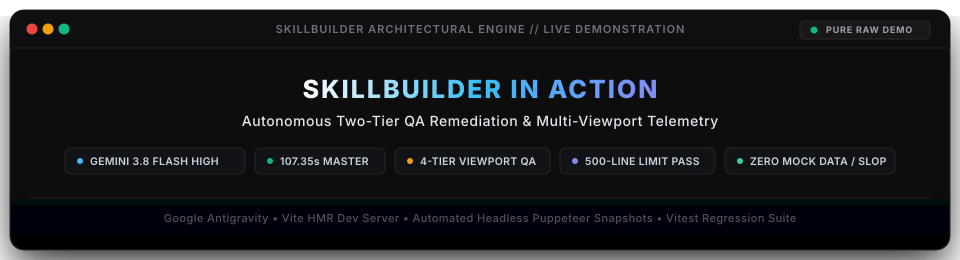
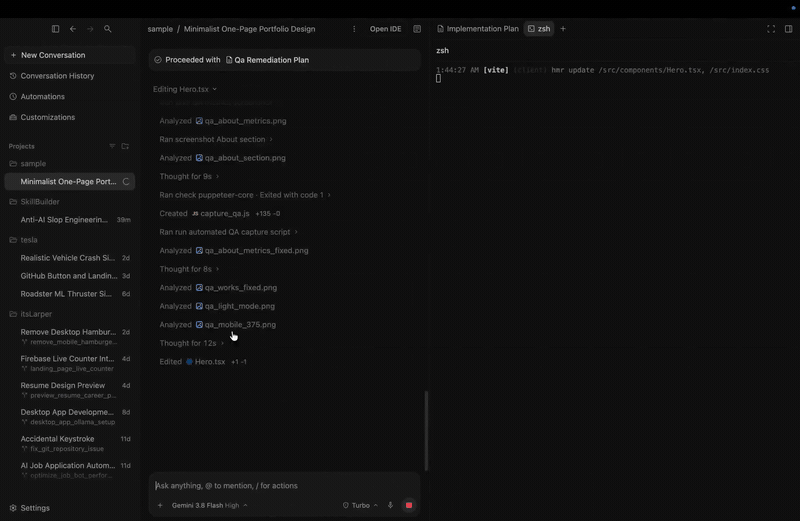
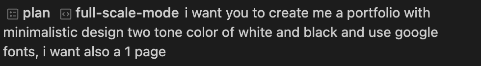
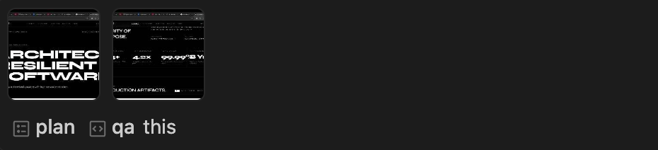
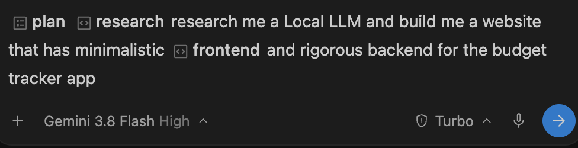
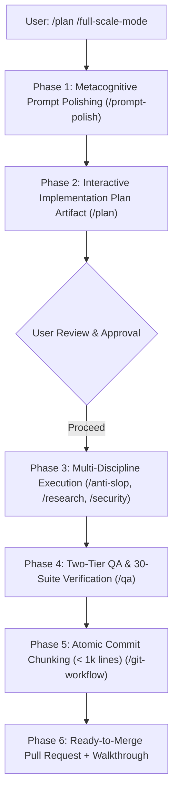
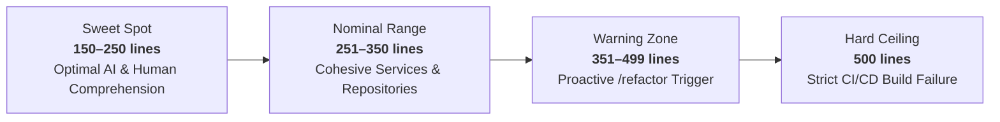

```text
  ███████╗██╗  ██╗██╗██╗     ██╗     ██████╗ ██╗   ██╗██╗██╗     ██████╗ ███████╗██████╗ 
  ██╔════╝██║ ██╔╝██║██║     ██║     ██╔══██╗██║   ██║██║██║     ██╔══██╗██╔════╝██╔══██╗
  ███████╗█████═╝ ██║██║     ██║     ██████╔╝██║   ██║██║██║     ██║  ██║█████╗  ██████╔╝
  ╚════██║██╔═██╗ ██║██║     ██║     ██╔══██╗██║   ██║██║██║     ██║  ██║██╔══╝  ██╔══██╗
  ███████║██║ ╚██╗██║███████╗███████╗██████╔╝╚██████╔╝██║███████╗██████╔╝███████╗██║  ██║
  ╚══════╝╚═╝  ╚═╝╚═╝╚══════╝╚══════╝╚═════╝  ╚═════╝ ╚═╝╚══════╝╚═════╝ ╚══════╝╚═╝  ╚═╝
```

# SkillBuilder: Agentic Engineering Skills

SkillBuilder is a production-grade suite of **22 specialized Agent Skills**, architectural guardrails, and automated CLI validators. Authored by **Arron Kian Parejas (@darknecrocities)**, it eliminates generic AI slop, decorative badges, toy mock databases, and overengineered buzzwords—transforming AI assistants into disciplined senior architects and pair programmers across **Google Antigravity**, **Cursor**, **Claude Code**, **OpenAI Codex**, **Windsurf**, and **Cline**.

<p align="center">
  
</p>

---

## Operating Philosophy

Most AI coding assistants suffer from structural myopia: they hallucinate parameters, mock databases with temporary static arrays, leak credentials into version control, exceed maintainable file boundaries, and decorate interfaces with generic "vibe coding" slop.

SkillBuilder enforces an uncompromising engineering standard:

> **Understand first. Polish the prompt. Learn continuously. Eliminate AI slop. Build real persistence. Test viewports relentlessly. Catalog errors. Deliver production software.**

---

## Live Demonstration: SkillBuilder in Action

Experience the unedited engineering workflow of SkillBuilder operating inside **Google Antigravity** with **Gemini 3.8 Flash (High)**. This demonstration captures an autonomous agent diagnosing and remediating critical visual clipping, contrast defects, and layout regressions across a production portfolio application—complete with dynamic camera shifts, smooth punch-in zooms, 4-tier viewport audits, automated test suites, and 500-line limit checks.

<p align="center">
  
</p>

<div align="center">
  <a href="assets/skillbuilderdemo_web.mp4">
    
  </a>
  <p>
    <em>🎬 <strong>Live Demonstration (Pure Wide-Angle Edition)</strong> &bull; Click image above to play full 1080p 60fps video with audio (107.35s)</em>
  </p>
  <p>
    <a href="assets/skillbuilderdemo_web.mp4"><strong>▶️ Play Demonstration Video (1080p 60fps &bull; 14MB)</strong></a> &bull;
    <a href="assets/skillbuilderdemo_cinematic_web.mp4"><strong>🎬 Watch Cinematic HUD Edition (34MB)</strong></a> &bull;
    <a href="assets/skillbuilderdemo_edited.mp4"><strong>💾 Download 4K Retina Master (2938x1912 &bull; 22MB)</strong></a>
  </p>
</div>

### Architectural Breakdown & Dynamic Camera Shift Map

| Phase | Timeline | Action & Highlight Target | Camera Shift Vector `(X1, Y1) -> (X2, Y2)` | Zoom | Telemetry HUD Badge & Highlight |
| :--- | :--- | :--- | :--- | :--- | :--- |
| **01** | `0:10 - 0:15` | **GitHub Repo Exploration** (`skills/` directory) | `(450, 720) -> (600, 580)` | `2.0x` | `REPO EXPLORATION // GitHub skills/ Directory`<br>Glowing cyan box around `skills/` folder |
| **02** | `0:18 - 0:27` | **Clean Architecture & RFC 7807** (`backend/SKILL.md`) | `(500, 720) -> (680, 420)` | `2.0x` | `CLEAN ARCHITECTURE // Core Domain & Persistence`<br>Glides from `SKILL.md` into architecture diagram |
| **03** | `0:29 - 0:38` | **Live Agent Runtime Stream** (Gemini 3.8 Flash High) | `(705, 350) -> (705, 550)` | `2.0x` | `LIVE RUNTIME // Gemini 3.8 Flash High Agent Execution`<br>Frames live file edit stream (`Hero.tsx`, `App.tsx`) |
| **04** | `0:41 - 0:53` | **Two-Tier QA Remediation Plan** (`/qa`) | `(705, 575) -> (1480, 350)` | `2.0x` | `QA REMEDIATION PLAN // Two-Tier Visual Bug Fixes`<br>Shifts from left clicked card across to opened plan |
| **05** | `1:04 - 1:14` | **Hit Command: `/fu` Autocomplete** (`fullstack`) | `(705, 1120) -> (705, 940)` | `2.0x` | `HIT COMMAND // /full Autocomplete & Orchestration`<br>Frames prompt bar and autocomplete popup menu |
| **06** | `1:15 - 1:25` | **Hit Command: `/Ai` & Skill Tooltips** (`anti-slop`) | `(705, 1120) -> (705, 940)` | `2.0x` | `HIT COMMAND // /Ai & /anti-slop Tooltip Cards`<br>Frames prompt bar and skill catalog popup |
| **07** | `1:28 - 1:38` | **Verified Output on `localhost:3001`** | `(500, 475) -> (960, 520)` | `2.0x` | `VERIFIED OUTPUT // Zero Clipping & 99.99% Alignment`<br>Frames unclipped Swiss hero title and Capabilities |
| **08** | `1:40 - 1:46` | **Deterministic Verification Gate** (Vitest & 500-Line) | `(705, 630) -> (1480, 390)` | `2.0x` | `GATE PASSED // 30 Test Suites & 500-Line Limit`<br>Shifts from terminal test run to verification checklist |

---

## The Golden Rule: Always Start with `/plan`

The single greatest source of AI-generated bugs, unmaintainable "vibe coding", and discarded prototypes is **skipping the planning phase**. When an agent jumps directly into code generation, it is forced to guess database schemas, invent non-existent packages, leak hardcoded credentials, and violate file limits.

### Why `/plan` is Mandatory on Every Project:
1. **Architectural Alignment Before Execution**: Validates requirements, component boundaries, and dependency compatibility before touching a single line of code.
2. **Deterministic Risk Reduction**: Maps out potential failure modes, breaking changes, and migrations in an interactive RFC document.
3. **Explicit User Approval**: Execution is paused until the user reviews and clicks **`Proceed`**, ensuring complete human-in-the-loop oversight.
4. **Zero Throwaway Code**: Eliminates endless rework loops caused by ambiguous initial specifications.

---

## Real-World Prompting Mastery: Skill Combos & Prompt Strategies

SkillBuilder transforms natural language requests into deterministic engineering workflows by **stacking modular skills directly in the chat bar**. By combining the native `/plan` gate with domain skills (`/full-scale-mode`, `/qa`, `/research`, `/anti-slop`, `/fullstack`), you provide unambiguous execution boundaries while preserving token efficiency.

Below is an in-depth breakdown of authentic real-world prompts captured directly inside **Google Antigravity**, illustrating proper skill invocation, prompt anatomy, and battle-tested prompting strategies:

---

### Case Study 1: The Full-Scale Project Orchestration Combo (`/plan` + `/full-scale-mode`)

<p align="center">
  
</p>

#### Prompt Anatomy & Dissection
```text
/plan /full-scale-mode i want you to create me a portfolio with minimalistic design two tone color of white and black and use google fonts, i want also a 1 page
```

| Element | Component | Engineering Function & Impact |
| :--- | :--- | :--- |
| **Pill 1** | `• plan` | Activates Antigravity's interactive planning phase; pauses execution for RFC review and explicit `Proceed` approval. |
| **Pill 2** | `• full-scale-mode` | Engages the 7-Phase EOS master project engine, orchestrating prompt refinement, architecture, and parallel subagents. |
| **Constraint 1** | `minimalistic design two tone color of white and black` | Locks the palette to disciplined monochrome neutrals (`#0A0A0B` / `#FFFFFF`), eliminating neon AI gradients and card soup. |
| **Constraint 2** | `use google fonts` | Enforces typographic hierarchy using clean variable web fonts (e.g., Inter, Space Grotesk) rather than generic system fallbacks. |
| **Constraint 3** | `1 page` | Sets a strict physical layout boundary, preventing bloated multi-page navigation or unfinished routes. |

#### Why This Strategy Works:
1. **Explicit Constraint Anchoring**: Rather than saying *"make a cool modern portfolio"* (which leads to generic AI slop with floating blobs and neon purple gradients), specifying `two tone color of white and black` and `1 page` gives the model crisp design parameters.
2. **Master Orchestrator Delegation**: Passing `/full-scale-mode` instructs the agent to automatically enforce the 500-line file limit, scaffold real component slices, and run QA verification gates without manual intervention.

---

### Case Study 2: The Contextual Remediation & Error Audit Combo (`/plan` + `/qa this`)

<p align="center">
  
</p>

#### Prompt Anatomy & Dissection
```text
/plan /qa this
```

| Element | Component | Engineering Function & Impact |
| :--- | :--- | :--- |
| **Pill 1** | `• plan` | Demands a structured root-cause remediation RFC with before/after diffs before modifying active code. |
| **Pill 2** | `‹› qa` | Triggers the Two-Tier Quality Assurance engine: 4-tier viewports (375px/768px/1280px) and Full App Functional QA. |
| **Target** | `this` | Contextual semantic pointer directing the agent to audit the active repository, active screen, or latest rendered output. |

#### Why This Strategy Works:
1. **Zero-Token Waste / Maximum Information Density**: You don't need to write a 500-word explanation of bugs. `/qa this` commands the agent to autonomously execute its comprehensive audit checklist:
   - Check for mobile layout clipping (`ERR-MOB-001`) and fixed-width pixel containers breaking on 375px viewports.
   - Audit WCAG 2.2 AA contrast ratios and minimum 44x44pt touch target ergonomics.
   - Inspect state machines (idle, loading, success, error, empty) and network timeouts (3s connection / 15s read).
2. **Deterministic Remediation**: Because `/plan` is prepended, the agent catalogs every discovered failure into a remediation matrix and presents the solution plan first.

---

### Case Study 3: The Technical Discovery & Fullstack Slice Combo (`/plan` + `/research`)

<p align="center">
  
</p>

#### Prompt Anatomy & Dissection
```text
/plan /research research me a Local LLM and build me a website that has minimalistic frontend and rigorous backend for the budget tracker app
```
*(Runtime: Powered by **Gemini 3.8 Flash High** with **Turbo** extended thinking)*

| Element | Component | Engineering Function & Impact |
| :--- | :--- | :--- |
| **Pill 1** | `• plan` | Requires architectural blueprint with API contract specifications (RFC 7807) and migration schema before coding. |
| **Pill 2** | `• research` | Triggers autonomous discovery to evaluate production local LLM runtimes (e.g. Ollama, ONNX, WebLLM) and licensing. |
| **Constraint 1** | `minimalistic frontend` | Demands restrained typography, zero decorative clutter, and semantic Lucide SVG icons. |
| **Constraint 2** | `rigorous backend` | Invokes Clean Architecture, parameterization, and strict input validation (Zod / Pydantic). |
| **Domain Scope** | `budget tracker app` | Sets concrete functional boundaries: transaction ledger, category schema, and real SQLite/PostgreSQL persistence. |

#### Why This Strategy Works:
1. **Research Before Architecture**: Prevents hallucinated or deprecated NPM packages. The agent discovers viable local runtimes, benchmarks memory footprints, and presents trade-offs in the plan.
2. **Dual-Boundary Architectural Separation**: Specifying *"minimalistic frontend and rigorous backend"* prompts the agent to cleanly decouple domain entities from UI presentation layers.

---

### The SkillBuilder Prompting Playbook (5 High-Yield Strategies)

| Strategy | Rule / Formula | Example Prompt | Expected Outcome |
| :--- | :--- | :--- | :--- |
| **1. The Golden Foundation** | `/plan` + `[Domain Skill]` + `[Task]` | `/plan /fullstack Add Stripe webhook handler with idempotent processing` | RFC implementation plan with problem details and idempotency keys before writing code. |
| **2. Contextual Audit** | `/plan /qa this` | `/plan /qa this` | Comprehensive 4-tier responsive and functional audit of current work with zero fluff. |
| **3. Proactive Research** | `/plan /research [Tech Question]` | `/plan /research Benchmark SQLite vs DuckDB for local analytics and implement` | Evaluates tradeoffs, selects production-grade package, and produces working integration. |
| **4. Anti-Slop UI Elevation** | `/anti-slop /ui [Feature]` | `/anti-slop /ui Build a spatial control center with Cupertino materials` | Sub-pixel directional lighting, micro-click acoustics, and semantic SVG icons. |
| **5. Clean Refactoring** | `/plan /refactor [Target]` | `/plan /refactor Split monolithic server.ts into hexagonal domain services` | Strangler Fig refactor decomposing files to comply with the 500-line ceiling. |

#### Golden Rules for Crafting High-Yield Prompts:
1. **Never Skip `/plan`**: Jumping directly into raw generation forces the model to guess dependencies and schemas, causing rework.
2. **Anchor with Negative Constraints**: Proactively state what *not* to do (*"zero mock data", "two-tone monochrome", "no fixed-pixel containers"*).
3. **Specify Real Persistence**: Always demand SQLite, PostgreSQL, or real file stores to prevent mock arrays.
4. **Use Semantic Context (`this`)**: Refer to active files or errors rather than pasting redundant code walls.
5. **Close with Verification**: Demand test runs (`./scripts/verify_all_skills.sh`) and line-limit audits as mandatory deliverables.

---

## Universal AI Platform Guide (Using SkillBuilder on ANY AI Platform)

SkillBuilder is engineered to run seamlessly across all modern AI environments. Whether you are using Google Antigravity, Cursor, Claude Code, or web-based ChatGPT / OpenAI Codex, follow these platform-specific execution protocols:

### 1. Google Antigravity
Google Antigravity provides native first-class support for SkillBuilder skills and slash commands:
- **Initiate Planning**: Type `/plan` followed by your goal:
  ```text
  /plan /world-class-engineering Build an edge telemetry fader with 120Hz spring physics
  ```
- **Prompt Refinement**: Antigravity automatically invokes `/prompt-polish` (PPE) to structure raw requests into RFC specifications before generating the interactive plan card with the `Proceed` button.

### 2. Cursor IDE
Cursor leverages the `.cursor/rules/*.mdc` rules engine and `.cursorrules`:
- **In Cursor Composer / Chat**: Reference the planning and polishing rules using `@`:
  ```text
  @plan @prompt-polish @world-class-engineering Create a PostgreSQL multi-tenant repository with zero-downtime migrations
  ```
- Cursor reads the active rules, enforces the 500-line file limit, and executes structured planning before generating code edits.

### 3. Claude Code & Claude Desktop
- **Claude Code (Terminal CLI)**: Automatically reads `CLAUDE.md` from the project root. Start tasks with:
  ```text
  /plan Refactor auth middleware into hexagonal domain services
  ```
- **Claude Desktop (Web / App)**: Paste `CLAUDE.md` into your **Project Instructions** or prepend your prompt:
  ```text
  [SkillBuilder Protocol Active: Run Phase 1 /prompt-polish then /plan]
  <Your project goal here>
  ```

### 4. ChatGPT / OpenAI Codex / GPT-4o
When working with ChatGPT or custom GPT assistants, use the **Universal Bootstrap Prompt Template**:

```markdown
You are operating under the SkillBuilder Engineering Protocol.
Before generating any implementation code, you MUST execute the following two phases:

Phase 1 (/prompt-polish):
- Analyze my request below.
- Refine it into: (1) Goals, (2) Explicit Constraints, (3) Schema/Interface Contracts, (4) Verification Matrix.
- Eliminate conversational padding and clarify hidden assumptions.

Phase 2 (/plan):
- Generate an RFC-style Implementation Plan with Mermaid diagrams and file breakdown.
- Strictly enforce the 500-line physical file limit and zero-mock persistence rule.
- STOP and wait for my explicit "Proceed" confirmation before writing any code.

Here is my task:
<Insert your project goal or raw prompt here>
```

### 5. Windsurf & Cline / Roo-Code
- **Windsurf (Cascade)**: Automatically reads `.windsurfrules` generated by `./scripts/install.sh --windsurf .`.
- **Cline / Roo-Code**: Automatically enforces `.clinerules` generated by `./scripts/install.sh --cline .`.

---

## Multi-Platform Compatibility Matrix

SkillBuilder runs natively across the entire modern AI coding ecosystem:

| Platform | Primary Configuration | Integration Mechanism | One-Line Installation |
| :--- | :--- | :--- | :--- |
| **Google Antigravity** | `plugin.json`, `.agents/skills/` | Native Plugin & Global Symlink | `./scripts/install.sh --global` |
| **Cursor IDE** | `.cursor/rules/*.mdc`, `.cursorrules` | Native Cursor Rules Engine | `./scripts/install.sh --cursor .` |
| **Claude Code** | `CLAUDE.md` | Anthropic Project Memory | `./scripts/install.sh --claude .` |
| **Codex / OpenAI** | `CODEX.md` | System Prompts & Custom Instructions | `./scripts/install.sh --codex .` |
| **Windsurf / Cascade** | `.windsurfrules` | Cascade System Rules | `./scripts/install.sh --windsurf .` |
| **Cline / Roo-Code** | `.clinerules` | Cline Autonomous Agent Rules | `./scripts/install.sh --cline .` |

---

## The Antigravity Power Combo Strategy (`/plan` + `/world-class-engineering`)

To produce the highest-quality software architecture, verified test suites, and clean, ready-to-merge GitHub Pull Requests on **Google Antigravity**, combine slash commands into the **Power Combo Workflow**:

```text
/plan /world-class-engineering <your feature or refactoring goal>
```



### The 6-Stage Power Delivery Lifecycle

1. **Metacognitive Ingestion & Prompt Polishing (`/prompt-polish`)**:
   - Ingests user intent and checks `.agents/learned_conventions.md` to prevent repeating previously corrected mistakes.
   - Extracts hidden assumptions, strips conversational padding, and structures requirements into an RFC-style specification matrix.
2. **Interactive Design Artifact (`/plan`)**:
   - Generates a formal technical implementation plan artifact in the Antigravity conversation directory.
   - Maps out component boundaries, data flows, database schemas, and verification strategies with mermaid diagrams.
   - Halts execution and presents an interactive **Proceed** button for user review.
3. **Anti-Slop Sanitized Implementation (`/anti-slop` & `/fullstack`)**:
   - Zero decorative badges (`shields.io`), zero obvious comments (`// set loading to true`), zero fake mock arrays.
   - Builds complete vertical slices wired to real persistence (SQLite, PostgreSQL, Cloud SQL) with strict Zod/Pydantic validation.
   - Enforces the disciplined neutral palette (zinc/slate) and semantic Lucide SVG vector icons (zero raw emojis in UI buttons).
4. **Autonomous Fallback Pivots (`/research`)**:
   - If any library, build tool, or dependency fails to install or is deprecated, autonomously discovers and benchmarks production-grade replacements using the P.A.T.H.S. criteria (Performance, Activity, Type safety, Hygiene, Size).
5. **Continuous Verification & Multi-Tiered Line Limits (`/full-scale-mode`, `/world-class-engineering`, `/refactor` & `/qa`)**:
   - Enforces the **Multi-Tiered Maintainability Standard**: Sweet Spot (150–250 lines), Nominal (251–350 lines), Warning Zone (351–499 lines), and Hard Ceiling (500 lines) via `check_source_line_limits.py --show-tiers`.
   - Enforces cognitive complexity hygiene: $\le 40$ lines per function, $\le 3$ nesting levels with early returns, and Cyclomatic Complexity $\le 10$.
   - Executes the **Two-Tier QA Engine**: Full UI/Frontend QA (`/qa ui`) for viewports, 44x44pt touch targets, WCAG AA, and 120Hz GPU compositor, plus Full App Functional QA (`/qa app`) for state machines, real persistence, 3s/15s timeouts, and mobile lifecycles.
   - Executes the master 30-suite verification test runner.
6. **Meaningful Commits (Title + Description), Push to Branch & Ready-to-Review PR (`/git-workflow`, `/full-scale-mode`)**:
   - Decomposes diffs into cohesive commits strictly below the **1,000-line push budget**.
   - Enforces **mandatory multi-line Conventional Commits** with a clear title AND a structured description body (Why, What, Verification).
   - **Always pushes immediately to remote branch** (`git push origin <branch>`).
   - **Always authors or updates a ready-to-merge GitHub Pull Request** via `gh pr create` / `gh pr edit` with test receipts, walkthrough diffs, and semantic release tags.

### The Multi-Tiered Code Quality & 500-Line Maintainability Matrix

SkillBuilder rejects naive, flat line-counting in favor of a scientifically grounded, multi-dimensional code quality architecture. Based on seminal empirical studies (Ostrand/Weyuker/Bell at AT&T Labs, Steve McConnell's *Code Complete*, and Robert C. Martin's *Clean Code*), defect density scales non-linearly once files cross 400–500 physical lines.

In autonomous AI pair-programming, file size also drives **The Double Mandate**:
1. **Human Maintainability**: Files must be comprehended within a single 60-second scan.
2. **AI Context Fidelity**: Files over 500 lines induce transformer **Context Rot** ("Lost-in-the-Middle"), inflate token consumption, and cause tool-calling diff failures (`edit_file`) on repeated boilerplate.



| Dimension | Target Metric | Engineering Purpose |
| :--- | :--- | :--- |
| **Hard Physical Ceiling** | **$\le 500$ lines** | Non-negotiable CI/CD build gate via `check_source_line_limits.py`. Zero exceptions. |
| **Proactive Refactor Trigger** | **$\ge 350$ lines** | Warning threshold in `/refactor` to decompose before breaching the ceiling. |
| **Ideal Sweet Spot** | **$150 - 250$ lines** | Target length for UI components, custom hooks, and domain services. |
| **Function Length** | **$\le 40$ lines** | Single responsibility per function; extract sub-helpers. |
| **Nesting Depth** | **$\le 3$ levels** | Mandatory early return guard clauses (`if (!valid) return;`). |
| **Cyclomatic Complexity** | **$\le 10$ per function** | Eliminates complex cascading conditionals and fragile state machines. |
| **Cohesive Separation** | **Anti-Shredding** | Never chop files arbitrarily; separate UI, Domain, Repository, and Contracts cleanly. |

### Specialized Slash Command Combos

| Intent | Recommended Command Combination | Outcome |
| :--- | :--- | :--- |
| **Full-Scale Feature Delivery** | `/plan /full-scale-mode <goal>` (or `/world-class-engineering`) | 7-phase EOS lifecycle, multi-agent parallel tracks, token budget ceilings, and chunked PR. |
| **Fullstack Vertical Slice** | `/plan /fullstack <goal>` | Real database migration, ORM repository, validated API route, and responsive UI without mocks. |
| **Safe Refactoring** | `/plan /refactor <module>` | Characterization testing, Strangler Fig pattern, and decomposing files approaching 500 lines. |
| **Two-Tier Full QA Pass** | `/plan /qa <scope>` | Dual-tier verification: Full UI/Frontend QA (`/qa ui`) and Full App Functional QA (`/qa app`). |
| **Security Hardening** | `/plan /security <surface>` | OWASP Top 10 remediation, defensive error handling (RFC 7807), auth token rotation, DDoS rate limiting, SSRF defense, and secret scanning. |

---

## The 22-Skill Master Reference Matrix

Every skill is individually invokable via `/` in Antigravity or as `.mdc` rules in Cursor:

| Command | Skill Name | Domain | Core Capabilities & Focus | Standalone CLI Tool | Primary Guardrail |
| :--- | :--- | :--- | :--- | :--- | :--- |
| `/full-scale-mode` | **Full-Scale Mode** | Orchestration | Master Phased Project Orchestration Engine (aliased with `/world-class-engineering`), 7-phase EOS lifecycle, parallel subagent swarms. | `verify_full_scale_orchestration.py` | Strict 7-phase gate compliance & 1,500-token subagent ceilings. |
| `/world-class-engineering` | **World-Class Engineering** | Architecture | 6-Phase EOS lifecycle (Understand -> Define -> Plan -> Implement -> Verify -> Deliver). | `check_source_line_limits.py` | Multi-tiered maintainability matrix & 500-line physical ceiling. |
| `/anti-slop` | **Anti-AI-Slop Sanitizer** | Clean Code | Purges decorative badges, fake mock databases, neon gradients, obvious comments, and marketing copy. | `sanitize_ai_slop.py` | Zero `shields.io`, zero fake mock arrays, zero emojis in UI controls. |
| `/research` | **Autonomous Research & Fallbacks** | Discovery | Autonomous fallback engine; researches alternatives when packages fail or deprecate. | `research_alternatives.py` | P.A.T.H.S. trade-off evaluation & minimal POC validation. |
| `/qa` | **Two-Tier Quality Assurance** | Quality | Full UI/Frontend QA (viewports, touch targets, WCAG, sub-pixel lighting) and Full App Functional QA (state machines, persistence, timeouts, mobile lifecycle, Master Error Catalog). | `verify_responsiveness_and_qa.py` & `verify_app_functionality.py` | Min 44x44pt touch targets, 3s/15s network timeouts, zero mocks. |
| `/ui` | **UI Design Systems & Tokens** | UI/UX | Apple HIG, Cupertino blur materials, squircle smoothing, high-contrast neutral scales (zinc/slate), Lucide SVGs. | `verify_ui_tokens.py` | Zero raw emojis in buttons/headers; explicit button types. |
| `/3d` | **3D WebGL & Product Showcase** | 3D/Graphics | Three.js, React Three Fiber, PBR clearcoat shaders, Draco GLTF compression, 60fps budgets, context loss handling. | `verify_3d_performance.py` | DPR clamped to <= 2.0; Draco GLTF loader; WebGL disposal. |
| `/frontend` | **Frontend Architecture** | Frontend | Pure component isolation, React 19, Next.js App Router, Flutter, memory leak prevention. | `verify_frontend_architecture.py` | AbortController on async `useEffect`; error boundaries. |
| `/backend` | **Backend Systems Engineering** | Backend | Clean architecture (Hexagonal), domain services, REST/gRPC contracts, idempotency. | `verify_api_contracts.py` | Strict runtime schema validation (Zod, Pydantic v2). |
| `/security` | **Security Hardening** | Security | OWASP Top 10 defenses, zero silent error swallowing, RFC 7807 problem details, refresh token family rotation, DDoS rate limits, SSRF validation, SQL parameterization. | `audit_security_hygiene.py` | Parameterized queries only; zero committed API credentials; zero silent catches. |
| `/fullstack` | **Fullstack Anti-Mock Delivery** | Fullstack | Complete vertical slices from UI to database (PostgreSQL/SQLite) with zero mock arrays. | `verify_end_to_end_integration.py` | Anti-mock mandate: real persistence on every feature. |
| `/database` | **Database & Datastores** | Data | Zero-downtime migrations (expand/contract), index optimization, ACID transactional integrity. | `verify_database_hygiene.py` | Non-blocking index creation; reversible migrations. |
| `/devops` | **Cloud & Container DevOps** | DevOps | Hardened multi-stage Dockerfiles (`USER 10001`), docker-compose, CI/CD pipelines. | `verify_container_security.py` | Non-root containers only; health checks on services. |
| `/ai` | **AI & LLM Engineering** | AI / GenAI | Production Gemini SDK, structured JSON outputs (`response_schema`), defensive tool calling. | `calculate_token_budget.py` | Schema-enforced outputs; token context window limits. |
| `/prompt-polish` | **Prompt Refinement (PPE)** | Metacognition | 5-phase Prompt Polishing Engine transforming raw requests into token-efficient specifications. | `polish_prompt.py` | Token compression and explicit acceptance criteria. |
| `/production-etiquette` | **Production Etiquette** | Reliability | Secret hygiene (`.env.example`), resilient network client (timeouts 3s/15s, retry with jitter). | `scaffold_project_hygiene.py` | Mandatory `.env.example` and timeout configs. |
| `/performance` | **Performance & Web Vitals** | Optimization | Core Web Vitals (LCP < 2.5s, CLS < 0.1, INP < 200ms), N+1 query elimination, bundle budgets. | `audit_performance_budgets.py` | Zero N+1 query cascades; explicit image dimensions. |
| `/api-design` | **API Contract Design** | API | OpenAPI 3.1 specifications, RFC 7807 Problem Details error format, idempotency headers. | `validate_openapi_spec.py` | RFC 7807 error format; required 2xx/4xx/5xx responses. |
| `/observability` | **Distributed Telemetry** | SRE | OpenTelemetry distributed tracing, structured JSON logs with correlation IDs, health/ready probes. | `verify_telemetry_standards.py` | Mandatory correlation IDs (`trace_id`); `/healthz` endpoints. |
| `/continuous-learning` | **Conversational Learning (CLP)** | Memory | Persists project invariants to `.agents/learned_conventions.md` to prevent repeated errors. | `record_learning.py` | Immediate recording of corrections; zero repeated mistakes. |
| `/refactor` | **Safe Refactoring** | Refactoring | Strangler Fig pattern, characterization testing, decomposing god files approaching 500 lines. | `detect_refactor_opportunities.py` | Proactive decomposition when files reach 350-400 lines. |
| `/git-workflow` | **Git Delivery & PR Engine** | Release | Conventional Commits (Title + Description), 1,000-line budget, remote branch push, and GitHub PR authoring. | `analyze_git_commit_chunks.py` & `verify_git_delivery_etiquette.py` | Mandatory Title + Description body; always push & open PR. |

---

## Anti-AI-Slop Craftsmanship, Authentic Art Movements & Universal Mobile Motion

SkillBuilder rejects generic AI "vibe coding" (purple hero gradients, nested card-soup, floaty 3s fades, and blurry raster logo blobs) in favor of mathematical vectors, physical materials, authentic design movements, kinetic variable typography, and universal multi-platform spring physics:

```mermaid
flowchart TD
    subgraph AntiSlop["1. Anti-AI-Slop & Brand Craftsmanship (/anti-slop)"]
        A["The 4 Logo Stress Tests: Silhouette (Pure B&W), 16px Favicon, 5s Memory Sketch, Vector Cleanliness"]
        B["60-30-10 Spatial Color Architecture & OKLCH Perceptual Lightness"]
        C["Dynamic Optical Tracking Curves (-0.035em Headings, +0.06em Captions)"]
        D["Tabular Numbers ('tnum' 1, 'zero' 1) for Telemetry Precision"]
    end
    subgraph Movements["2. Authentic Art Movements (/ui)"]
        M1["Industrial Tactical Functionalism: Dieter Rams / Teenage Engineering hardware rotary encoders"]
        M2["Swiss International Editorial: Josef Müller-Brockmann grid systems & clip-path typography"]
        M3["Japanese Wabi-Sabi: Asymmetric breathing room, sumi/washi organic tones, serene pacing"]
        M4["Technical CAD Architecture: Telemetry coordinate grids, hairline rulers, vector wireframes"]
    end
    subgraph Motion["3. Universal Motion Architecture (Web & Multi-Platform Mobile)"]
        E["Web: Framer Motion Zero-Re-Render Pipeline (useMotionValue + useTransform composite layers)"]
        F1["React Native: Reanimated 3 UI-Thread Worklets + Gesture Handler + Expo Haptics"]
        F2["iOS (SwiftUI): withAnimation(.spring) + UIImpactFeedbackGenerator + Canvas GPU"]
        F3["Android (Compose): Animatable spring + LocalHapticFeedback + Hardware Canvas"]
        F4["Flutter (Dart): AnimationController.unbounded + SpringSimulation + Impeller 120Hz"]
        G["Tactile Detent Haptics: Precise physical feedback on discrete rotary detent tick boundaries"]
    end
    subgraph WebGL3D["4. 3D WebGL Roadster Showcase (/3d)"]
        I["Three.js PBR MeshPhysicalMaterial (Clearcoat 1.0) & Studio 3-Point HDR Rig"]
        J["OrbitControls with Inertial Damping & Strict GPU Memory Disposal"]
    end
    AntiSlop --- Movements --- Motion --- WebGL3D
```



### Production Component Templates Catalog

| Component Template | Platform / Ecosystem | Design Movement / Physics | Key Capabilities |
| :--- | :--- | :--- | :--- |
| **`MachinedTitaniumStrip.tsx`** | Web (React) | Studio Anodized Hardware | Anodized titanium chassis, knurled fader, 16-seg LED meter, zero-dep Web Audio clicks. |
| **`SpatialCommandPalette.tsx`** | Web (React) | Apple / Linear Spatial UX | Cupertino acrylic refraction, physical 3D keycaps, spring `layoutId` active pill. |
| **`IndustrialTactileEncoder.native.tsx`** | Mobile (React Native) | Industrial Tactical (Reanimated 3) | 120Hz UI-thread worklets, Expo Haptics detents, SVG oscilloscope, tabular numerals. |
| **`IndustrialTactileEncoder.swift`** | Mobile (iOS SwiftUI) | Industrial Tactical (CoreHaptics) | Native SwiftUI drag gesture, `withAnimation(.spring)`, rigid haptics, Canvas waveform. |
| **`IndustrialTactileEncoder.kt`** | Mobile (Android Compose) | Industrial Tactical (Jetpack Compose) | Compose pointerInput, `Animatable` spring, LocalHapticFeedback, Canvas oscilloscope. |
| **`IndustrialTactileEncoder.dart`** | Mobile (Flutter) | Industrial Tactical (Impeller 120Hz) | Unbounded spring dial, `selectionClick()` detent haptics, CustomPainter waveform. |
| **`IndustrialTactileEncoder.tsx`** | Web (React) | Industrial Tactical (Teenage Eng) | Draggable rotary knob, spring detents, live SVG oscilloscope, tabular Hz readout. |
| **`KineticTextReveal.tsx`** | Web (React) | Swiss International Editorial | Staggered clip-path headline reveal, variable-weight hover interpolation (`wght`/`wdth`). |
| **`MagneticSpatialCard.tsx`** | Web (React) | Spatial 3D / Perspective | Spring-driven tilt, dynamic specular glare tracking, elevated 3D depth layer. |
| **`AppleGlassCard.tsx`** | Web (React) | Cupertino Acrylic Glass | Multi-layer backdrop blur (24px), specular top-edge highlight, continuous squircle. |
| **`SpatialControlCenter.tsx`** | Web (React) | Apple Spatial Control | Translucent control widget, tactile toggles, continuous range sliders. |
| **`TactileSpringButton.tsx`** | Web (React) | Apple Mass-Spring-Damper | Snappy micro-interaction button with 44x44px accessible touch target. |
| **`CraftedAppLogo.svg` / `.tsx`** | Web / Vector | Mathematical Brand System | Passes all 4 Logo Stress Tests with material and monochrome silhouette variants. |
| **`ThreeRoadsterShowcase.tsx`** | Web (Three.js) | Interactive 3D WebGL | PBR dual-coat automotive paint, 60fps budget, Draco GLTF loader, HDR lighting. |

- **Automated Validation Gates**: Checked via `sanitize_ai_slop.py`, `verify_ui_tokens.py`, `verify_frontend_quality.py`, `check_source_line_limits.py`, and `verify_3d_performance.py`.

---

## Multi-Platform Installation Guide

### Option 1: Google Antigravity

```bash
# Global installation (active in all Antigravity projects on this workstation)
./scripts/install.sh --global

# Or per-project installation (.agents/skills/ + AGENTS.md)
./scripts/install.sh --project /path/to/my-project
```

### Option 2: Cursor IDE

Convert all 21 skills into native `.cursor/rules/*.mdc` rule files and a consolidated `.cursorrules`:
```bash
./scripts/install.sh --cursor /path/to/my-cursor-project
```
- Each skill becomes a modular `.cursor/rules/<skill>.mdc` file with frontmatter (`globs: *`, `alwaysApply: false`).
- Cursor automatically surfaces and references skills contextually or via `@` mentions in chat.

### Option 3: Anthropic Claude Code & Claude Desktop

Export guidelines into `CLAUDE.md`:
```bash
./scripts/install.sh --claude /path/to/my-claude-project
```
- Generates `CLAUDE.md` in the project root, which Claude Code automatically reads as project memory on every command.
- For Claude Desktop, copy `CLAUDE.md` contents into **Project Instructions**.

### Option 4: OpenAI Codex / ChatGPT / GPT-4o

Export guidelines into `CODEX.md`:
```bash
./scripts/install.sh --codex /path/to/my-openai-project
```
- Paste `CODEX.md` into **ChatGPT Custom Instructions** or OpenAI Assistant System Prompts.

### Option 5: Windsurf & Cline / Roo-Code

Export native `.windsurfrules` and `.clinerules`:
```bash
./scripts/install.sh --windsurf /path/to/my-project
./scripts/install.sh --cline /path/to/my-project
```

### Option 6: Universal Multi-Platform Setup (All-in-One)

Generate configurations for all IDEs and agents simultaneously:
```bash
./scripts/install.sh --all /path/to/my-project
```

---

## Developer Workspace (`workspace/`)

A dedicated configuration and tooling hub:
- **[`profile.json`](workspace/profile.json)**: Developer metadata, preferred stacks (React 19, Next.js, Tailwind v4, Flutter, Node.js, FastAPI, Go, PostgreSQL, Cloud SQL, GCP, Gemini 2.5), and token budget preferences.
- **[`pairing_manifesto.md`](workspace/pairing_manifesto.md)**: The 8 non-negotiable tenets of pair-programming.
- **[`prompt_templates/`](workspace/prompt_templates/)**: High-density prompt templates for specifications and bug reproductions.

---

## Continuous Conversational Learning (CLP)

Agents absorb developer corrections and persist them to disk:
```bash
# Record an architectural invariant
python3 skills/continuous-learning/scripts/record_learning.py \
  --category ARCH --text "Use native fetch over axios in all new backend services"

# List all recorded invariants
python3 skills/continuous-learning/scripts/record_learning.py --list
```

---

## Automated Verification Suites (26 Suites)

SkillBuilder includes a master test runner executing 26 independent verification suites:

```bash
./scripts/verify_all_skills.sh
```

All 26 suites run and pass in under 0.5s:
1. **500-Line Source File Policy**: Verifies all source files adhere to the 500-line ceiling.
2. **World-Class Engineering Unit Tests**: Validates line-checking and EOS extraction logic.
3. **Anti-AI-Slop Tests**: Validates badge, mock array, and obvious comment sanitization.
4. **Autonomous Research Tests**: Validates package alternative recommendation engine.
5. **Responsiveness QA Tests**: Validates viewport matrix, fixed-width traps, and touch targets.
6. **List-an-Error QA Tests**: Validates Master Error Catalog lookup and classification.
7. **UI Design Tokens Tests**: Validates vector icons, raw emoji bans, and token scales.
8. **UI Frontend Quality Tests**: Validates accessibility and anti-vibe-coding rules.
9. **Frontend Architecture Tests**: Validates lifecycle memory safety and AbortController signals.
10. **Security Defense Tests**: Validates SQL injection defense and secret leak detection.
11. **Fullstack Anti-Mock Tests**: Validates real persistence and boundary schema validation.
12. **Performance & Web Vitals Tests**: Validates N+1 query cascades and CLS image dimensions.
13. **API Design OpenAPI Tests**: Validates OpenAPI 3.1 contracts and status code definitions.
14. **Observability Telemetry Tests**: Validates structured logging and healthcheck endpoints.
15. **Safe Refactoring Tests**: Validates detection of oversized files and deep nesting.
16. **Git Workflow Commit Chunking Tests**: Validates the 1,000-line commit chunk budget.
17. **Continuous Learning Tests**: Validates convention persistence and deduplication.
18. **Backend API Contract Tests**: Validates route contracts and schema validation.
19. **Database Hygiene Tests**: Validates migration safety and non-blocking indexing.
20. **Container DevOps Security Tests**: Validates non-root user and multi-stage container rules.
21. **AI Token Budget Tests**: Validates token calculation and context window budgeting.
22. **Prompt Polish Tests**: Validates intent extraction and filler stripping.
23. **Prompt Polish Learning Tests**: Validates convention indexing.
24. **Production Etiquette Hygiene Tests**: Validates `.env.example`, `.gitignore`, and scaffolding.
25. **Production Etiquette Git Chunk Tests**: Validates git diff partitioning.
26. **Multi-Platform Exporter Tests**: Validates Cursor, Claude, Codex, Windsurf, and Cline rule exports.

---

## Repository Architecture

```text
SkillBuilder/
├── plugin.json                                 # Antigravity plugin manifest (v3.0.0)
├── README.md                                   # Comprehensive documentation & slash command index
├── INTEGRATION_GUIDE.md                        # Step-by-step setup guide for Antigravity
├── AGENTS.md                                   # Root rules enforced on all projects
├── rules/
│   └── AGENTS.md                               # Plugin-level rules
├── workspace/                                  # Developer Workspace & Presets
├── skills/
│   ├── full-scale-mode/                        # Master 7-phase EOS & multi-agent swarm
│   ├── world-class-engineering/                # Master EOS & 500-line ceiling (aliased)
│   ├── anti-slop/                              # Anti-AI-slop & clean craftsmanship
│   ├── research/                               # Autonomous research & alternative fallbacks
│   ├── qa/                                     # Two-Tier QA (Full UI & Full App Functionality)
│   ├── ui/                                     # Design tokens, neutral scales & Lucide icons
│   ├── frontend/                               # React 19, Next.js, Flutter & effect cleanup
│   ├── backend/                                # Clean architecture & Zod/Pydantic validation
│   ├── security/                               # OWASP Top 10, RFC 7807, auth rotation, DDoS & SSRF
│   ├── fullstack/                              # Anti-mock vertical slices & real persistence
│   ├── database/                               # Zero-downtime migrations & ACID integrity
│   ├── devops/                                 # Multi-stage non-root containers & CI/CD
│   ├── ai/                                     # Gemini SDK, structured JSON & token budgets
│   ├── prompt-polish/                          # Prompt Polishing Engine (PPE)
│   ├── production-etiquette/                   # Resilient network clients & secret hygiene
│   ├── performance/                            # Core Web Vitals & N+1 query elimination
│   ├── api-design/                             # OpenAPI 3.1 & RFC 7807 Problem Details
│   ├── observability/                          # OpenTelemetry tracing & structured JSON logs
│   ├── continuous-learning/                    # Persistent conventions (CLP)
│   ├── refactor/                               # Safe debt remediation & file decomposition
│   └── git-workflow/                           # Atomic commit chunking (<1k lines) & releases
└── scripts/
    ├── install.sh                              # Universal multi-platform installer
    ├── export_multiplatform.py                 # Multi-platform exporter (Cursor, Claude, Codex)
    └── verify_all_skills.sh                    # Master 30-suite verification test runner
```
