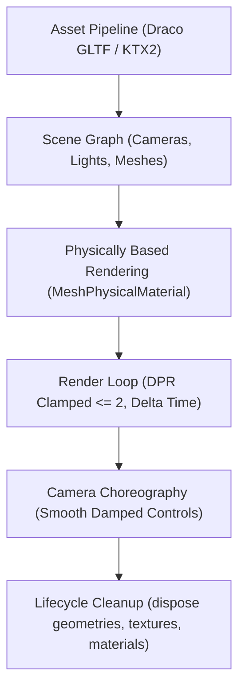

# Interactive 3D WebGL & Three.js Engineering (`/3d`)

> **Philosophy**: *Real-time 3D must be physically grounded and buttery-smooth. Enforce 60fps budgets, Draco compression, PBR physical materials, and strict memory disposal.*

This skill establishes production engineering standards for interactive 3D web applications, real-time product visualizers (e.g., automotive/roadster showcases), Three.js, and React Three Fiber (R3F).

---

## 1. Quick Navigation & Progressive Disclosure

| Resource Type | Document | Description |
| :--- | :--- | :--- |
| **Reference** | [references/threejs-performance-optimization.md](references/threejs-performance-optimization.md) | 60fps/120fps frame budgets, geometry instancing, frustum culling, texture mipmapping. |
| **Reference** | [references/pbr-materials-and-draco.md](references/pbr-materials-and-draco.md) | Physically-based materials, clearcoat setups, Draco glTF compression. |
| **Utility** | [scripts/verify_3d_performance.py](scripts/verify_3d_performance.py) | Audits Three.js source code for DPR clamping, disposal routines, and Draco decoders. |
| **Template** | [templates/ThreeRoadsterShowcase.tsx](templates/ThreeRoadsterShowcase.tsx) | Complete production Three.js automotive showcase component. |

---

## 2. Core 3D Architecture & The Roadster Pattern



### Rule 1: Physically Based Rendering (PBR) Materials
For premium product visualizations (automotive car bodies, metallic chassis, high-end consumer hardware), use `MeshPhysicalMaterial` rather than basic Phong or Lambert materials:
- **`clearcoat`**: `1.0` (simulates automotive polyurethane clearcoat layer).
- **`clearcoatRoughness`**: `0.05` to `0.1` (high-gloss specular reflections).
- **`metalness`**: `0.8` to `0.95` for metallic bodywork, `0.0` for plastics/leather.
- **`roughness`**: `0.1` to `0.3` for polished metallic paint, `0.6` to `0.8` for matte trim.
- **`envMapIntensity`**: `1.2` to `1.5` for balanced studio HDR reflections.

```typescript
// Production PBR Car Paint Material
const carPaintMaterial = new THREE.MeshPhysicalMaterial({
  color: new THREE.Color("#d00000"), // Deep Carmine Red
  metalness: 0.85,
  roughness: 0.15,
  clearcoat: 1.0,
  clearcoatRoughness: 0.04,
  reflectivity: 0.9,
  envMapIntensity: 1.3,
});
```

### Rule 2: Studio Lighting & Contact Shadows
- Never rely solely on ambient light. Set up a balanced **3-Point Studio Rig**:
  1. **Key Light**: `DirectionalLight` (intensity `1.5`, soft shadows enabled).
  2. **Fill Light**: Soft ambient light or HDRI environment map (intensity `0.8`).
  3. **Rim / Specular Light**: Backlight highlighting the vehicle silhouette.
- Use a **Contact Shadow Plane** (`ContactShadows` in R3F or blurred shadow render texture) directly beneath the vehicle chassis to anchor it to the ground plane without expensive real-time shadow map cascades.

### Rule 3: Responsive Canvas & DPR Clamping
- **Strict Guardrail**: Always clamp device pixel ratio to a maximum of `2.0`:
```typescript
const dpr = Math.min(window.devicePixelRatio, 2.0);
renderer.setPixelRatio(dpr);
```
Unclamped Retina displays (3.0x - 4.0x DPR) render 9x to 16x more fragments, causing severe GPU throttling and battery drain on mobile devices.

---

## 2. Asset Pipeline & Draco Compression

| Asset Type | Prohibited Anti-Pattern | Mandatory Production Standard |
| :--- | :--- | :--- |
| **3D Models** | Uncompressed raw `.obj` or `.gltf` (> 20MB). | Binary `.glb` with Draco compression (< 5MB initial payload). |
| **Textures** | Uncompressed 4K `.png` (> 10MB each). | Compressed `.ktx2` / Basis Universal or downsampled 1024x1024 WebP textures. |
| **Draw Calls** | Hundreds of separate meshes with distinct materials. | Merged geometries, `InstancedMesh`, and texture atlasing (< 50 draw calls). |
| **Render Loop** | Creating new vectors or materials inside `tick()`. | Pre-allocated mutable vectors (`THREE.Vector3`) mutated in-place. |

### Draco GLTF Loader Configuration
```typescript
import { GLTFLoader } from "three/examples/jsm/loaders/GLTFLoader.js";
import { DRACOLoader } from "three/examples/jsm/loaders/DRACOLoader.js";

const dracoLoader = new DRACOLoader();
dracoLoader.setDecoderPath("https://www.gstatic.com/draco/versioned/decoders/1.5.6/");

const gltfLoader = new GLTFLoader();
gltfLoader.setDRACOLoader(dracoLoader);
```

---

## 3. Lifecycle Memory Cleanup & Context Recovery

Every 3D component must dispose of GPU resources on unmount to prevent memory leaks:
```typescript
useEffect(() => {
  return () => {
    scene.traverse((object) => {
      if (object instanceof THREE.Mesh) {
        object.geometry.dispose();
        if (Array.isArray(object.material)) {
          object.material.forEach((mat) => mat.dispose());
        } else if (object.material) {
          object.material.dispose();
        }
      }
    });
    renderer.dispose();
  };
}, []);
```

---

## 4. 3D Performance Auditor CLI

Audit your 3D components for render loop memory allocations and missing DPR limits:
```bash
python3 skills/3d/scripts/verify_3d_performance.py --path .
```
