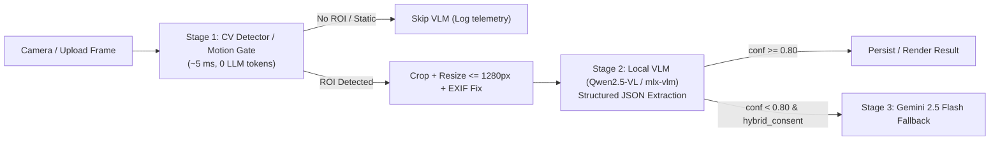

# CV -> VLM -> LLM Cost Cascade & Stream Cancellation

> **Objective**: Cut multimodal token spend by `70–95%` via deterministic CV gating and enforce zero-leak SSE/NDJSON stream cancellation in frontends.

---

## 1. Cascaded Multimodal Pipeline



- **Why Cascade Beats Raw VLM**: Running a `5 ms` YOLO/motion check drops empty/duplicate frames before image tokenization, while cropping to the ROI reduces image patches from `~1,500` tokens to `~256` tokens.

---

## 2. Cancelable SSE / Fetch Streaming (TypeScript)

```typescript
export async function streamModelResponse(
  endpoint: string,
  body: Record<string, unknown>,
  onToken: (chunk: string) => void,
  externalSignal?: AbortSignal,
): Promise<void> {
  const controller = new AbortController();
  const timer = setTimeout(() => controller.abort(new Error("AI_STREAM_TIMEOUT")), 15_000);
  externalSignal?.addEventListener("abort", () => controller.abort(), { once: true });

  try {
    const res = await fetch(endpoint, {
      method: "POST",
      headers: { "Content-Type": "application/json" },
      body: JSON.stringify(body),
      signal: controller.signal,
    });
    if (!res.ok || !res.body) throw new Error(`AI_HTTP_${res.status}`);

    const reader = res.body.getReader();
    const decoder = new TextDecoder();
    while (true) {
      const { value, done } = await reader.read();
      if (done) break;
      onToken(decoder.decode(value, { stream: true }));
    }
  } finally {
    clearTimeout(timer);
  }
}
```
