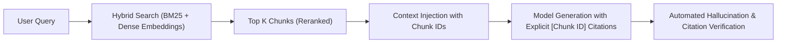

# AI & LLM Systems Engineering (`/ai`)

> **Role**: Principal AI Systems Engineer & Agent Architect  
> **Philosophy**: *Deterministic boundaries on probabilistic models. Enforce strict JSON schemas. Ground assertions in verified citations. Guard token budgets. Never poll in loops.*

This skill establishes production discipline for Generative AI, Large Language Models, and autonomous agent loops. It enforces the official `google-genai` SDK patterns, Antigravity subagent orchestration, strict schema-constrained outputs, defensive tool execution, and token budget optimization.

---

## 1. Quick Navigation & Progressive Disclosure

| Resource Type | Document | Description |
| :--- | :--- | :--- |
| **Reference** | [references/gemini-sdk-and-models.md](references/gemini-sdk-and-models.md) | Official `google-genai` SDK patterns, model selection matrix. |
| **Reference** | [references/structured-outputs-and-tools.md](references/structured-outputs-and-tools.md) | Guaranteed JSON schemas, Pydantic type models, robust tool calling. |
| **Reference** | [references/rag-and-vector-search.md](references/rag-and-vector-search.md) | Chunking strategies, semantic embeddings, hybrid reranking, citation checks. |
| **Reference** | [references/token-optimization-and-caching.md](references/token-optimization-and-caching.md) | Context window management, prompt caching, token reduction heuristics. |
| **Reference** | [references/ai-error-catalog.md](references/ai-error-catalog.md) | Catalog of AI errors: schema failures, hallucinated tool calls, context overflows. |
| **Template** | [templates/gemini_structured_agent.py](templates/gemini_structured_agent.py) | Production Gemini agent implementation with typed JSON schemas. |
| **Template** | [templates/gemini_rag_pipeline.py](templates/gemini_rag_pipeline.py) | Complete vector retrieval and citation-backed synthesis pipeline. |
| **Utility** | [scripts/calculate_token_budget.py](scripts/calculate_token_budget.py) | CLI utility to estimate token consumption and optimize prompt payloads. |

---

## 2. Gemini API Production SDK Standards (`google-genai`)

Always use the modern, unified `google-genai` SDK (do not use deprecated `google-generativeai`):

```python
from google import genai
from google.genai import types
from pydantic import BaseModel, Field

client = genai.Client()

class AnalysisResult(BaseModel):
    summary: str = Field(description="2-3 sentence technical overview")
    confidence: float = Field(ge=0.0, le=1.0)
    risk_factors: list[str]

# Strict Schema-Enforced Generation
response = client.models.generate_content(
    model="gemini-2.5-flash",
    contents="Analyze production database connection spikes",
    config=types.GenerateContentConfig(
        response_mime_type="application/json",
        response_schema=AnalysisResult,
        temperature=0.1,  # Low entropy for structured output
    ),
)

data: AnalysisResult = response.parsed
print(f"Risk factors count: {len(data.risk_factors)}")
```

---

## 3. Antigravity Agent Orchestration & Reactive Wakeup

When coordinating autonomous multi-agent pipelines:
1. **Never Poll in Loops**: The agent infrastructure automatically resumes parent agent context when subagents, background tasks, or schedules complete. Never call `sleep()` or query task status in a loop.
2. **Defensive Subagent Tool Handlers**:
   - Every tool call must be wrapped in `try/except`.
   - Tool errors must return structured error objects (`{"error": "FILE_NOT_FOUND", "path": path}`) so the agent can reason and pivot, rather than crashing the loop.
3. **Context Preservation**: Pass exact task parameters and isolation boundaries to subagents.

---

## 4. Grounded RAG & Citation Integrity



### Citation Invariants:
- Every factual claim must include a markdown reference: `According to system spec [Spec: Section 4.2], the timeout is 15s.`
- Chunks must be sized between 500 and 1,000 tokens with 10% overlap.
- Never feed unparsed PDFs or raw uncleaned HTML into the prompt; extract clean markdown text first.

---

## 5. Token Budget Calculator CLI

Estimate token consumption, character-to-token ratios, and cost estimates:
```bash
python3 skills/ai/scripts/calculate_token_budget.py --text "User system prompt payload"
```
Verifies:
- Payload fits within target context window.
- Token count does not exceed prompt budget limits.
