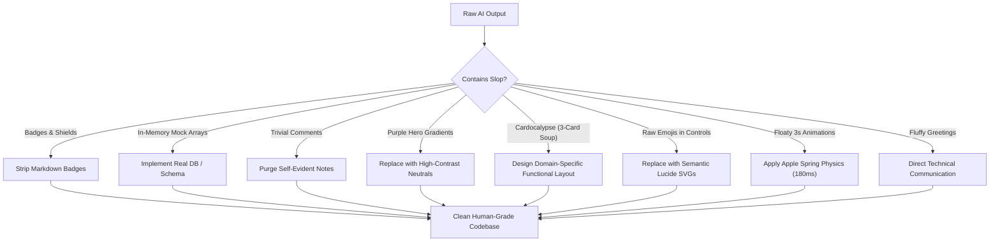
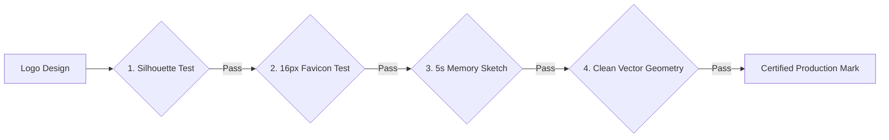
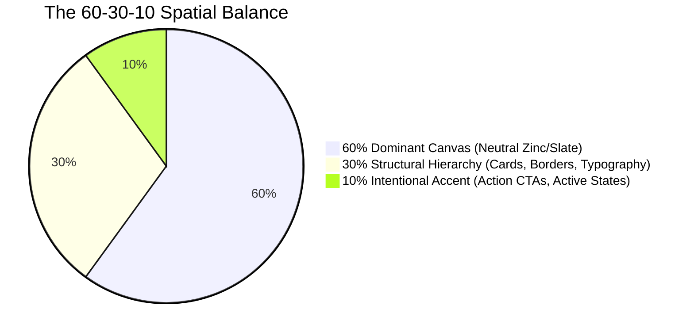

# Anti-AI-Slop & Clean Craftsmanship (`/anti-slop`)

> **Philosophy**: *Zero fluff. Zero decorative badges. Zero toy mock arrays. Zero neon purple gradients. Zero conversational sycophancy. Deliver real, human-grade, high-density software.*

This skill purges synthetic AI tropes and enforces professional engineering rigor across architecture, implementation, user interfaces, documentation, brand identity, and agent pairing.

---

## 1. Quick Navigation & Specialized References

| Resource Type | Document | Description |
| :--- | :--- | :--- |
| **Reference** | [references/ui-slop-taxonomy.md](references/ui-slop-taxonomy.md) | Detailed breakdown of the 10 UI AI slop patterns and production remediations. |
| **Reference** | [references/app-logo-and-icon-craftsmanship.md](references/app-logo-and-icon-craftsmanship.md) | The 4 Logo Stress Tests, modular grids, Apple continuous squircles, optical centering. |
| **Reference** | [references/color-theory-and-palette-architecture.md](references/color-theory-and-palette-architecture.md) | 60-30-10 spatial rule, OKLCH perceptual lightness, temperature undertones, WCAG 2.2. |
| **Reference** | [references/typography-and-font-pairing.md](references/typography-and-font-pairing.md) | Editorial serif + neo-grotesque pairing, dynamic optical tracking, tabular numbers. |
| **Reference** | [references/animation-and-motion-design.md](references/animation-and-motion-design.md) | Apple mass-spring-damper physics, GPU-only composite rule, staggered list choreography. |
| **Reference** | [../ui/references/unique-art-styles-and-aesthetics.md](../ui/references/unique-art-styles-and-aesthetics.md) | 4 Authentic Art Movements (Tactical, Swiss, Wabi-Sabi, CAD) replacing SaaS flatland. |
| **Reference** | [../ui/references/kinetic-typography-and-variable-fonts.md](../ui/references/kinetic-typography-and-variable-fonts.md) | Variable font axes (`wght`, `wdth`), clip-path text reveals, and tabular numbers. |
| **Reference** | [../ui/references/advanced-motion-web-and-flutter.md](../ui/references/advanced-motion-web-and-flutter.md) | Framer Motion zero-re-render springs & Flutter Impeller 120Hz detent haptics. |
| **Reference** | [../ui/references/universal-mobile-motion-architecture.md](../ui/references/universal-mobile-motion-architecture.md) | Universal mobile motion: React Native worklets, iOS SwiftUI, Android Compose, and Flutter. |
| **Template** | [templates/CraftedAppLogo.svg](templates/CraftedAppLogo.svg) | Production-grade mathematical vector SVG logo mark passing all 4 stress tests. |
| **Template** | [templates/CraftedAppLogo.tsx](templates/CraftedAppLogo.tsx) | React vector logo component with material and monochrome silhouette variants. |
| **Template** | [../ui/templates/TactileSpringButton.tsx](../ui/templates/TactileSpringButton.tsx) | Production tactile button implementing Apple spring physics and 44x44px touch targets. |
| **Utility** | [scripts/sanitize_ai_slop.py](scripts/sanitize_ai_slop.py) | Standalone CLI auditor checking codebases for badges, mocks, glows, and AI tropes. |

---

## 2. The Core Anti-Slop Prohibitions



| Slop Category | Prohibited Pattern | Mandatory Engineering Standard |
| :--- | :--- | :--- |
| **Decorative Badges** | `shields.io`, build/version badges, decorative tags. | Clean semantic headers; metadata belongs in manifests (`package.json`, `Cargo.toml`). |
| **Fake Mock Arrays** | `const mockUsers = [...]` acting as permanent state. | Real persistence: SQLite, PostgreSQL, Cloud SQL, or structured file stores. |
| **Comment Slop** | Obvious restatements: `// set loading to true`, `# increment counter`. | Intent-only comments: explain *why* non-obvious architecture was chosen. |
| **Purple Hero Gradients** | `#6366f1` to `#ec4899` linear gradients across headers. | Calibrated neutral surfaces (`zinc-950`) with 1px specular highlights. |
| **Cardocalypse** | 3-column generic SaaS cards nested within cards. | Bespoke functional layouts tailored to the domain's data hierarchy. |
| **Raw Emoji Controls** | 🚀, ✨, 🔥 in buttons, navigation, and headers. | Semantic SVG icons (Lucide Icons) with `aria-hidden="true"`. |
| **AI Logo Blobs** | Swirling gradient ribbons, floating cubes, messy vectors. | Monochromatic silhouette first; modular grid; passes the 16px Favicon test. |
| **Unconfigured Inter** | Default Inter with 0 letter-spacing on 48px headings. | Dynamic optical tracking (`-0.035em` on display, `+0.06em` on captions), `tnum`. |
| **Floaty Motion** | 3-second linear fades, CPU-killing particle meshes. | Snappy Apple springs (160ms–220ms), GPU composite properties (`transform`, `opacity`). |
| **Conversational Sycophancy** | "Sure! I'd be happy to help with that!", "Great choice!". | Omit conversational padding; provide dense, targeted engineering answers. |

---

## 3. App Logo & Icon Craftsmanship Standards

Every logo or application icon must pass the **4 Mandatory Logo Stress Tests**:



1. **The Silhouette Test**: The logo must be instantly recognizable in **100% solid black on white** and **100% solid white on black**. If it relies on gradients or drop-shadows to define its shape, reject it immediately.
2. **The 16px Favicon Test**: When scaled down to $16 \times 16\text{ px}$, strokes must not blur together into visual noise. Minimum stroke weight: $1.5\text{ px}$ at $16\text{ px}$ scale.
3. **The 5-Second Memory Sketch Test**: A user must be able to accurately sketch the silhouette from memory after 5 seconds of viewing.
4. **The Vector Cleanliness Check**: Hand-crafted SVG paths with clean mathematical nodes ($< 30$ control points), zero overlapping bezier mess.

---

## 4. Color Theory & The 60-30-10 Architecture



- **60% Dominant Canvas**: Temperature-calibrated dark neutral (`zinc-950` `#09090b` or `slate-950`). Never pure `#000000` without temperature.
- **30% Structural Hierarchy**: Architectural containers, cards, borders (`zinc-800`), secondary text (`zinc-400`).
- **10% Intentional Accent**: High-contrast focal points (`sky-500`, `emerald-500`).
- **Contrast Guardrail**: Ensure all text satisfies WCAG 2.2 AA ($4.5:1$ for body, $3:1$ for headers).

---

## 5. Typography Hierarchy & Optical Tracking

Dynamic letter-spacing is mandatory across font sizes:
- **Display Headings ($48\text{ px}+$):** Tight negative tracking (`letter-spacing: -0.035em`).
- **Section Titles ($20\text{--}32\text{ px}$):** Moderate negative tracking (`letter-spacing: -0.015em`).
- **Body Copy ($14\text{--}16\text{ px}$):** Neutral tracking (`letter-spacing: -0.005em`).
- **Captions & Eyebrows ($10\text{--}12\text{ px}$):** Wide positive tracking (`letter-spacing: +0.06em; text-transform: uppercase`).
- **Tabular Data:** Always enable `font-feature-settings: "tnum" 1, "zero" 1;` on numbers.

---

## 6. Tactile Motion & Apple Spring Physics

Reject mechanical linear CSS transitions. Use Apple mass-spring-damper physics:
- **Button Press**: scale down to `0.97`, duration `160ms`, spring timing `cubic-bezier(0.175, 0.885, 0.32, 1.275)`.
- **Panel Entrances**: duration `280ms`, timing `cubic-bezier(0.16, 1, 0.3, 1)`.
- **GPU Composite Rule**: Strictly animate `transform` and `opacity`. Never animate `width`, `height`, `top`, or `left`.
- **Accessibility**: Always respect `@media (prefers-reduced-motion: reduce)`.

---

## 7. Anti-Mock / Real Persistence Mandate

Never generate arrays of fake objects when creating API endpoints or data services. Use SQLite with `better-sqlite3`, PostgreSQL with `pg`, or local structured storage with Zod schema validation.

---

## 8. Sanitizer CLI Execution

Audit any directory using the standalone anti-slop validator:
```bash
python3 skills/anti-slop/scripts/sanitize_ai_slop.py --path .
```
This CLI audits:
- Presence of shields.io badges in documentation.
- Trivial restatement comments in source files.
- Hardcoded mock data arrays pretending to be state.
- Neon gradient utility classes and raw emoji buttons.
- Excessive fuzzy glow drop-shadows and unconfigured typography.
