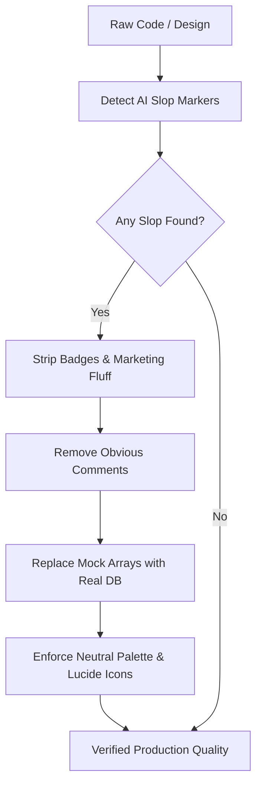

# Anti-AI-Slop & Clean Craftsmanship (`/anti-slop`)

> **Philosophy**: *Zero fluff. Zero decorative badges. Zero toy mock arrays. Zero neon purple gradients. Deliver real, human-grade, high-density software.*

This skill purges synthetic AI tropes and enforces professional engineering rigor across architecture, implementation, user interfaces, and documentation.

---

## 1. The Anti-Slop Prohibitions

| Slop Category | Prohibited Pattern | Mandatory Engineering Standard |
| :--- | :--- | :--- |
| **Decorative Badges** | `shields.io`, build/version badges, decorative tags. | Clean semantic headers; metadata belongs in manifests (`package.json`, `Cargo.toml`). |
| **Fake Mock Arrays** | `const mockUsers = [...]` acting as permanent state. | Real persistence: SQLite, PostgreSQL, Cloud SQL, or structured file stores. |
| **Comment Slop** | Obvious restatements: `// set loading to true`, `# increment counter`. | Intent-only comments: explain *why* non-obvious architecture was chosen. |
| **Neon Vibe Tropes** | Purple/indigo gradients (`from-purple-600 to-indigo-600`), neon glow rings. | Disciplined neutrals (`zinc`, `slate`), subtle 1px borders, high contrast. |
| **Card Soup** | 3-column generic SaaS cards nested within cards. | Bespoke functional layouts tailored to the domain's data hierarchy. |
| **Raw Emoji Controls** | 🚀, ✨, 🔥 in buttons, navigation, and headers. | Semantic SVG icons (Lucide Icons) with `aria-hidden="true"`. |
| **Marketing Copy** | "Revolutionary AI-powered next-generation paradigm". | Direct, factual, token-efficient technical communication. |

---

## 2. Dynamic Sanitization Workflow

When authoring or reviewing code, execute the sanitization pass:



### Sanitizer CLI Execution
Audit any directory using the standalone validator:
```bash
python3 skills/anti-slop/scripts/sanitize_ai_slop.py --path .
```

---

## 3. Concrete Before vs. After Code Examples

### Example A: Comments & Code Simplicity
```typescript
// ❌ AI SLOP: Obvious comments, premature factory wrappers
// Function to fetch the user profile
export function getUserProfileFactory() {
  return async function(userId: string) {
    // Check if user id is provided
    if (!userId) {
      // Throw an error if not found
      throw new Error("User ID is required");
    }
    // Return the user data
    return await db.users.findUnique({ where: { id: userId } });
  };
}

// ✅ CLEAN PRODUCTION: Direct, typed, intent-revealing
export async function getUserProfile(userId: string): Promise<User> {
  if (!userId) throw new ValidationError("userId must not be empty");
  const user = await db.users.findUnique({ where: { id: userId } });
  if (!user) throw new NotFoundError(`User ${userId} does not exist`);
  return user;
}
```

### Example B: UI Palette & Iconography
```tsx
// ❌ AI SLOP: Purple gradient, raw emoji, generic card soup
<div className="bg-gradient-to-r from-purple-600 to-indigo-600 p-8 rounded-2xl shadow-xl">
  <h2 className="text-white font-bold">🚀 AI-Powered Assistant v1.0</h2>
  <button className="bg-green-400 hover:bg-green-500 text-black px-4 py-2 rounded-xl shadow-[0_0_15px_#22c55e]">
    ✨ Start Generating
  </button>
</div>

// ✅ CLEAN PRODUCTION: Accessible neutral scale, Lucide SVG, precise state
import { Sparkles } from "lucide-react";

<div className="bg-zinc-900 border border-zinc-800 p-6 rounded-lg">
  <div className="flex items-center gap-2">
    <Sparkles className="w-4 h-4 text-zinc-400" aria-hidden="true" />
    <h2 className="text-sm font-medium text-zinc-100">Telemetry Engine</h2>
  </div>
  <button 
    type="button"
    className="mt-4 px-3 py-1.5 bg-zinc-100 hover:bg-zinc-200 text-zinc-900 text-xs font-medium rounded transition-colors focus-visible:outline-2 focus-visible:outline-offset-2 focus-visible:outline-zinc-400"
  >
    Execute Pipeline
  </button>
</div>
```
