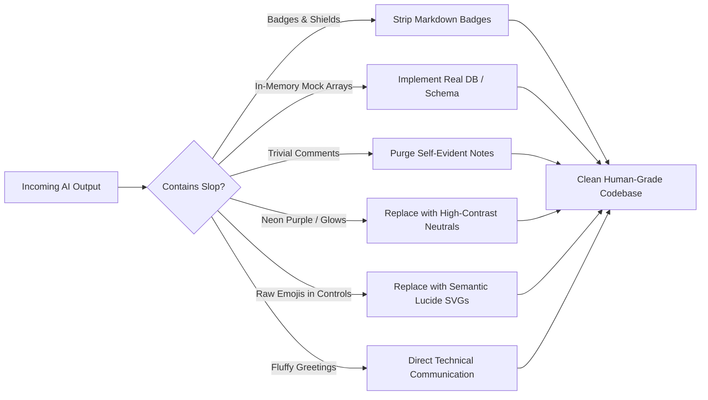

# Anti-AI-Slop & Clean Craftsmanship (`/anti-slop`)

> **Philosophy**: *Zero fluff. Zero decorative badges. Zero toy mock arrays. Zero neon purple gradients. Zero conversational sycophancy. Deliver real, human-grade, high-density software.*

This skill purges synthetic AI tropes and enforces professional engineering rigor across architecture, implementation, user interfaces, documentation, and agent pairing.

---

## 1. The Anti-Slop Prohibitions



| Slop Category | Prohibited Pattern | Mandatory Engineering Standard |
| :--- | :--- | :--- |
| **Decorative Badges** | `shields.io`, build/version badges, decorative tags. | Clean semantic headers; metadata belongs in manifests (`package.json`, `Cargo.toml`). |
| **Fake Mock Arrays** | `const mockUsers = [...]` acting as permanent state. | Real persistence: SQLite, PostgreSQL, Cloud SQL, or structured file stores. |
| **Comment Slop** | Obvious restatements: `// set loading to true`, `# increment counter`. | Intent-only comments: explain *why* non-obvious architecture was chosen. |
| **Neon Vibe Tropes** | Purple/indigo gradients (`from-purple-600 to-indigo-600`), neon glow rings. | Disciplined neutrals (`zinc`, `slate`), subtle 1px borders, high contrast. |
| **Card Soup** | 3-column generic SaaS cards nested within cards. | Bespoke functional layouts tailored to the domain's data hierarchy. |
| **Raw Emoji Controls** | 🚀, ✨, 🔥 in buttons, navigation, and headers. | Semantic SVG icons (Lucide Icons) with `aria-hidden="true"`. |
| **Conversational Sycophancy** | "Sure! I'd be happy to help with that!", "Great choice!". | Omit conversational padding; provide dense, targeted engineering answers. |
| **Marketing Copy** | "Revolutionary AI-powered next-generation paradigm". | Direct, factual, token-efficient technical communication. |

---

## 2. Dynamic Sanitization Workflow

When authoring or reviewing code, execute the sanitization pass:

### Rule 1: Zero Restatement Comments
Comments must explain **why**, never **what**. If code requires a comment to explain what it is doing, refactor variable or function names.

```typescript
// ❌ AI SLOP: Self-evident restatements
// Check if user is authenticated
if (!session.user) {
  // Redirect to login page
  router.push("/login");
  // Return early
  return null;
}

// ✅ CLEAN PRODUCTION: Self-documenting code
if (!session.user) {
  router.push("/login");
  return null;
}
```

### Rule 2: Anti-Mock / Real Persistence Mandate
Never generate arrays of fake objects when creating API endpoints or data services. Use SQLite with `better-sqlite3`, PostgreSQL with `pg`, or local structured storage with Zod schema validation:

```typescript
// ❌ AI SLOP: In-memory toy array pretending to be a database
const USERS = [
  { id: "1", name: "Alice", role: "admin" },
  { id: "2", name: "Bob", role: "user" },
];

export async function GET() {
  return Response.json(USERS);
}

// ✅ CLEAN PRODUCTION: Parameterized SQL against real storage
import Database from "better-sqlite3";
import { z } from "zod";

const db = new Database("app.db");
db.pragma("journal_mode = WAL");

const UserSchema = z.object({
  id: z.string().uuid(),
  name: z.string().min(1),
  role: z.enum(["admin", "user"]),
});

export async function GET() {
  const rows = db.prepare("SELECT id, name, role FROM users WHERE active = 1").all();
  return Response.json(UserSchema.array().parse(rows));
}
```

### Rule 3: High-Density Pairing Communication
When communicating with the user or other agents:
1. Never open with pleasantries or flattery ("Certainly! I can definitely do that for you!").
2. State the exact action taken, diff, and verification status.
3. Structure complex information using markdown tables or code fences.

---

## 3. Sanitizer CLI Execution

Audit any directory using the standalone anti-slop validator:
```bash
python3 skills/anti-slop/scripts/sanitize_ai_slop.py --path .
```
This CLI verifies:
- Presence of shields.io badges in documentation.
- Trivial restatement comments in source files.
- Hardcoded mock data arrays pretending to be state.
- Neon gradient utility classes and raw emoji buttons.
