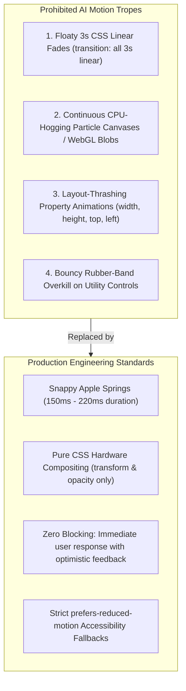
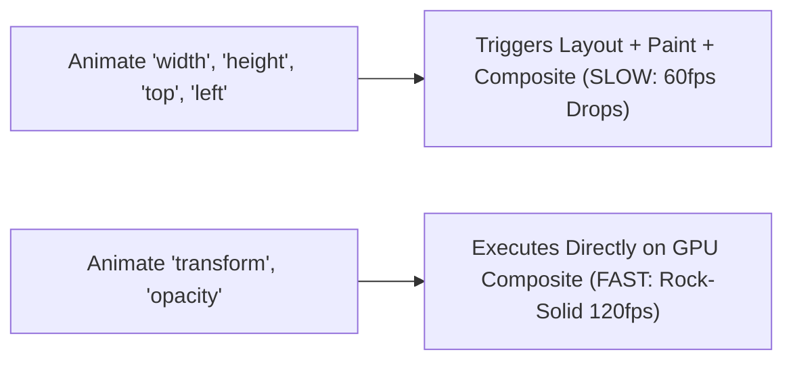

# Tactile Animation & Motion Design: The Anti-Slop Guide

> **Core Philosophy**: *Animation must communicate physical mass, momentum, and tactile state. Never delay the user with floaty 3-second linear fades or CPU-killing particle meshes. Animate only transform and opacity.*

This reference establishes the physics of interface motion, Apple-style mass-spring-damper configurations, GPU rendering pipelines, and accessibility guardrails.

---

## 1. The 4 Anti-Slop Motion Prohibitions



---

## 2. Mass-Spring-Damper Physical Model

Realistic interface motion does not use mechanical cubic-beziers; it obeys the second-order harmonic oscillator equation:

$$m \frac{d^2x}{dt^2} + c \frac{dx}{dt} + k x = 0$$

where:
- $m$ is the **mass** (typically normalized to $1.0$).
- $k$ is the **stiffness** (force pulling the object to its target rest position).
- $c$ is the **damping coefficient** (friction resisting motion).

The **damping ratio** $\zeta$ determines the physical feel:
$$\zeta = \frac{c}{2\sqrt{m k}}$$
- $\zeta < 1.0$: Underdamped (slight spring overshoot, organic bounce).
- $\zeta = 1.0$: Critically damped (fastest return to rest with zero overshoot).
- $\zeta > 1.0$: Overdamped (sluggish, avoid for user interface controls).

---

## 3. Production Spring Presets

| Interaction Type | Mass ($m$) | Stiffness ($k$) | Damping ($c$) | Duration | Feel & Application |
| :--- | :--- | :--- | :--- | :--- | :--- |
| **Tactile Button Press** | `1.0` | `380` | `30` | $\approx 160\text{ ms}$ | Snappy, zero perceptible lag. Press scale `0.97`. |
| **Drawer / Modal Sheet** | `1.0` | `240` | `26` | $\approx 280\text{ ms}$ | Fluid, substantial inertia, settles smoothly into place. |
| **Hover Tooltip / Popover** | `0.8` | `400` | `32` | $\approx 140\text{ ms}$ | Crisp, immediate appearance without distraction. |
| **Staggered Card List** | `1.0` | `300` | `28` | $\approx 220\text{ ms}$ | Waterfall appearance with 35ms stagger per child. |

### CSS Approximation of Apple Spring Timing:
```css
/* Tactile Spring (High stiffness, minimal overshoot) */
.spring-tactile {
  transition-property: transform, opacity, background-color, border-color;
  transition-duration: 180ms;
  transition-timing-function: cubic-bezier(0.175, 0.885, 0.32, 1.275);
}

/* Fluid Panel Spring */
.spring-fluid {
  transition-property: transform, opacity;
  transition-duration: 300ms;
  transition-timing-function: cubic-bezier(0.16, 1, 0.3, 1);
}
```

---

## 4. The Composite-Only Rendering Pipeline

Browsers execute four phases to render an element: **JavaScript $\to$ Style $\to$ Layout $\to$ Paint $\to$ Composite**.



### The Ironclad Composite Rule:
- **Never animate**: `width`, `height`, `top`, `left`, `bottom`, `right`, `margin`, `padding`, `border-width`.
- **Strictly animate**:
  - Position changes via `transform: translate3d(x, y, 0);`
  - Scale changes via `transform: scale(s);`
  - Rotation changes via `transform: rotate(deg);`
  - Visibility changes via `opacity: o;`

---

## 5. Staggered List Choreography

When presenting multiple items (e.g. data table rows, metric cards), animate them with a **30ms–40ms stagger offset**:

```tsx
// React Staggered Entrance Example
export const StaggeredList: React.FC<{ items: string[] }> = ({ items }) => {
  return (
    <ul className="flex flex-col gap-2">
      {items.map((item, index) => (
        <li
          key={item}
          className="transition-all duration-300 ease-out"
          style={{
            transitionDelay: `${index * 35}ms`,
            transform: "translateY(0)",
            opacity: 1,
          }}
        >
          {item}
        </li>
      ))}
    </ul>
  );
};
```

---

## 6. Accessibility: Reduced Motion Mandate

Always provide an explicit override for users with vestibular or motion sensitivities:

```css
@media (prefers-reduced-motion: reduce) {
  *,
  *::before,
  *::after {
    animation-duration: 0.01ms !important;
    animation-iteration-count: 1 !important;
    transition-duration: 0.01ms !important;
    scroll-behavior: auto !important;
  }
}
```
