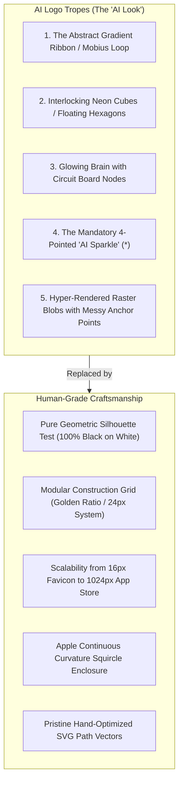
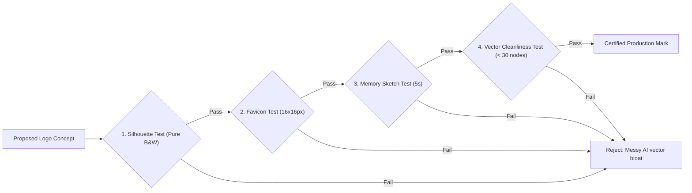
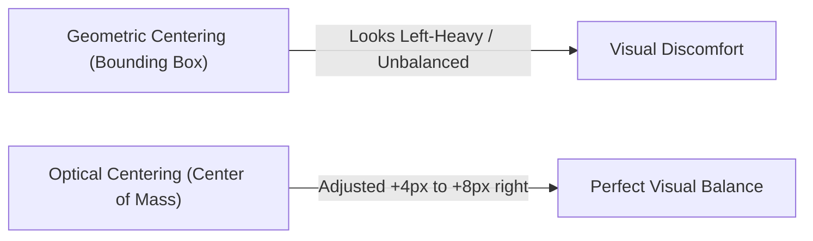

# App Logo & Icon Craftsmanship: The Anti-Slop Guide

> **Core Philosophy**: *A logo is not an illustration. A logo is an ultra-scalable, mathematically balanced geometric mark. If it fails in pure black and white, or becomes unreadable at 16x16px, it is not a logo—it is AI slop.*

This reference establishes the engineering principles for authoring world-class application logos, macOS/iOS app store icons, and scalable vector assets that withstand production stress testing.

---

## 1. The 5 AI Logo Failure Tropes



| AI Cliché | Why It Fails | Professional Replacement |
| :--- | :--- | :--- |
| **Swirling Gradient Ribbon** | Relies on 15 gradient stops; turns into a grey smudge in monochrome or small sizes. | Distinct geometric silhouette with clear positive/negative space. |
| **Interlocking Cubes / Hexagons** | Generic cliché representing "crypto" or "blockchain"; zero unique brand identity. | Purposeful glyph or brand metaphor rooted in the application's unique domain. |
| **Glowing Brain Nodes** | Literal, amateur depiction of AI; completely unreadable at favicon scale ($16\times16\text{ px}$). | Elegant abstract symbol or typographic monogram with balanced proportions. |
| **4-Pointed Sparkle Accent** | Visual noise stamped onto corners; screams "synthetic AI wrapper". | Omit decorative sparkles. Let structural form and negative space communicate excellence. |
| **Messy AI Vector Output** | Thousands of jittery, unaligned anchor points; non-trademarkable and impossible to embroider. | Minimal mathematical geometry (circles, arcs, $45^\circ/90^\circ$ vectors) aligned to a grid. |

---

## 2. The 4 Mandatory Logo Stress Tests

Every app logo or brand icon authored in SkillBuilder must pass all four gates:



### Test 1: The Silhouette Test (Monochrome First)
Strip all colors, gradients, and shadows. Render the mark in **100% solid black on white** and **100% solid white on black**.
- **Passing Criterion**: The shape remains instantly recognizable. The mark communicates through its silhouette and negative space alone.
- **AI Failure**: If the logo becomes an unrecognizable black blob when gradients are removed, reject it immediately.

### Test 2: The 16px Favicon Test
Scale the mark to $16 \times 16\text{ px}$ and inspect on a standard display (1x DPR):
- **Passing Criterion**: Key lines and voids remain distinct without blending into a fuzzy grey dot. Minimum stroke thickness must be at least $1.5\text{ px}$ at $16\text{ px}$ scale.
- **AI Failure**: Micro-facets, thin lines, and interior circuits vanish into visual noise.

### Test 3: The 5-Second Memory Sketch Test
Show the mark to a user for 5 seconds, then ask them to draw it from memory with a single pen:
- **Passing Criterion**: The user can accurately replicate the fundamental structure (e.g. Apple's silhouette, Nike's swoosh, Target's concentric rings).
- **AI Failure**: Complex 12-layer gradient origami birds cannot be sketched from memory.

### Test 4: The Vector Node Cleanliness Check
Open the SVG file in text format:
- **Passing Criterion**: The primary glyph path uses clean geometric commands (`M`, `L`, `C`, `A`, `Z`) with fewer than 30 total control points.
- **AI Failure**: AI vectorizers produce 500+ jagged points with overlapping self-intersections.

---

## 3. The Modular Construction Grid & Apple Squircle

### The Master Grid System ($512 \times 512\text{ px}$)
Construct app icons inside a $512\times512\text{ px}$ canvas based on an 8-column, 8-row grid:
- **Outer Canvas**: $512 \times 512\text{ px}$
- **Safe Icon Area**: $384 \times 384\text{ px}$ (centered, 64px padding)
- **Central Focus Circle**: Diameter $300\text{ px}$ ($\approx \phi$ ratio of 512)
- **Key Angles**: Strictly $0^\circ$, $45^\circ$, and $90^\circ$ for diagonal lines.

### The Apple Continuous Curvature Squircle Mask
Standard rounded rectangles (`border-radius: 22%`) create visible tangent breaks. Apple uses a continuous curve (Lamé superellipse where $n \approx 4$):

$$\left|\frac{x}{a}\right|^4 + \left|\frac{y}{b}\right|^4 = 1$$

In SVG, apply the standardized continuous curve clip-path or path formula:

```svg
<!-- Standard macOS / iOS App Icon Squircle Path (512x512) -->
<path d="M 120 32
         C 40 32, 32 40, 32 120
         L 32 392
         C 32 472, 40 480, 120 480
         L 392 480
         C 472 480, 480 472, 480 392
         L 480 120
         C 480 40, 472 32, 392 32
         Z" />
```

---

## 4. Optical Centering vs. Geometric Centering

A frequent AI mistake is centering asymmetrical marks mathematically using the SVG bounding box center (`(viewBox.width / 2, viewBox.height / 2)`).



### The Play Triangle Rule:
- A triangle pointing right has $2/3$ of its area on the left side of its bounding box.
- Centering it mathematically makes it look too far to the left.
- **Remediation**: Shift the shape rightward along the X-axis by **$1/6$ of its width** to achieve true optical balance.

---

## 5. Production SVG Standards for App Logos

```svg
<!-- Production-Grade Crafted App Mark (Self-Contained & Theme-Adaptive) -->
<svg xmlns="http://www.w3.org/2000/svg" viewBox="0 0 512 512" width="100%" height="100%" aria-label="SkillBuilder Logo" role="img">
  <defs>
    <!-- Cupertino Specular Edge Gradient -->
    <linearGradient id="specular-light" x1="0%" y1="0%" x2="100%" y2="100%">
      <stop offset="0%" stop-color="#ffffff" stop-opacity="0.25" />
      <stop offset="100%" stop-color="#ffffff" stop-opacity="0.02" />
    </linearGradient>
    <!-- Background Acrylic Gradient -->
    <linearGradient id="surface-acrylic" x1="0%" y1="0%" x2="0%" y2="100%">
      <stop offset="0%" stop-color="#1c1c20" />
      <stop offset="100%" stop-color="#0e0e11" />
    </linearGradient>
  </defs>

  <!-- Squircle Base Surface -->
  <rect x="32" y="32" width="448" height="448" rx="108" fill="url(#surface-acrylic)" />
  <rect x="32" y="32" width="448" height="448" rx="108" fill="none" stroke="url(#specular-light)" stroke-width="2" />

  <!-- Geometric Central Mark: The Precision Compass / Diamond -->
  <path d="M 256 128 L 336 256 L 256 384 L 176 256 Z" fill="#f4f4f5" />
  <circle cx="256" cy="256" r="28" fill="#0e0e11" />
  <circle cx="256" cy="256" r="14" fill="#38bdf8" />
</svg>
```
