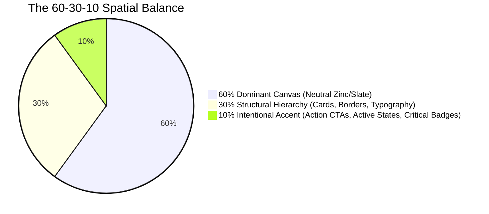
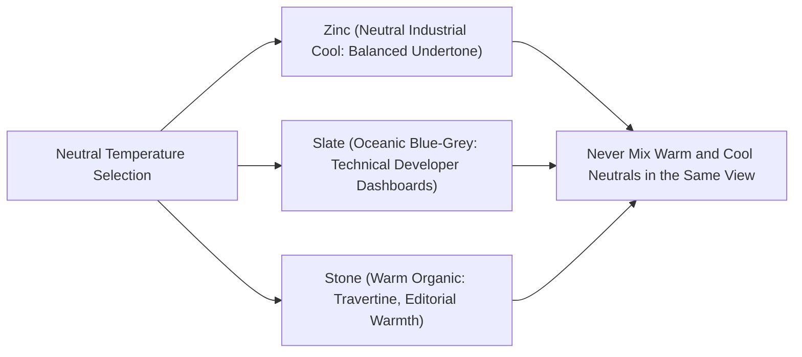

# Color Theory & Strategic Palette Architecture

> **Core Philosophy**: *Color is functional information, not decorative paint. A disciplined interface uses a 60-30-10 spatial balance, temperature-calibrated neutrals, and purposeful semantic tokens that pass WCAG 2.2 AA contrast standards.*

This reference establishes the scientific foundations of color theory, dark-mode luminance ramps, and perceptual color models (OKLCH) to eradicate random AI gradient slop.

---

## 1. The 60-30-10 Spatial Color Architecture

Every cohesive interface must distribute visual weight according to the **60-30-10 Spatial Rule**:



| Allocation | Visual Role | Token Palette Example | Architectural Purpose |
| :--- | :--- | :--- | :--- |
| **60% Dominant Canvas** | Background, body canvas, empty space | `zinc-950` (`#09090b`), `zinc-900` (`#18181b`) | Provides visual resting space; establishes visual depth and calm. |
| **30% Structural Hierarchy** | Cards, sidebars, borders, secondary text | `zinc-800` (`#27272a`), `zinc-400` (`#a1a1aa`), `zinc-200` (`#e4e4e7`) | Creates architectural container boundaries, dividers, and typography hierarchy. |
| **10% Intentional Accent** | Primary buttons, active tabs, status indicators | `sky-500` (`#0ea5e9`), `emerald-500` (`#10b981`) | Draws eye directly to high-priority interactions without competing visual noise. |

---

## 2. Temperature-Calibrated Neutrals: Eliminating Dead Plastic Hexes

Pure computer greys (`#111111`, `#222222`, `#333333`) lack physical presence and feel dead to the human eye. Real physical materials always have a subtle color temperature.



### The 3 Master Neutral Families:
1. **Zinc Scale (Default for SkillBuilder)**:
   - Hue angle: $\approx 240^\circ$, minimal saturation ($\approx 3\%$).
   - Perfect for: Modern productivity software, developer tools, Apple-style Cupertino dark surfaces.
   - Core ramp: `zinc-950` (`#09090b`) $\to$ `zinc-900` (`#18181b`) $\to$ `zinc-800` (`#27272a`) $\to$ `zinc-100` (`#f4f4f5`).
2. **Slate Scale (Technical / Telemetry)**:
   - Hue angle: $\approx 215^\circ$, cool oceanic blue-grey tint.
   - Perfect for: Cloud consoles, terminal emulators, security telemetry.
3. **Stone Scale (Editorial / Warm)**:
   - Hue angle: $\approx 45^\circ$, warm sandstone/paper undertone.
   - Perfect for: Long-form reading, documentation hubs, humanistic publishing.

> [!CAUTION]
> **Temperature Clash Anti-Pattern**: Never mix warm `stone-800` borders inside a cool `slate-950` canvas. Stick to one cohesive neutral temperature scale per interface.

---

## 3. Perceptual Lightness (OKLCH) vs. Legacy sRGB Hexes

Standard sRGB hexes deceive human perception: pure yellow (`#ffff00`) has a perceived luminance of $\approx 93\%$, whereas pure blue (`#0000ff`) has a perceived luminance of $\approx 7\%$, even though both have $100\%$ saturation.

```css
/* ✅ Production CSS using OKLCH for uniform perceptual lightness */
:root {
  /* Ambient canvas background */
  --surface-base: oklch(0.14 0.01 250);
  --surface-elevated: oklch(0.18 0.015 250);
  --border-subtle: oklch(0.28 0.01 250 / 0.5);
  
  /* Accent colors sharing identical perceptual lightness (0.70) */
  --accent-blue: oklch(0.70 0.16 240);
  --accent-emerald: oklch(0.70 0.16 150);
  --accent-amber: oklch(0.70 0.16 75);
  --accent-rose: oklch(0.70 0.16 15);
}
```

Using OKLCH guarantees that warning, success, and error badges have identical visual prominence on the screen.

---

## 4. Accessibility & Contrast Math (WCAG 2.2 AA / AAA)

Contrast ratio is calculated from relative luminance values ($L_1$ and $L_2$):

$$\text{Contrast Ratio} = \frac{L_1 + 0.05}{L_2 + 0.05}$$

where relative luminance $L$ is computed from linearized RGB channels:
$$L = 0.2126R + 0.7152G + 0.0722B$$

### Minimum Contrast Thresholds:
- **Normal Body Text ($< 18\text{ px}$)**: $\ge 4.5:1$ (WCAG AA), $\ge 7:1$ (WCAG AAA).
- **Large Text ($\ge 18\text{ px}$ bold or $\ge 24\text{ px}$ normal)**: $\ge 3:1$ (WCAG AA), $\ge 4.5:1$ (WCAG AAA).
- **Interactive UI Components & Hairline Borders**: $\ge 3:1$ against adjacent backgrounds.

---

## 5. Purposeful Semantic Token Matrix

Never use raw arbitrary hexes (`#22c55e`, `#ef4444`) directly in JSX. Standardize on semantic tokens:

| Semantic State | Production Token | Contrast on Dark | Psychological Function |
| :--- | :--- | :--- | :--- |
| **Success** | `emerald-400` (`#34d399`) / `emerald-500` | $8.2:1$ (AAA) | Verified build, active connection, healthy test suite. |
| **Warning** | `amber-400` (`#fbbf24`) / `amber-500` | $10.5:1$ (AAA) | Deprecated API, approaching rate limit, memory pressure. |
| **Destructive** | `rose-400` (`#fb7185`) / `rose-500` | $7.1:1$ (AAA) | Failed build, unhandled exception, resource deletion. |
| **Active / Info** | `sky-400` (`#38bdf8`) / `sky-500` | $8.9:1$ (AAA) | In-progress task, selected tab, primary call-to-action. |
