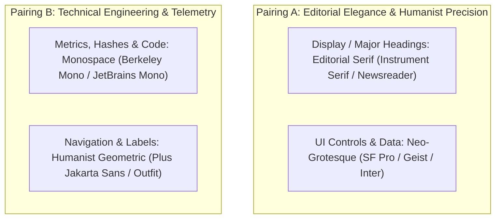
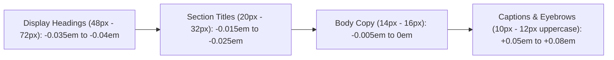

# Typography Hierarchy & Font Pairing: The Anti-Slop Guide

> **Core Philosophy**: *Default Inter with zero letter-spacing is the hallmark of uncurated AI generation. Great typography pairs intentional typefaces, adjusts tracking dynamically to optical size, and activates OpenType features for numerical precision.*

This reference establishes the rules of font pairing, optical tracking formulas, tabular data layout, and modular typographic scales across web applications.

---

## 1. The Anti-Slop Font Pairing Matrix

Stop using a single unconfigured sans-serif font for every element. Pair contrasting, high-character typefaces to establish immediate authority:



| Domain / Application | Primary Headings | Body & Controls | Code & Telemetry | Vibe & Character |
| :--- | :--- | :--- | :--- | :--- |
| **Developer Tools & Infrastructure** | `Geist` or `SF Pro Display` | `SF Pro Text` / `Inter` | `Geist Mono` or `Berkeley Mono` | Razor-sharp, technical, distraction-free. |
| **High-End Editorial / Fintech** | `Newsreader` or `Instrument Serif` | `SF Pro Text` | `JetBrains Mono` | Sophisticated, trustworthy, human-crafted. |
| **Creative / Spatial Software** | `Plus Jakarta Sans` | `Inter` (with OpenType features) | `SF Mono` | Modern geometric, open, tactile. |

---

## 2. Dynamic Optical Tracking Curves

Letter spacing must change inversely with font size: as text gets larger, letterforms drift apart and require **negative tracking**; as text gets smaller, letterforms collide and require **positive tracking**.



### The Optical Tracking Reference Table:

| Font Size | Line Height | Letter Spacing (Tracking) | Tailwind Class | CSS Property | Typical Use Case |
| :--- | :--- | :--- | :--- | :--- | :--- |
| **$48\text{ px}$ ($3\text{ rem}$)** | $52\text{ px}$ | `-0.035em` | `tracking-tighter` | `letter-spacing: -0.035em;` | Hero Display Heading |
| **$36\text{ px}$ ($2.25\text{ rem}$)** | $40\text{ px}$ | `-0.025em` | `tracking-tight` | `letter-spacing: -0.025em;` | Page Title |
| **$24\text{ px}$ ($1.5\text{ rem}$)** | $32\text{ px}$ | `-0.015em` | `tracking-tight` | `letter-spacing: -0.015em;` | Section / Modal Header |
| **$14\text{ px}$ ($0.875\text{ rem}$)** | $20\text{ px}$ | `-0.005em` | `tracking-normal` | `letter-spacing: -0.005em;` | Standard Body Copy |
| **$11\text{ px}$ ($0.6875\text{ rem}$)** | $16\text{ px}$ | `+0.06em` | `tracking-widest uppercase` | `letter-spacing: 0.06em;` | Eyebrow Label / Badge |

---

## 3. OpenType Features: Tabular Numbers & Disambiguation

AI generators almost never configure OpenType feature tags, causing numbers in tables to wobble horizontally as digits change ($1$ is narrower than $8$).

### Tabular Numbers Mandate (`tnum`):
Always enable `tnum` on any column, counter, or financial metric so all digits have identical widths:

```css
/* ✅ Production Typography Settings */
.data-tabular {
  font-feature-settings: "tnum" 1, "zero" 1;
  font-variant-numeric: tabular-nums slashed-zero;
}

/* Character Disambiguation for Inter */
.inter-disambiguated {
  font-feature-settings: 
    "cv02" 1, /* Open 4 */
    "cv03" 1, /* Open 6 */
    "cv04" 1, /* Open 9 */
    "cv11" 1, /* Single-storey a */
    "tnum" 1; /* Tabular numbers */
}
```

---

## 4. The Minor Third Modular Scale (1.200 Ratio)

For dense data dashboards and SaaS products, avoid excessive scaling jumps (like Golden Ratio 1.618 or Perfect Fifth 1.5). Use the **Minor Third Scale ($1.200$)**:

$$\text{Size}_{n} = \text{Base} \times 1.2^n$$

- **Caption ($n=-1$)**: $11.6\text{ px} \approx 12\text{ px}$
- **Base Body ($n=0$)**: $14.0\text{ px}$
- **Sub-heading ($n=1$)**: $16.8\text{ px} \approx 17\text{ px}$
- **Card Title ($n=2$)**: $20.2\text{ px} \approx 20\text{ px}$
- **Section Title ($n=3$)**: $24.2\text{ px} \approx 24\text{ px}$
- **Display Hero ($n=4$)**: $29.0\text{ px} \approx 30\text{ px}$
- **Mega Display ($n=5$)**: $34.8\text{ px} \approx 36\text{ px}$

This maintains crisp vertical rhythm without blowing out available viewport height.
