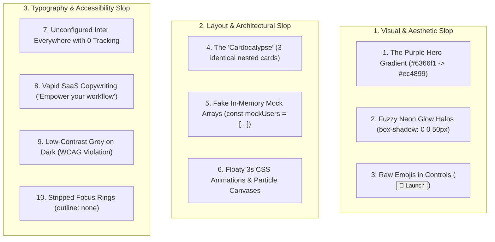

# The UI AI Slop Taxonomy & Craftsmanship Guide

> **Core Axiom**: *AI models generate the statistical average of their training data. Without deliberate constraints, they output identical purple gradients, nested card soups, and generic SaaS platitudes. Human-grade design is specific, intentional, and high-density.*

This reference catalogs the 10 most destructive "AI Slop" patterns in modern user interface engineering, providing root-cause analysis, visual anti-patterns, and concrete production remediations in Tailwind CSS v4 and React.

---

## The 10 AI Slop Anti-Patterns Matrix



---

## 1. The Purple-to-Indigo Hero Gradient

### The Slop Pattern
AI models default to purple/indigo gradients because early Tailwind UI and SaaS templates heavily featured them. It has become the universal signature of low-effort AI generation.

```tsx
// ❌ AI SLOP: The ubiquitous Midjourney/OpenAI purple hero gradient
<div className="bg-gradient-to-r from-purple-600 via-pink-500 to-indigo-600 p-12 text-white">
  <h1 className="text-5xl font-extrabold">Next-Gen Intelligence</h1>
</div>
```

### Production Craftsmanship Standard
Use deep, temperature-calibrated neutral surfaces (`zinc-950`, `slate-950`) with single-pixel specular highlights and subtle ambient lighting:

```tsx
// ✅ PRODUCTION: High-contrast neutral with physical specular edge highlight
<div className="relative bg-zinc-950 border border-zinc-800/80 p-12 rounded-3xl overflow-hidden shadow-2xl">
  <div 
    className="pointer-events-none absolute inset-x-0 top-0 h-px bg-gradient-to-r from-transparent via-zinc-400/20 to-transparent" 
    aria-hidden="true" 
  />
  <h1 className="text-4xl font-semibold tracking-tight text-zinc-100 font-sans">
    Real-Time Telemetry Pipeline
  </h1>
</div>
```

---

## 2. The "Cardocalypse" (3-Column Generic Grid)

### The Slop Pattern
Every concept is forced into a row of three rounded cards, each containing a generic Lucide/Heroicon, a 2-word title, and 2 lines of vague filler copy.

```tsx
// ❌ AI SLOP: Cookie-cutter 3-card soup
<div className="grid grid-cols-1 md:grid-cols-3 gap-6">
  <div className="p-6 bg-white/5 border border-white/10 rounded-2xl">
    <Sparkles className="w-6 h-6 text-purple-400" />
    <h3 className="font-bold mt-2">Fast Performance</h3>
    <p className="text-zinc-400 text-sm">Experience lightning-fast speeds with our optimized engine.</p>
  </div>
  {/* Duplicate 2 more times */}
</div>
```

### Production Craftsmanship Standard
Design asymmetric, functional layouts directly mapped to the domain's data hierarchy:
- Use data tables for multi-attribute dense records.
- Use horizontal stat strips for key metrics.
- Use split-view master-detail layouts for complex objects.

---

## 3. Raw Emojis in Controls

### The Slop Pattern
Inserting raw Unicode characters (`🚀`, `✨`, `🔥`, `⚙️`) into buttons, navigation links, and headings. Emojis render inconsistently across Apple, Android, Windows, and Linux, and lack scalable CSS vector styling.

```tsx
// ❌ AI SLOP: Raw emojis in interactive UI
<button className="px-4 py-2 bg-indigo-600 text-white rounded-lg">
  🚀 Launch App ✨
</button>
```

### Production Craftsmanship Standard
Import semantic Lucide SVG icons. Always attach `aria-hidden="true"` when paired with descriptive text, or provide explicit `aria-label` for icon-only buttons:

```tsx
// ✅ PRODUCTION: Scalable SVG vector icon with accessible attributes
import { Rocket } from "lucide-react";

<button
  type="button"
  className="inline-flex items-center gap-2 px-3.5 py-1.5 text-xs font-semibold text-zinc-950 bg-zinc-100 hover:bg-zinc-200 rounded-lg transition-colors focus-visible:outline-2 focus-visible:outline-offset-2 focus-visible:outline-zinc-400"
>
  <Rocket className="w-3.5 h-3.5 text-zinc-700" aria-hidden="true" />
  <span>Deploy Instance</span>
</button>
```

---

## 4. Fuzzy Neon Glow Halos

### The Slop Pattern
Applying massive multi-colored box shadows (`shadow-[0_0_50px_#a855f7]`) that lack realistic diffuse falloff, bleeding over surrounding content and looking amateurish.

```css
/* ❌ AI SLOP: Cartoonish neon glow */
.neon-glow {
  box-shadow: 0 0 40px rgba(168, 85, 247, 0.6);
}
```

### Production Craftsmanship Standard
Simulate physical light transport with multi-stop diffuse shadows and specular edge borders:

```css
/* ✅ PRODUCTION: Multi-tier physical shadow + specular hairline */
.physical-surface {
  background-color: rgba(24, 24, 27, 0.75);
  backdrop-filter: blur(24px) saturate(180%);
  border: 1px solid rgba(255, 255, 255, 0.08);
  box-shadow: 
    inset 0 1px 1px 0 rgba(255, 255, 255, 0.15),
    0 10px 20px -5px rgba(0, 0, 0, 0.4),
    0 20px 40px -15px rgba(0, 0, 0, 0.6);
}
```

---

## 5. Unconfigured Inter Everywhere (0 Tracking on Large Headings)

### The Slop Pattern
Setting `font-family: 'Inter', sans-serif;` with default letter spacing on large display headings. At large sizes (36px–72px), unconfigured Inter glyphs drift apart awkwardly.

### Production Craftsmanship Standard
- Apply **tight negative tracking** to headings:
  - 24px: `letter-spacing: -0.015em`
  - 36px: `letter-spacing: -0.025em`
  - 48px+: `letter-spacing: -0.035em`
- Enable OpenType stylistic sets for disambiguation:
  `font-feature-settings: "cv02", "cv03", "cv04", "cv11", "tnum";`

---

## 6. Vapid SaaS Copywriting Clichés

| Prohibited AI Slop Copy | Production Engineering Copy |
| :--- | :--- |
| "Build the future of work with revolutionary AI" | "Automated query profiling & index migration engine" |
| "Empower your team to achieve unprecedented velocity" | "Deploys multi-stage Docker containers with 5-gate CI/CD" |
| "Seamless and intuitive experience for modern enterprises" | "Sub-50ms p95 latency with Redis cluster caching" |
| "Unlock the power of your data" | "Exports telemetry in W3C TraceContext JSON format" |

---

## 7. Low-Contrast Grey on Dark (WCAG Violation)

### The Slop Pattern
Using `#71717a` (zinc-500) text on `#09090b` (zinc-950) backgrounds. This yields a contrast ratio of **2.8:1**, failing WCAG 2.2 AA (requires minimum 4.5:1 for body copy).

### Production Craftsmanship Standard
- **Primary Body Copy**: `zinc-100` (`#f4f4f5`) on `zinc-950` $\to$ **15.2:1** (WCAG AAA).
- **Secondary Subtitles**: `zinc-400` (`#a1a1aa`) on `zinc-950` $\to$ **6.8:1** (WCAG AA).
- **Muted Captions**: `zinc-400` minimum; never use `zinc-600` for functional text.

---

## 8. Stripped Focus States

### The Slop Pattern
`outline: none;` without replacement, rendering the interface completely unusable for keyboard and screen reader navigation.

### Production Craftsmanship Standard
```css
/* ✅ Accessible focus ring with 2px offset */
.accessible-focus:focus-visible {
  outline: 2px solid #a1a1aa;
  outline-offset: 2px;
}
```
