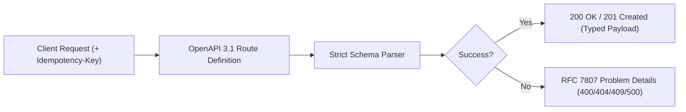

# API Contract Design & OpenAPI 3.1 (`/api-design`)

> **Philosophy**: *APIs are permanent contracts. Design first. Standardize errors with RFC 7807. Enforce idempotency on state-changing operations.*

This skill establishes API contract standards, RESTful resource modeling, OpenAPI 3.1 specifications, and uniform error semantics.

---

## 1. RESTful Contract Architecture



### Rule 1: RFC 7807 Problem Details Error Format
Every error response must follow the standard RFC 7807 schema (`application/problem+json`):
```json
{
  "type": "https://api.example.com/errors/resource-not-found",
  "title": "Resource Not Found",
  "status": 404,
  "detail": "User with ID 'usr_123' does not exist in the tenant workspace.",
  "instance": "/v1/users/usr_123",
  "code": "USER_NOT_FOUND"
}
```

### Rule 2: Idempotency Keys on Mutations
- State-changing mutations (especially financial transactions, payments, or critical entity creation) must accept an optional or mandatory `Idempotency-Key: <UUID>` header.
- Cached results for the key must be returned if replayed within a 24-hour TTL.

### Rule 3: Uniform Status Code Discipline
- `200 OK`: Successful read or update.
- `201 Created`: Entity successfully created (must return `Location` header or created object).
- `204 No Content`: Successful deletion with empty body.
- `400 Bad Request`: Validation failure.
- `401 Unauthorized`: Missing or invalid authentication token.
- `403 Forbidden`: Authenticated caller lacks RBAC permissions.
- `404 Not Found`: Target resource does not exist.
- `409 Conflict`: Unique constraint violation or concurrent mutation collision.
- `429 Too Many Requests`: Rate limit exhausted (must include `Retry-After` header).
- `500 Internal Server Error`: Unhandled server exception (never expose raw stack traces).

---

## 2. OpenAPI Specification Validator CLI

Validate OpenAPI specs against enterprise contract standards:
```bash
python3 skills/api-design/scripts/validate_openapi_spec.py --spec openapi.yaml
```
