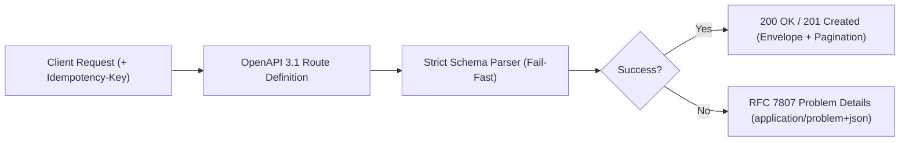

# API Contract Design & OpenAPI 3.1 (`/api-design`)

> **Philosophy**: *APIs are permanent contracts. Design first. Standardize errors with RFC 7807. Enforce idempotency on state-changing operations. Paginate with cursors, never unbounded offsets.*

This skill establishes API contract standards, RESTful resource modeling, OpenAPI 3.1 specifications, uniform error semantics, and backward-compatibility rules.

---

## 1. RESTful Contract Architecture



---

## 2. Core API Contract Standards

### 2.1 RFC 7807 Problem Details Error Envelope
Every error response must use Content-Type `application/problem+json`:

```json
{
  "type": "https://api.example.com/errors/resource-not-found",
  "title": "Resource Not Found",
  "status": 404,
  "detail": "User with ID 'usr_01HXYZ...' does not exist in the tenant workspace.",
  "instance": "/v1/users/usr_01HXYZ...",
  "code": "USER_NOT_FOUND",
  "timestamp": "2026-10-25T14:00:00Z"
}
```

### 2.2 Cursor-Based Pagination Standard
Never implement unbounded queries or naive offset-based pagination (`OFFSET 10000`) for large collections. Use cursor pagination:

```json
{
  "data": [
    { "id": "usr_01H1", "name": "Alice", "created_at": "2026-10-25T12:00:00Z" },
    { "id": "usr_01H2", "name": "Bob", "created_at": "2026-10-25T11:45:00Z" }
  ],
  "pagination": {
    "limit": 20,
    "has_more": true,
    "next_cursor": "ZXlKaGJHY2lPaUpTVXpVeE5pSXNJblI1Y0NJNklrcFhWQ0o5..."
  }
}
```

- Query Parameters: `?limit=20&cursor=<opaque_base64_string>`
- Cursor encoding: Opaque Base64 of `(sort_value, id)` tuple to guarantee stable deterministic sorting across insertions.

### 2.3 Idempotency Key Specification
- Header: `Idempotency-Key: <UUIDv4>`
- Required on all payment, checkout, reservation, or email dispatch endpoints.
- Server validates that replayed requests with the same key and same payload return the identical cached response without re-executing side effects.
- If payload differs for the same key, return `422 Unprocessable Entity` (`ERR_IDEMPOTENCY_PAYLOAD_MISMATCH`).

### 2.4 Status Code Hierarchy
- `200 OK`: Successful read or update mutation.
- `201 Created`: Resource created. Must include `Location: /v1/resources/{id}`.
- `204 No Content`: Successful delete with empty body.
- `400 Bad Request`: Schema validation failure.
- `401 Unauthorized`: Missing or expired token.
- `403 Forbidden`: Authenticated caller lacks permissions.
- `404 Not Found`: Target resource does not exist.
- `409 Conflict`: Unique constraint violation or state collision.
- `422 Unprocessable Entity`: Business logic invariant violation.
- `429 Too Many Requests`: Rate limit exhausted. Must include `Retry-After: <seconds>`.
- `500 Internal Server Error`: Server exception. Never leak stack traces.

---

## 3. Deprecation & Sunset Standards

When deprecating an API endpoint or version:
1. Announce deprecation at least 90 days prior to removal.
2. Emit standard HTTP deprecation headers on every response:
   - `Deprecation: @1735689600` (Unix timestamp of deprecation announcement)
   - `Sunset: Wed, 11 Nov 2026 00:00:00 GMT` (Date of scheduled turn-off)
   - `Link: <https://docs.example.com/migrations/v2>; rel="deprecation"`
3. Log usage metrics to identify clients still calling deprecated endpoints.

---

## 4. OpenAPI Specification Validator CLI

Validate OpenAPI 3.1 YAML/JSON specifications against contract rules:
```bash
python3 skills/api-design/scripts/validate_openapi_spec.py --spec openapi.yaml
```
Verifies:
- All routes have explicit `responses` with status codes.
- Error schemas reference RFC 7807 problem details structure.
- Mutation endpoints support `Idempotency-Key` headers where appropriate.
- Collections enforce pagination parameters.
