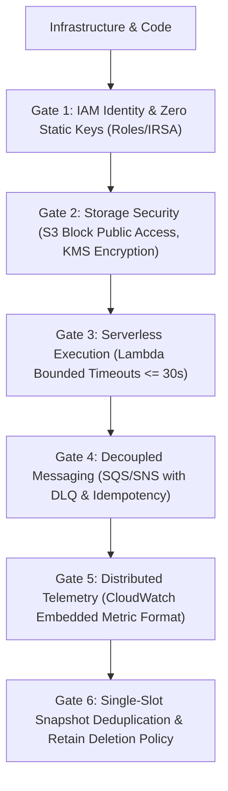

# Amazon Web Services Resilient Architecture (`/aws`)

> **Philosophy**: *Zero static access keys. Role-based execution via IAM Task Roles / IRSA. S3 private-by-default with KMS encryption. Bounded Lambda timeouts. Event-driven idempotency.*

This skill establishes defensive engineering standards for designing, deploying, and maintaining cloud infrastructure on **Amazon Web Services (AWS)**.

---

## 1. The Core AWS Architecture Gates



1. **Gate 1: IAM Identity & Zero Static Keys**: Prohibit long-lived `AKIA...` keys. Use **IAM Roles for Service Accounts (IRSA)** or **ECS Task Roles**.
2. **Gate 2: S3 Storage Hardening**: All S3 buckets must enforce `BlockPublicAcls`, `BlockPublicPolicy`, `IgnorePublicAcls`, and `RestrictPublicBuckets`. Encryption via AWS KMS must be enabled.
3. **Gate 3: Bounded Lambda Execution**: Lambda execution timeouts must be bounded ($\le 30\text{s}$ for API-facing functions). Functions must handle errors without hanging sockets.
4. **Gate 4: Asynchronous Messaging & DLQ**: SQS queues must configure a Dead-Letter Queue (DLQ) with max receive count $\le 5$ and message deduplication IDs (FIFO).
5. **Gate 5: Structured Telemetry**: Emit CloudWatch metrics using the Embedded Metric Format (EMF) rather than synchronous PutMetricData calls.
6. **Gate 6: Deduplicated Storage Backups & Sensitive Deletion Gate**:
   - Enforce `RemovalPolicy.RETAIN`, S3 `versioned: true`, and RDS/DynamoDB `deletionProtection: true` on all stateful constructs.
   - Coordinate backups via `.backups/backup_manifest.json` (`StateSha256` tag) so concurrent agents never create duplicate RDS/DynamoDB/S3 backup spam when state is unchanged.
   - Always halt and notify the user first before configuring `RemovalPolicy.DESTROY`, `force_destroy = true`, or deleting S3 buckets/DynamoDB tables.

---

## 2. Serverless Lambda & S3 Infrastructure (TypeScript CDK)

```typescript
import * as cdk from "aws-cdk-lib";
import * as s3 from "aws-cdk-lib/aws-s3";
import * as lambda from "aws-cdk-lib/aws-lambda";
import { Construct } from "constructs";

export class SecureStorageStack extends cdk.Stack {
  constructor(scope: Construct, id: string, props?: cdk.StackProps) {
    super(scope, id, props);

    // Private-by-default encrypted S3 bucket
    const secureBucket = new s3.Bucket(this, "ArtifactVault", {
      blockPublicAccess: s3.BlockPublicAccess.BLOCK_ALL,
      encryption: s3.BucketEncryption.S3_MANAGED,
      enforceSSL: true,
      versioned: true,
      removalPolicy: cdk.RemovalPolicy.RETAIN
    });

    // Bounded Lambda function
    const processor = new lambda.Function(this, "EventProcessor", {
      runtime: lambda.Runtime.NODEJS_20_X,
      handler: "index.handler",
      code: lambda.Code.fromAsset("dist"),
      timeout: cdk.Duration.seconds(15),
      memorySize: 512,
      environment: {
        BUCKET_NAME: secureBucket.bucketName
      }
    });

    secureBucket.grantReadWrite(processor);
  }
}
```

---

## 3. Defensive SQS Event Handling with Idempotency

```typescript
import type { SQSEvent, SQSBatchResponse } from "aws-lambda";

export async function handler(event: SQSEvent): Promise<SQSBatchResponse> {
  const batchItemFailures: { itemIdentifier: string }[] = [];

  for (const record of event.Records) {
    try {
      const payload = JSON.parse(record.body);
      const idempotencyKey = record.messageAttributes?.IdempotencyKey?.stringValue || record.messageId;

      await processTransaction(idempotencyKey, payload);
    } catch (err) {
      console.error(`Failed processing message ${record.messageId}:`, err);
      // Mark individual failed record for retry rather than failing entire batch
      batchItemFailures.push({ itemIdentifier: record.messageId });
    }
  }

  return { batchItemFailures };
}
```

---

## 4. AWS Hygiene & Security Verification CLI

Audit infrastructure definitions and code for static credentials and insecure storage configurations:

```bash
python3 skills/aws/scripts/verify_aws_hygiene.py --path . --strict
```

Audited Rules:
- `AWS-STATIC-ACCESS-KEY`: Detects hardcoded `AKIA...` access key IDs.
- `AWS-S3-PUBLIC-EXPOSURE`: Flags S3 buckets missing explicit public access blocks.
- `AWS-S3-UNENCRYPTED`: Flags S3 bucket declarations without server-side encryption.
- `AWS-LAMBDA-UNBOUNDED-TIMEOUT`: Warns on Lambda functions with timeouts $> 60\text{s}$ on API routes.
- `AWS-DESTRUCTIVE-REMOVAL-POLICY`: Flags `RemovalPolicy.DESTROY` or `force_destroy = true` on storage/database constructs without explicit user approval (`@user-approved-deletion`).
