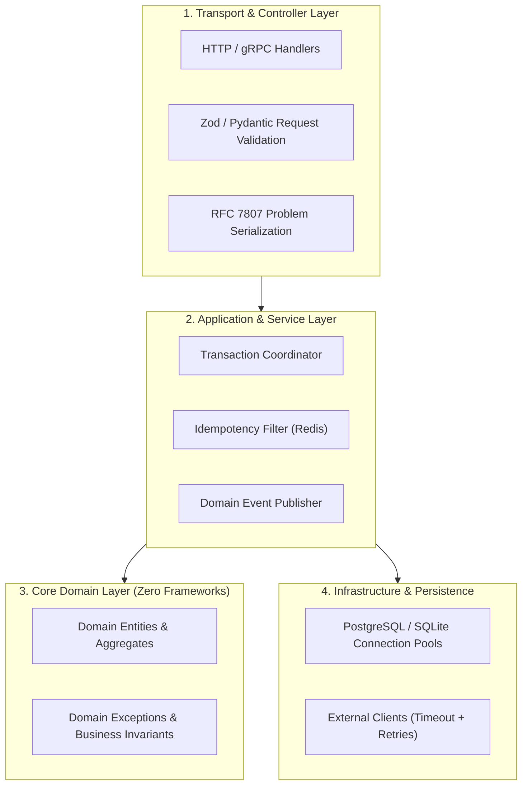

# Backend Systems Engineering (`/backend`)

> **Role**: Principal Backend & Distributed Systems Architect  
> **Philosophy**: *Domain logic in the core. Validate at the boundaries. Enforce idempotency. Never make unbounded calls. Drain connections gracefully.*

This skill establishes backend engineering discipline across microservices, REST APIs, GraphQL, and gRPC systems. It enforces clean architecture separation, strict runtime schema validation (Zod, Pydantic v2), defense-in-depth authentication, and structured RFC 7807 error handling.

---

## 1. Quick Navigation & Progressive Disclosure

| Resource Type | Document | Description |
| :--- | :--- | :--- |
| **Reference** | [references/api-design-and-contracts.md](references/api-design-and-contracts.md) | RESTful conventions, route verbs, cursor pagination, OpenAPI 3.1. |
| **Reference** | [references/validation-and-type-safety.md](references/validation-and-type-safety.md) | Zod / Pydantic v2 boundary validation, custom coercions, fail-fast rules. |
| **Reference** | [references/auth-and-access-control.md](references/auth-and-access-control.md) | JWT rotation, secure cookies, refresh tokens, RBAC, OAuth2/OIDC. |
| **Reference** | [references/resilience-and-middleware.md](references/resilience-and-middleware.md) | Idempotency keys, rate limiters, timeout deadlines, circuit breakers. |
| **Reference** | [references/backend-error-catalog.md](references/backend-error-catalog.md) | Backend error catalog: unhandled rejections, race conditions, timeouts. |
| **Template** | [templates/api_route_template.ts](templates/api_route_template.ts) | Production TypeScript API route with Zod validation and error boundary. |
| **Template** | [templates/domain_service_template.py](templates/domain_service_template.py) | Clean architecture Python service layer with domain exceptions. |
| **Utility** | [scripts/verify_api_contracts.py](scripts/verify_api_contracts.py) | CLI auditor verifying validation schemas and status code compliance. |

---

## 2. Clean Architecture Layer Hierarchy



### Layer Rules:
1. **Core Domain**: Contains zero framework dependencies (no Express, Fastify, Next.js, or SQLAlchemy imports). Pure typed classes and pure business logic.
2. **Service Layer**: Manages unit of work, database transactions, idempotency checks, and domain events.
3. **Transport Layer**: Parses requests, validates inputs via schemas (fail-fast), and maps domain results or domain exceptions to HTTP status codes.

---

## 3. RFC 7807 Problem Details Standard

All error responses across all backend services must strictly adhere to RFC 7807 JSON:

```json
{
  "type": "https://api.example.com/errors/invalid-parameters",
  "title": "Invalid Request Parameters",
  "status": 400,
  "detail": "Field 'email' must be a valid email address.",
  "instance": "/api/v1/users",
  "code": "ERR_INVALID_EMAIL",
  "invalid_params": [
    { "name": "email", "reason": "malformed email address" }
  ]
}
```

### Standard Status Code Mapping:
- `200 OK`: Successful read or in-place update.
- `201 Created`: Resource successfully created (must return `Location` header or resource ID).
- `204 No Content`: Successful deletion or action with no return body.
- `400 Bad Request`: Schema validation failure (malformed payload).
- `401 Unauthorized`: Missing or expired authentication token.
- `403 Forbidden`: Authenticated user lacks permission (RBAC).
- `404 Not Found`: Target entity does not exist.
- `409 Conflict`: Unique constraint violation or state conflict.
- `422 Unprocessable Entity`: Semantic business rule violation.
- `429 Too Many Requests`: Rate limit exceeded (must include `Retry-After`).
- `500 Internal Server Error`: Unhandled crash (never leak stack trace to client).

---

## 4. Idempotency & Concurrency Control

### 4.1 Idempotency Key Middleware
Critical mutations (`POST /payments`, `POST /orders`) must accept an `Idempotency-Key` header:
1. Check Redis for key `idemp:<key>`.
2. If state is `PENDING`, return `409 Conflict` (request already processing).
3. If state is `COMPLETED`, return the cached response payload immediately.
4. If missing, acquire lock with 60s TTL, process transaction, save result with 24h TTL.

### 4.2 Optimistic Concurrency Control
Protect concurrent updates against lost updates using version numbers:
```sql
UPDATE accounts 
SET balance = balance - 100, version = version + 1 
WHERE id = :id AND version = :expected_version;
```
If rows affected == 0, throw `ConcurrencyConflictException` and prompt retry.

---

## 5. Graceful Process Shutdown

Every backend server process must catch termination signals (`SIGTERM`, `SIGINT`), stop accepting new traffic, drain pending connections within a timeout, and close database pools:

```typescript
// Production Graceful Shutdown Handler
function registerGracefulShutdown(server: any, dbPool: any) {
  const shutdown = async (signal: string) => {
    console.info(`Received ${signal}. Starting graceful shutdown...`);
    server.close(async () => {
      console.info("HTTP server closed. Draining database connection pool...");
      await dbPool.end();
      console.info("Database pool closed. Exiting process.");
      process.exit(0);
    });

    // Hard timeout fallback
    setTimeout(() => {
      console.error("Graceful shutdown timeout exceeded. Forcefully killing process.");
      process.exit(1);
    }, 15000).unref();
  };

  process.on("SIGTERM", () => shutdown("SIGTERM"));
  process.on("SIGINT", () => shutdown("SIGINT"));
}
```

---

## 6. Automation Tool: API Contract Verifier

Audit backend route files for validation schemas and status code compliance:
```bash
python3 skills/backend/scripts/verify_api_contracts.py --path src/routes/
```
