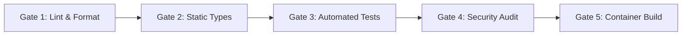

# Continuous Integration & Delivery (CI/CD) Architecture

Guidelines for establishing the 5-Gate automated testing and build pipeline in GitHub Actions.

---

## The 5 Gates of CI/CD

1. **Gate 1: Lint & Code Style**: Run formatters and linters (`eslint`, `ruff check`, `prettier --check`).
2. **Gate 2: Static Type Checking**: Full compiler verification (`tsc --noEmit`, `mypy`, `go vet`).
3. **Gate 3: Test Suites**: Run unit and integration tests with code coverage report.
4. **Gate 4: Dependency Security Audit**: Check for known CVEs (`npm audit --audit-level=high`, `pip-audit`, `trivy`).
5. **Gate 5: Container Build & Verification**: Build the multi-stage Docker container and verify exit status.
