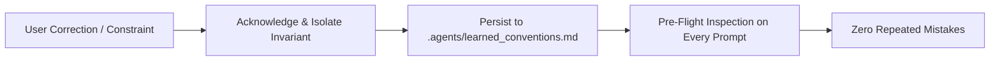

# Continuous Conversational Learning (`/continuous-learning`)

> **Philosophy**: *Mistakes happen once; repeating them is unacceptable. Absorb developer corrections immediately, record invariants to disk, and enforce them forever.*

This skill governs the Conversational Learning Protocol (CLP). It turns user corrections, preferred patterns, and architecture rules into persisted project invariants.

---

## 1. The Continuous Learning Cycle



### Rule 1: Immediate Memory Persistence
- When a user corrects a pattern (e.g. *"Use Tailwind v4 syntax"*, *"Never use Axios, use native fetch"*, *"Our DB IDs use prefix usr_"*), invoke `record_learning.py` immediately.
- Never rely solely on in-context memory. Persist to disk so future sessions and sub-agents inherit the rules.

### Rule 2: Invariant Structure
Every learned rule is stored with standard categorization and timestamps:
`- **[CATEGORY-001] (YYYY-MM-DD)**: <Concrete actionable invariant>`
- `UI`: Styling, tokens, icon preferences, font scales.
- `ARCH`: Framework choices, package prohibitions, layer boundaries.
- `API`: Response envelope formats, status code handling.
- `DATA`: Database migration tools, ID schemas, index requirements.
- `SEC`: Specific auth protocols, disallowed patterns.

---

## 2. Learning Recorder CLI

Record and query learned conventions:
```bash
# Record an invariant
python3 skills/continuous-learning/scripts/record_learning.py --category ARCH --text "Use native fetch over axios in all new modules"

# List all recorded conventions
python3 skills/continuous-learning/scripts/record_learning.py --list
```
