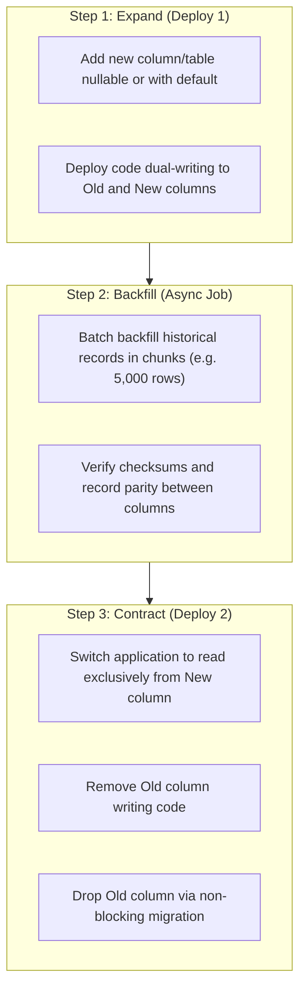

# Database & Datastore Engineering (`/database`)

> **Role**: Principal Database Architect & Data Engineer  
> **Philosophy**: *Data is the foundation. Index intentionally. Migrate without downtime. Guard ACID integrity. Keep transactions micro-short.*

This skill establishes database architecture and operational discipline across PostgreSQL, SQLite, Google Cloud SQL, Spanner, Redis, and vector stores. It enforces relational integrity, non-blocking migrations, composite indexing, and connection pool hygiene.

---

## 1. Quick Navigation & Progressive Disclosure

| Resource Type | Document | Description |
| :--- | :--- | :--- |
| **Reference** | [references/schema-design-and-normalization.md](references/schema-design-and-normalization.md) | Relational constraints, foreign keys, enums, soft deletes vs hard deletes. |
| **Reference** | [references/zero-downtime-migrations.md](references/zero-downtime-migrations.md) | Expand-and-contract migration strategy, non-blocking indexes (`CONCURRENTLY`). |
| **Reference** | [references/indexing-and-query-optimization.md](references/indexing-and-query-optimization.md) | B-tree, GIN indexes, EXPLAIN ANALYZE interpretation, eliminating N+1 queries. |
| **Reference** | [references/connection-pooling-and-transactions.md](references/connection-pooling-and-transactions.md) | PgBouncer configuration, isolation levels, lock minimization. |
| **Reference** | [references/database-error-catalog.md](references/database-error-catalog.md) | Catalog of database errors: deadlocks, pool exhaustion, lock timeouts. |
| **Template** | [templates/migration_expand_contract.sql](templates/migration_expand_contract.sql) | Production 3-step zero-downtime SQL migration template. |
| **Template** | [templates/drizzle_schema_template.ts](templates/drizzle_schema_template.ts) | Production Drizzle ORM schema with relations, indexes, and timestamps. |
| **Utility** | [scripts/verify_database_hygiene.py](scripts/verify_database_hygiene.py) | CLI auditor checking migrations for missing FK indexes and hazardous locks. |

---

## 2. Zero-Downtime Expand-and-Contract Migrations



### PostgreSQL Migration Guardrails:
1. **Never use `ALTER TABLE ... ADD COLUMN ... DEFAULT <expensive>`** without PG 11+ instant metadata defaults.
2. **Never create indexes synchronously** on production tables:
   ```sql
   -- ❌ HAZARDOUS: Locks table for writes
   CREATE INDEX idx_users_email ON users(email);

   -- ✅ PRODUCTION: Non-blocking background build
   CREATE INDEX CONCURRENTLY idx_users_email ON users(email);
   ```
3. **Always set lock timeouts** before running DDL migrations:
   ```sql
   SET lock_timeout = '3s';
   SET statement_timeout = '15s';
   ```

---

## 3. Index Optimization & N+1 Elimination

### 3.1 Index Types Decision Matrix
- **B-tree (Default)**: Equality (`=`), range (`<`, `>`, `BETWEEN`), sorting (`ORDER BY`).
- **GIN (Generalized Inverted Index)**: `JSONB` document paths, arrays, full-text search (`tsvector`).
- **Partial Index**: High cardinality sub-queries (e.g. `WHERE status = 'unprocessed'`). Saves 90%+ index memory.
- **Composite Index Order**: Equality columns first, range/sort columns second (`(tenant_id, created_at DESC)`).

### 3.2 Eliminating N+1 Query Anti-Patterns
```typescript
// ❌ ANTI-PATTERN: N+1 queries in loop
const users = await db.users.findMany();
for (const user of users) {
  user.posts = await db.posts.findMany({ where: { userId: user.id } }); // N queries!
}

// ✅ PRODUCTION: Single batch join or DataLoader
const usersWithPosts = await db.users.findMany({
  include: { posts: true } // Single JOIN or IN (...) query
});
```

---

## 4. Connection Pool Tuning

Unbounded connections exhaust server RAM and trigger `remaining connection slots are reserved for non-replication superuser connections`.

### Mathematical Pool Sizing Formula:
$$\text{Pool Size} = (\text{CPU Cores} \times 2) + \text{Disk Spindle Count}$$
For a 4-core cloud instance, pool size should be **8 to 12 connections per worker**, never hundreds.

### Safe Session Timeouts:
- `statement_timeout = '5000ms'` (kill runaway queries before consuming all worker threads)
- `idle_in_transaction_session_timeout = '10000ms'` (reclaim idle locked connections)

---

## 5. Automation Tool: Database Hygiene Verifier

Audit SQL migration scripts for hazardous locks or missing indexes:
```bash
python3 skills/database/scripts/verify_database_hygiene.py --path migrations/
```
