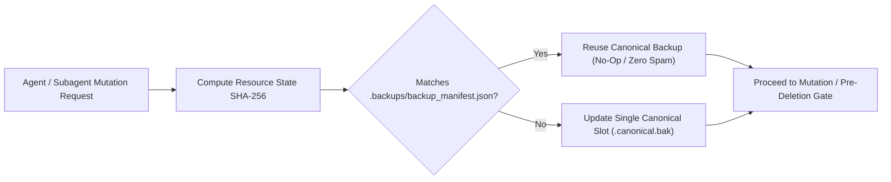

# Deduplicated Single-Slot Backups & Sensitive Deletion Guardrails

This reference defines the mandatory operational protocol for database, serverless, and cloud storage backups and destructive operation safeguards when one or more AI agents work simultaneously across `/database`, `/firebase`, `/supabase`, `/aws`, `/gcp`, `/data-pipelines`, and `/fullstack`.

---

## 1. The Zero-Spam Content-Addressable Backup Protocol

When multiple agents or iterative turns execute migrations, schema updates, or bulk mutations, naive backup logic creates redundant timestamped files (`db.bak.1`, `db.bak.2`, `backup_2026_copy.sql`), exhausting storage and polluting the repository.

### Core Rules:
1. **SHA-256 Content/Schema State Digest**: Before creating any backup, compute the SHA-256 digest of the current database file, SQL dump, schema directory, or storage state.
2. **Shared Manifest & Multi-Agent Lease Lock (`.backups/backup_manifest.json`)**:
   - All concurrent subagents inspect `.backups/backup_manifest.json` before running a backup.
   - If `last_state_sha256` for the target resource matches the current SHA-256 digest and the canonical backup file exists, the agent **skips creating a duplicate backup** (`status: "SKIPPED_DUPLICATE_HASH"`).
3. **Single Canonical Rolling Slot**:
   - Maintain a single canonical backup file per resource (`<resource_name>.canonical.bak`) inside `.backups/` (which must be gitignored).
   - Never litter the workspace with numbered or epoch-suffixed duplicate dumps (`*.bak.173000*`, `*_copy.sql`, `*_backup_2.sql`).



---

## 2. Cloud & Serverless Single-Slot Backup Matrix

| Platform / Skill | Canonical Backup Mechanism | Deduplication Key | Retention / Deletion Guardrail |
| :--- | :--- | :--- | :--- |
| **PostgreSQL / SQLite (`/database`)** | `manage_deduplicated_backup.py` / `pg_dump --clean` | SHA-256 of SQLite file or schema/data dump | Single rolling `.canonical.bak` slot; `SET lock_timeout = '3s'`. |
| **Firebase (`/firebase`)** | `gcloud firestore export gs://<bucket>/canonical-snapshot` | `backup_manifest.json` state digest + rules hash | `allow delete: if false;` (soft-delete via `deletedAt` timestamp). |
| **Supabase (`/supabase`)** | `supabase db dump -f .backups/supabase.canonical.sql` | SHA-256 of `supabase/migrations/` + dump | Mandatory RLS; explicit user approval before dropping tables or storage objects. |
| **AWS (`/aws`)** | S3 Object Versioning + RDS/DynamoDB tagged snapshot | Tag `StateSha256=<digest>` on AWS Backup vault | `RemovalPolicy.RETAIN`, `deletionProtection: true`, S3 `BlockPublicAccess.BLOCK_ALL`. |
| **GCP (`/gcp`)** | Cloud SQL automated PITR + single-slot GCS export | GCS object metadata `x-goog-meta-state-sha256` | `deletion_protection = true` on Cloud SQL/Spanner; GCS soft-delete policy. |

---

## 3. Sensitive Data & Destructive Deletion Gate (Tell the User First)

Agents are strictly prohibited from autonomously deleting, dropping, truncating, or purging sensitive data or stateful storage resources without explicit human-in-the-loop authorization.

### 3.1 Sensitivity Classification Tiers
- **Tier 1 — Critical Security & Identity**: `.env` files, secret keys, `auth.users`, IAM roles, refresh token vaults, audit logs.
- **Tier 2 — Production Tenant & Financial Data**: Customer tables, orders, invoices, Firestore user collections, S3/GCS customer buckets, Supabase `storage.objects`.
- **Tier 3 — Schema & Infrastructure State**: Database tables/columns (`DROP TABLE`, `DROP COLUMN`, `TRUNCATE`), Terraform state, Cloud SQL/RDS instances.

### 3.2 Mandatory Pre-Deletion User Disclosure Template
Before executing any hard deletion on Tier 1–3 resources, the agent MUST halt and present this exact disclosure to the user:

```markdown
> [!CAUTION]
> **Sensitive Deletion Confirmation Required**
> - **Target Resource**: `<table / collection / bucket / file path>`
> - **Operation**: `<DROP TABLE | TRUNCATE | DELETE | Bucket Purge | File Removal>`
> - **Sensitivity Tier**: `<Tier 1 / Tier 2 / Tier 3>`
> - **Estimated Impact Scope**: `<row count / document count / file size>`
> - **Verified Canonical Backup**: `<.backups/<name>.canonical.bak (SHA-256: <hash>)>`
> - **Safer Soft-Delete Alternative**: `<e.g., Add deleted_at TIMESTAMPTZ / RemovalPolicy.RETAIN>`
>
> Please confirm if you want me to proceed with this permanent deletion or use the soft-delete alternative.
```

### 3.3 SQL & IaC Approval Annotations
Once the user explicitly approves a hard deletion, annotate the migration or infrastructure file so automated CI/CD verifiers recognize the authorized exception:
- SQL migrations: `-- @user-approved-deletion` and `-- @verified-backup-sha256: <digest>`
- TypeScript / Terraform / Rules: `// @user-approved-deletion` or `# @user-approved-deletion`
