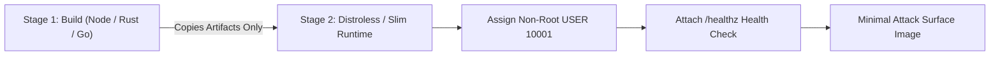
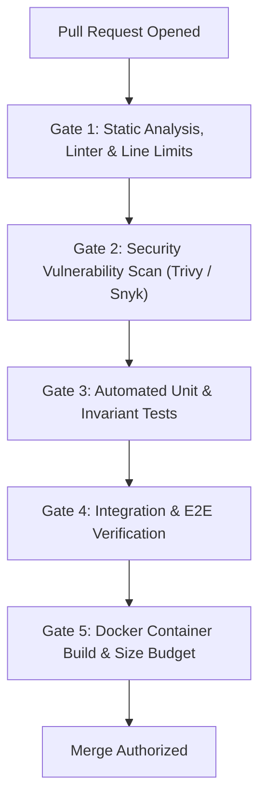

# Cloud, DevOps & Infrastructure Engineering (`/devops`)

> **Role**: Principal Cloud & SRE / Platform Engineer  
> **Philosophy**: *Infrastructure as Code. Principle of least privilege. Distroless non-root containers. Comprehensive telemetry. 5-gate pipeline quality.*

This skill establishes cloud infrastructure and DevOps discipline across Google Cloud Platform (GCP), AWS, Docker, Kubernetes, and GitHub Actions. It enforces multi-stage containerization, non-root security contexts, declarative IaC, automated 5-gate CI/CD pipelines, and structured telemetry.

---

## 1. Quick Navigation & Progressive Disclosure

| Resource Type | Document | Description |
| :--- | :--- | :--- |
| **Reference** | [references/cloud-architecture-and-gcp.md](references/cloud-architecture-and-gcp.md) | GCP Cloud Run, GKE, IAM least-privilege roles, Secret Manager. |
| **Reference** | [references/container-security-and-distroless.md](references/container-security-and-distroless.md) | Multi-stage builds, non-root security (`USER 10001`), minimal base images. |
| **Reference** | [references/observability-and-telemetry.md](references/observability-and-telemetry.md) | Structured JSON logging, OpenTelemetry distributed tracing, metrics. |
| **Reference** | [references/ci-cd-pipelines.md](references/ci-cd-pipelines.md) | 5-gate GitHub Actions CI pipeline architecture. |
| **Reference** | [references/cloud-error-catalog.md](references/cloud-error-catalog.md) | Catalog of cloud errors: OOMKilled, CrashLoopBackOff, IAM permissions. |
| **Template** | [templates/github_actions_reusable_workflow.yml](templates/github_actions_reusable_workflow.yml) | Production GitHub Actions CI/CD pipeline template. |
| **Template** | [templates/cloud_run_service.tf](templates/cloud_run_service.tf) | Production Terraform manifest for GCP Cloud Run with Secret Manager. |
| **Utility** | [scripts/verify_container_security.py](scripts/verify_container_security.py) | CLI auditor for Dockerfile security guardrails and non-root users. |

---

## 2. Hardened Multi-Stage Container Standard

Never deploy single-stage Docker containers with root UID 0 or build compilers in production. Follow the multi-stage non-root pattern:



### Production Dockerfile Template:
```dockerfile
# Stage 1: Dependency resolution and compilation
FROM node:20-alpine AS builder
WORKDIR /app
RUN apk add --no-cache libc6-compat
COPY package*.json ./
RUN npm ci --prefer-offline --no-audit
COPY . .
RUN npm run build && npm prune --production

# Stage 2: Minimal non-root production runtime
FROM gcr.io/distroless/nodejs20-debian12:nonroot AS runner
WORKDIR /app
ENV NODE_ENV=production
ENV PORT=8080

# Run as non-root user (distroless nonroot is UID 65532, custom alpine is UID 10001)
USER 65532:65532

COPY --from=builder /app/package.json ./
COPY --from=builder /app/node_modules ./node_modules
COPY --from=builder /app/dist ./dist

EXPOSE 8080
HEALTHCHECK --interval=30s --timeout=3s --retries=3 \
  CMD ["node", "-e", "fetch('http://localhost:8080/healthz').then(r => r.ok ? process.exit(0) : process.exit(1)).catch(() => process.exit(1))"]

CMD ["dist/server.js"]
```

---

## 3. The 5-Gate CI/CD Pipeline Standard

Every pull request must pass the 5 automated quality gates before merge authorization:



1. **Gate 1 - Static Analysis**: `check_source_line_limits.py`, ESLint, Prettier, TypeScript strict check (`tsc --noEmit`).
2. **Gate 2 - Security Audit**: `npm audit --audit-level=high`, secret scanner (`gitleaks`), container CVE scan.
3. **Gate 3 - Unit Testing**: Fast unit tests with code coverage thresholds (>= 80%).
4. **Gate 4 - Integration Testing**: Spin up database service containers, execute integration suites.
5. **Gate 5 - Container Verification**: Verify Docker build executes non-root, image size under budget (< 200MB).

---

## 4. Automation Tool: Container Security Verifier

Audit Dockerfiles and container configurations for security compliance:
```bash
python3 skills/devops/scripts/verify_container_security.py --path Dockerfile
```
Verifies:
- Explicit multi-stage build structure.
- Non-root user declaration (`USER <non-root-uid>`).
- Health check directive defined.
- Sensitive files excluded via `.dockerignore`.
