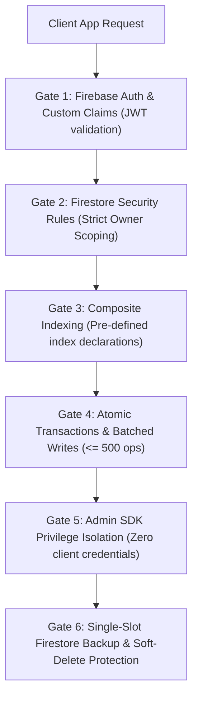

# Firebase Serverless, Firestore & Security Rules (`/firebase`)

> **Philosophy**: *Zero open security rules. Client SDKs are untrusted. Enforce request.auth scoping on every document. Batch writes capped at 500 ops. Atomic transactions for financial balances. Composite indexes for multi-field queries.*

This skill establishes defensive engineering standards for building and deploying applications backed by **Google Firebase** and **Cloud Firestore**.

---

## 1. Quick Navigation & Progressive Disclosure

| Resource Type | Document | Description |
| :--- | :--- | :--- |
| **Reference** | [references/firestore-schema-and-rules.md](references/firestore-schema-and-rules.md) | Subcollection design, denormalization patterns, hardened firestore.rules. |
| **Reference** | [references/firebase-auth-and-admin-sdk.md](references/firebase-auth-and-admin-sdk.md) | Session cookie validation, Admin SDK privilege isolation, ADC authentication. |
| **Utility** | [scripts/verify_firebase_rules.py](scripts/verify_firebase_rules.py) | Audits security rules for open access vulnerabilities, unbounded collections, and missing auth. |

---

## 2. The Core Firebase Architecture Gates



1. **Gate 1: Authentication & Custom Claims**: Verify identity on every client call. Use custom claims (`role`, `tenantId`) in JWT tokens for RBAC.
2. **Gate 2: Zero Open Security Rules**: Prohibit `allow read, write: if true;` under any circumstance. All document access must require `request.auth != null` and match `resource.data.userId == request.auth.uid`.
3. **Gate 3: Composite Indexing**: Declare multi-field queries in `firestore.indexes.json` before deployment to prevent runtime query rejections.
4. **Gate 4: Atomic Transactions & Batch Caps**: Mutating related balances or counters must use `db.runTransaction()`. Batched writes must never exceed the 500 document ceiling.
5. **Gate 5: Admin SDK Privilege Isolation**: Never bundle Firebase Admin SDK service account credentials in client or edge bundles.
6. **Gate 6: Deduplicated Single-Slot Exports & Sensitive Deletion Gate**:
   - Before deploying breaking `firestore.rules`, `storage.rules`, or bulk collection migrations, verify or update the single canonical backup slot via `manage_deduplicated_backup.py` or `gcloud firestore export gs://<bucket>/canonical-snapshot` keyed by the SHA-256 state hash in `.backups/backup_manifest.json` (zero spammy duplicate exports across concurrent agents).
   - Enforce `allow delete: if false;` (soft-deletes via `deletedAt` timestamp) on sensitive collections. Always halt and notify the user first before purging any Firestore collection or Firebase Storage bucket.

---

## 2. Hardened Firestore Security Rules (`firestore.rules`)

```javascript
rules_version = '2';
service cloud.firestore {
  match /databases/{database}/documents {

    // Helper functions
    function isAuthenticated() {
      return request.auth != null;
    }

    function isOwner(userId) {
      return isAuthenticated() && request.auth.uid == userId;
    }

    function isValidUserPayload() {
      return request.resource.data.keys().hasAll(['email', 'displayName', 'updatedAt'])
        && request.resource.data.email is string
        && request.resource.data.updatedAt == request.time;
    }

    // User profile collection
    match /users/{userId} {
      allow read: if isAuthenticated();
      allow create: if isOwner(userId) && isValidUserPayload();
      allow update: if isOwner(userId) && isValidUserPayload();
      allow delete: if false; // Soft deletes only
    }

    // Tenant-isolated documents
    match /tenants/{tenantId}/documents/{docId} {
      allow read, write: if isAuthenticated() && request.auth.token.tenantId == tenantId;
    }
  }
}
```

---

## 3. Atomic Transactions & Batch Size Hygiene (TypeScript)

```typescript
import { getFirestore, runTransaction, doc } from "firebase-admin/firestore";

const db = getFirestore();

export async function transferBalance(
  fromUserId: string,
  toUserId: string,
  amount: number
): Promise<void> {
  if (amount <= 0) throw new Error("Transfer amount must be positive");

  const fromRef = db.collection("wallets").doc(fromUserId);
  const toRef = db.collection("wallets").doc(toUserId);

  await runTransaction(db, async (transaction) => {
    const fromDoc = await transaction.get(fromRef);
    const toDoc = await transaction.get(toRef);

    if (!fromDoc.exists || !toDoc.exists) {
      throw new Error("One or both wallets not found");
    }

    const currentFromBalance = fromDoc.data()?.balance || 0;
    if (currentFromBalance < amount) {
      throw new Error("Insufficient funds");
    }

    transaction.update(fromRef, { balance: currentFromBalance - amount, updatedAt: new Date() });
    transaction.update(toRef, { balance: (toDoc.data()?.balance || 0) + amount, updatedAt: new Date() });
  });
}
```

---

## 4. Firebase Rules & Hygiene Verification CLI

Audit your repository for insecure Firestore security rules and exposed Admin SDK keys:

```bash
python3 skills/firebase/scripts/verify_firebase_rules.py --path . --strict
```

Audited Rules:
- `FIREBASE-OPEN-WILDCARD-RULE`: Flags open `allow read, write: if true;` rules.
- `FIREBASE-MISSING-AUTH-CHECK`: Flags mutation rules without `request.auth` checks.
- `FIREBASE-EXPOSED-ADMIN-KEY`: Flags committed `firebase-adminsdk` service account JSON keys.
- `FIREBASE-OVERSIZED-BATCH`: Flags unchunked batch operations exceeding 500 writes.
- `FIREBASE-UNSAFE-DELETE-RULE`: Flags unscoped `allow delete: if request.auth != null;` rules lacking owner/role verification or soft-delete protection.
