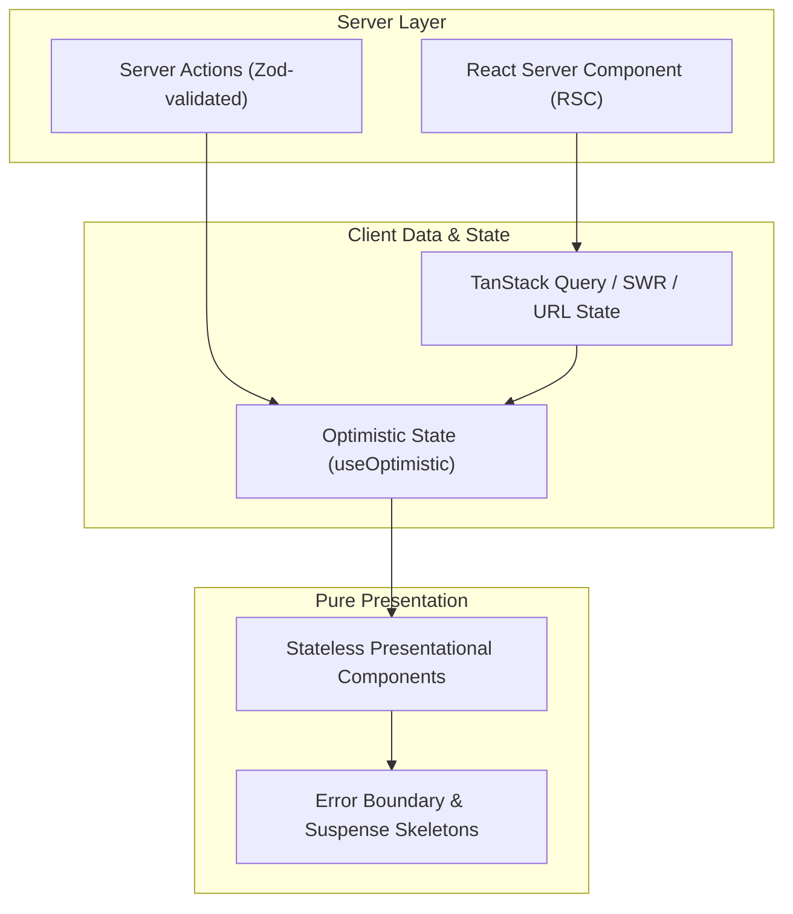

# Frontend Architecture & State Management (`/frontend`)

> **Philosophy**: *Keep components pure. Isolate side effects. Manage state deliberately. Handle errors at the boundary. Never leak business logic into render trees.*

This skill enforces high-performance client architecture across React 19, Next.js App Router, TypeScript, and modern web applications.

---

## 1. Architecture Tiers & Component Separation



### 1.1 Clean Boundary Separation Rules
1. **Server Components by Default**: In Next.js App Router, all components are React Server Components (RSC) unless interactive hooks (`useState`, `useEffect`, `useRef`, browser events) are strictly required.
2. **Push `"use client"` to the Leaves**: Never mark an entire page or large container `"use client"`. Wrap only the interactive controls (buttons, inputs, dropdowns) at the leaf nodes.
3. **Zero Inline Fetches in JSX**: Never trigger raw HTTP requests directly inside presentation components. Use dedicated hooks or server functions.

---

## 2. State Management Decision Matrix

Choose the simplest state layer appropriate for the data lifecycle:

| State Scope | Recommended Tool | Example Use Case | Anti-Pattern |
| :--- | :--- | :--- | :--- |
| **URL State** | `useSearchParams` / `nuqs` | Filters, pagination, active tab, modal open status | Duplicating URL search params into local `useState` |
| **Server Cache** | `TanStack Query` or RSC | API data, entity collections, cached user profiles | Storing API responses in Redux/Zustand without cache invalidation |
| **Interactive Form** | `React 19 Actions` + `useActionState` | Form submission, password updates, checkout flow | Managing 15 separate `useState` variables for inputs |
| **Client UI Global** | `Zustand` (minimal stores) | Theme preference, audio player state, active sidebar drawer | Putting massive complex database entities into global client store |
| **Local Ephemeral** | `useState` / `useReducer` | Dropdown open/close, hover tooltip, slider value | Passing down 5 levels of props instead of local state |

---

## 3. React 19 Server Actions & Optimistic Updates

Standardize form mutations using React 19 Actions and `useOptimistic`:

```tsx
"use client";

import { useActionState, useOptimistic, startTransition } from "react";
import { updateProfile } from "@/actions/profile";
import { UserCheck } from "lucide-react";

interface ProfileFormProps {
  initialName: string;
}

export function ProfileForm({ initialName }: ProfileFormProps) {
  const [state, formAction, isPending] = useActionState(updateProfile, { success: true, error: null });
  const [optimisticName, setOptimisticName] = useOptimistic(
    initialName,
    (current, newName: string) => newName
  );

  const handleSubmit = (formData: FormData) => {
    const nextName = formData.get("name") as string;
    startTransition(() => {
      setOptimisticName(nextName);
    });
    formAction(formData);
  };

  return (
    <form action={handleSubmit} className="flex flex-col gap-3 max-w-sm">
      <label htmlFor="name-input" className="text-xs font-medium text-zinc-300">
        Display Name (Current: {optimisticName})
      </label>
      <input
        id="name-input"
        name="name"
        defaultValue={initialName}
        disabled={isPending}
        className="px-3 py-1.5 bg-zinc-900 border border-zinc-800 rounded text-sm text-zinc-100 focus:outline-none focus:ring-2 focus:ring-zinc-400"
      />
      {state.error && <p className="text-xs text-rose-400">{state.error}</p>}
      <button
        type="submit"
        disabled={isPending}
        className="inline-flex items-center justify-center gap-2 px-3 py-1.5 bg-zinc-100 hover:bg-zinc-200 text-zinc-900 text-xs font-semibold rounded transition-colors disabled:opacity-50"
      >
        <UserCheck className="w-3.5 h-3.5" aria-hidden="true" />
        {isPending ? "Saving..." : "Save Changes"}
      </button>
    </form>
  );
}
```

---

## 4. Memory Safety & Effect Cleanup

Always wire an `AbortController` or cancellation signal to async operations inside `useEffect`:

```typescript
useEffect(() => {
  const controller = new AbortController();
  let isMounted = true;

  async function loadData() {
    try {
      const res = await fetch("/api/v1/metrics", { signal: controller.signal });
      if (!res.ok) throw new Error(`HTTP ${res.status}`);
      const data = await res.json();
      if (isMounted) setMetrics(data);
    } catch (err: unknown) {
      if ((err as Error).name !== "AbortError" && isMounted) {
        setError(err instanceof Error ? err.message : "Fetch failed");
      }
    }
  }

  loadData();
  return () => {
    isMounted = false;
    controller.abort();
  };
}, []);
```

---

## 5. Platform Domain Routing & Token Discipline

To eliminate token quota bloat and maintain sharp agent context fidelity:
- **Mobile Applications** (React Native, Flutter, Swift, Kotlin): Delegate presentation, touch targets (44x44pt/48x48dp), safe areas, and gesture springs strictly to [`/mobile-ui`](../mobile-ui/SKILL.md). Never inject web DOM CSS or container query rules into native mobile tasks.
- **Web Applications** (React 19, Next.js, Vue, Tailwind CSS): Delegate responsive layouts, Component-Level Container Queries (`@container`), CSS View Transitions, and fluid `clamp()` curves strictly to [`/web-ui`](../web-ui/SKILL.md). Never inject native SwiftUI or Compose Lookahead rules into web tasks.
- **Token Quota Rule**: Agents must never mount both `/mobile-ui` and `/web-ui` into the same prompt turn, saving up to ~1,850 tokens per turn.

---

## 6. Frontend Architecture Validator CLI

Scan frontend modules for architecture violations, inline fetches in JSX, and missing cleanup:
```bash
python3 skills/frontend/scripts/verify_frontend_architecture.py --path .
```
