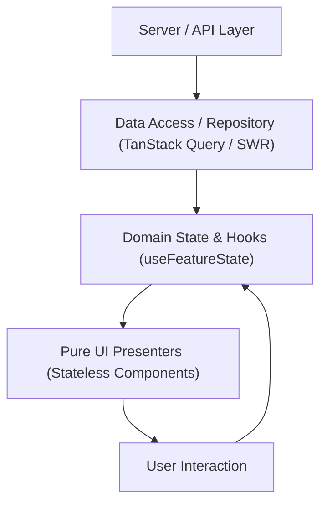

# Frontend Architecture & State Management (`/frontend`)

> **Philosophy**: *Keep components pure. Isolate side effects. Manage state deliberately. Handle errors at the boundary.*

This skill enforces high-performance client architecture across React 19, Next.js App Router, TypeScript, and Flutter.

---

## 1. Architecture Tiers & Component Separation



### Rule 1: Clean Boundary Separation
- **No Direct Fetching in Presentation**: Never trigger inline `fetch()` or `axios.get()` inside JSX render bodies. Encapsulate data fetching within dedicated query hooks or server components.
- **Server Components by Default**: In Next.js App Router, keep components as React Server Components (RSC) unless interactive hooks (`useState`, `useEffect`, `onClick`) are required. Place `"use client"` strictly at leaf nodes.

### Rule 2: Memory Safety & Effect Cleanup
- Always wire an `AbortController` or cancellation signal to async operations inside `useEffect`:
```typescript
useEffect(() => {
  const controller = new AbortController();
  async function loadData() {
    try {
      const res = await fetch("/api/v1/metrics", { signal: controller.signal });
      const data = await res.json();
      setMetrics(data);
    } catch (err: unknown) {
      if ((err as Error).name !== "AbortError") {
        setError(err instanceof Error ? err.message : "Fetch failed");
      }
    }
  }
  loadData();
  return () => controller.abort();
}, []);
```

### Rule 3: Error Boundaries & Fallback States
- Every route or primary feature widget must be wrapped in an `ErrorBoundary`.
- Display actionable, human-readable error messages with retry actions rather than unhandled white screens.

---

## 2. Frontend Architecture Validator CLI

Scan frontend modules for architecture violations:
```bash
python3 skills/frontend/scripts/verify_frontend_architecture.py --path .
```
