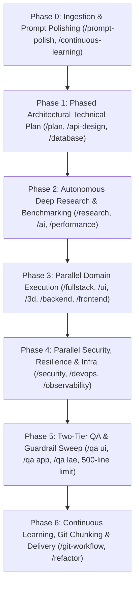
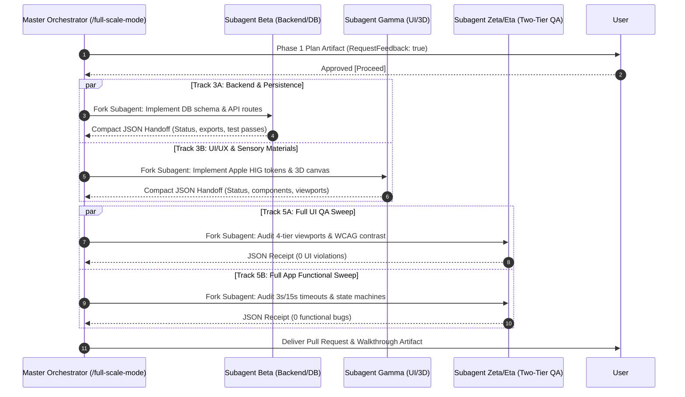

# Full-Scale Mode: Master Project Orchestration Engine (`/full-scale-mode`)

> **Role**: Master AI Systems Architect & Multi-Agent Conductor  
> **Philosophy**: *Understand deeply. Plan deliberately. Dispatch concurrently. Budget tokens relentlessly. Verify thoroughly. Deliver atomically.*

**Full-Scale Mode (`/full-scale-mode`)** is the apex orchestrator of the SkillBuilder ecosystem. It unifies all 22 modular engineering skills into an end-to-end, seven-phase project delivery lifecycle. It coordinates parallel subagent swarms across decoupled domain tracks while enforcing strict token budget ceilings, context compaction, and quality gates.

> ℹ️ **Backward Compatibility**: `/full-scale-mode` and `/world-class-engineering` are co-equal, fully interchangeable aliases. Both trigger the complete 7-phase EOS lifecycle.

---

## 1. Quick Navigation & Architectural Manuals

Consult the specialized manuals for in-depth execution protocols:

| Resource Type | Document | Description |
| :--- | :--- | :--- |
| **Reference** | [references/phased-project-execution-matrix.md](references/phased-project-execution-matrix.md) | Comprehensive 7-phase delivery lifecycle (Phase 0 to 6) with entry/exit gates. |
| **Reference** | [references/agent-orchestration-and-parallel-subagents.md](references/agent-orchestration-and-parallel-subagents.md) | Multi-agent swarm topology, role archetypes, and structured JSON handoffs. |
| **Reference** | [references/token-budget-and-context-management.md](references/token-budget-and-context-management.md) | Strict token optimization, context pruning, prompt compression, and compaction. |
| **Utility** | [scripts/verify_full_scale_orchestration.py](scripts/verify_full_scale_orchestration.py) | Standalone validator for phase plans, subagent token ceilings, and skill registry. |
| **Legacy Engine** | [../world-class-engineering/SKILL.md](../world-class-engineering/SKILL.md) | Original 6-phase EOS principles and 500-line source file policy guardrail. |

---

## 2. The 22-Skill Execution Catalogue

Full-Scale Mode serves as the central switchboard for all 22 specialized skills:

| Command | Skill Name | Phase Activated | Core Role in Full-Scale Mode |
| :--- | :--- | :--- | :--- |
| `/prompt-polish` | Prompt Refinement (PPE) | Phase 0 | Structures ambiguous prompts into an RFC-style specification matrix. |
| `/continuous-learning` | Conversational Learning (CLP) | Phase 0 & 6 | Ingests and persists project invariants to `.agents/learned_conventions.md`. |
| `/plan` | Technical Planning | Phase 1 | Generates interactive implementation plan artifact; halts for user sign-off. |
| `/api-design` | API Contract Design | Phase 1 & 3A | Enforces OpenAPI 3.1 specifications and RFC 7807 problem details. |
| `/database` | Database & Datastores | Phase 1 & 3A | Governs zero-downtime schema migrations (expand/contract) and ACID boundaries. |
| `/research` | Autonomous Research & Fallbacks | Phase 2 | Benchmarks alternative libraries using P.A.T.H.S. when dependencies fail. |
| `/ai` | AI & LLM Systems | Phase 2 & 3 | Manages Gemini SDK integration, structured JSON outputs, and tool calling. |
| `/performance` | Performance & Web Vitals | Phase 2 & 5 | Audits Core Web Vitals (LCP, CLS < 0.05, INP) and eliminates N+1 queries. |
| `/fullstack` | Fullstack Anti-Mock Delivery | Phase 3A | Builds complete vertical slices wired to real persistence; zero fake mock arrays. |
| `/backend` | Backend Systems | Phase 3A | Enforces Hexagonal architecture and runtime schema validation (Zod, Pydantic). |
| `/ui` | UI Design Systems & Tokens | Phase 3B | Implements Apple HIG tokens, Cupertino blur materials, and sub-pixel lighting. |
| `/3d` | 3D WebGL & Showcase | Phase 3B | Three.js / R3F engineering with PBR clearcoat shaders and Draco compression. |
| `/frontend` | Frontend Architecture | Phase 3B | Pure component isolation, React 19, Next.js, Flutter, and effect cleanup. |
| `/anti-slop` | Anti-AI-Slop Sanitizer | Phase 3B & 5C | Purges decorative shields, neon gradients, obvious comments, and raw emojis. |
| `/security` | Security Hardening | Phase 4A | OWASP Top 10 defense, SQL query parameterization, and zero committed secrets. |
| `/production-etiquette` | Production Etiquette | Phase 4A | Enforces 3s/15s network timeouts, jittered exponential backoff, and 300ms debounce. |
| `/devops` | Cloud & Container DevOps | Phase 4B | Hardened multi-stage Dockerfiles (`USER 10001`) and docker-compose. |
| `/observability` | Distributed Telemetry | Phase 4B | OpenTelemetry tracing and structured JSON logs with correlation IDs. |
| `/qa` | Two-Tier Quality Assurance | Phase 5A & 5B | Audits Full UI QA (`/qa ui`) and Full App Functional QA (`/qa app`). |
| `/world-class-engineering` | World-Class Engineering | Continuous | Enforces the 500-line physical source file limit and 7 Quality Gates. |
| `/refactor` | Safe Refactoring | Phase 6 | Decomposes files approaching the 500-line ceiling using Strangler Fig patterns. |
| `/git-workflow` | Git Workflow & Releases | Phase 6 | Enforces the 1,000-line commit budget, Conventional Commits, and semantic PRs. |

---

## 3. The 7-Phase Full-Scale Project Lifecycle

Every initiative progresses through these seven sequential phases:



### Mandatory Phase Gate Protocol:
1. **Phase 0 (Understand & Refine)**: Ingest prompt, extract implicit requirements, calculate estimated token budget ($chars / 3.8$).
2. **Phase 1 (Plan & Align)**: Author implementation plan artifact; **MUST** halt for user `[Proceed]` sign-off before modifying code.
3. **Phase 2 (Research & Benchmark)**: Evaluate dependencies using P.A.T.H.S.; build minimal working proof-of-concept.
4. **Phase 3 (Concurrent Build)**: Dispatch parallel subagents for Track 3A (Backend/DB) and Track 3B (UI/UX/3D).
5. **Phase 4 (Harden & Contain)**: Dispatch parallel subagents for Track 4A (Security/Resilience) and Track 4B (DevOps/Telemetry).
6. **Phase 5 (Verify & Catalog)**: Execute Two-Tier QA sweeps (`/qa ui` and `/qa app`) and 500-line source file checks.
7. **Phase 6 (Ship & Persist)**: Split commits strictly under the 1,000-line review budget, tag release (`vX.Y.Z`), author PR, and record learnings.

---

## 4. Parallel Subagent Swarm Orchestration

When tasks are decoupled across independent domains, dispatch specialized subagents in parallel:



---

## 5. Token Usage Awareness & Optimization Standards

To prevent context bloat and runaway token consumption, Full-Scale Mode enforces five **Strict Token Guardrails**:

1. **Prompt Payload Compression**: Subagent prompts use high-density engineering instructions; zero conversational pleasantries.
2. **Context Pruning & Targeted Slicing**: Provide only targeted line ranges (`file.ts#L10-L40`) and interfaces rather than entire repositories.
3. **Structured JSON Inter-Agent Payloads**: Subagents hand off findings via compact JSON receipts (`SubagentHandoffPayload`) rather than verbose essays, saving up to 85% generation tokens.
4. **Anti-Recomputation Symbol Cache**: The primary orchestrator maintains an in-memory symbol index; subagents query the cache rather than re-scanning disk.
5. **Context Compaction Trigger (`/compact`)**: If cumulative context consumption reaches $60\%$ of window capacity, intermediate execution steps are compressed into a crisp RFC state checkpoint.

---

## 6. Verification Tooling

Audit workspace readiness and orchestration integrity:
```bash
python3 skills/full-scale-mode/scripts/verify_full_scale_orchestration.py --path .
```
Verify the 500-line physical source limit across all files:
```bash
python3 skills/world-class-engineering/scripts/check_source_line_limits.py --path .
```
Verify token budget for any prompt or file:
```bash
python3 skills/ai/scripts/calculate_token_budget.py --file <file> --budget 1500
```
