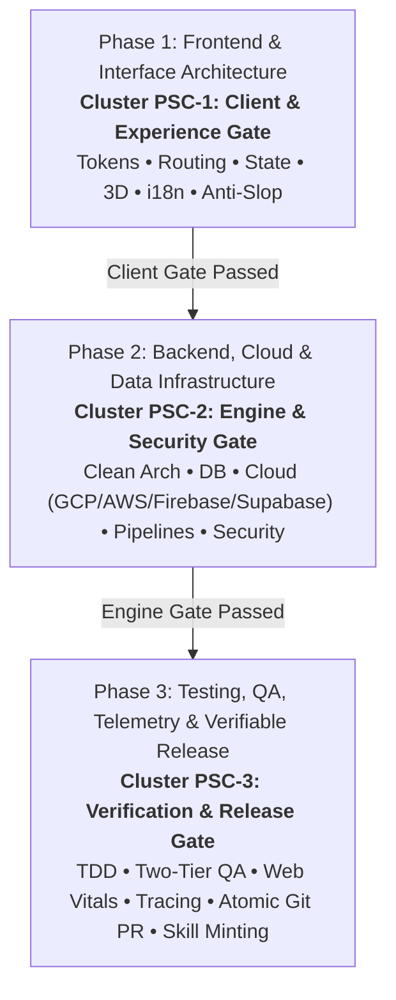

# Full-Scale Mode: Master Project Orchestration Engine (`/full-scale-mode`)

> **Role**: Master AI Systems Architect & Multi-Agent Conductor  
> **Philosophy**: *Understand deeply. Plan deliberately. Dispatch concurrently. Budget tokens relentlessly. Verify thoroughly. Deliver atomically.*

**Full-Scale Mode (`/full-scale-mode`)** is the apex orchestrator of the SkillBuilder ecosystem. It unifies all **32 modular engineering skills** into a streamlined, 3-phase project delivery lifecycle: the **3-Phase Triad Cadence (Frontend, Backend, Testing)**. It features **Autonomous Skill Resonance (ASR)** for contextual auto-activation and the **Skill Synthesis Protocol (SSP)** for minting custom project skills.

> ℹ️ **Backward Compatibility**: `/full-scale-mode` and `/world-class-engineering` are co-equal, fully interchangeable aliases. Both trigger the complete 3-Phase Triad Cadence.

---

## 1. The 3-Phase Triad Cadence

The Triad Cadence consolidates project execution into 3 synchronized, high-impact tiers:



### The Phase Skill Clusters (PSC):

| Phase | Core Objective | Triad Gateway Focus | Active Phase Skill Cluster (PSC) |
| :--- | :--- | :--- | :--- |
| **Phase 1: Frontend & Interface** | Apple HIG design tokens, file-based routing, client state machines, 3D WebGL, i18n, and prompt refinement. | Client & Experience Gate | `/frontend`, `/ui`, `/mobile-ui`, `/web-ui`, `/3d`, `/routing`, `/state-management`, `/i18n`, `/anti-slop`, `/prompt-polish` |
| **Phase 2: Backend & Infrastructure** | Hexagonal services, API contracts, real persistence, cloud runtimes, streaming pipelines, and security hardening. | Engine & Security Gate | `/backend`, `/fullstack`, `/api-design`, `/database`, `/gcp`, `/aws`, `/firebase`, `/supabase`, `/data-pipelines`, `/devops`, `/security`, `/ai`, `/local-llm`, `/research` |
| **Phase 3: Testing & Verifiable Release** | TDD test suites, Two-Tier QA (viewports & app resilience), Web Vitals, OpenTelemetry tracing, and atomic PR release. | Verification & Release Gate | `/testing`, `/qa`, `/performance`, `/observability`, `/production-etiquette`, `/git-workflow`, `/refactor`, `/continuous-learning`, `/project-skills`, `/world-class-engineering`, `/full-scale-mode` |

### Platform Domain Specialization (PDS) & Token Quota Preservation (TQP)
In Phase 1, the orchestrator classifies the target into **Mobile-First**, **Web-First**, or **Universal/Cross-Platform** to eliminate cross-platform token waste:
- **Mobile Targets** (iOS, Android, React Native, Expo, Flutter): Mounts `/mobile-ui` (SwiftUI `matchedGeometry`, Compose `LookaheadScope`, predictive back, springs, haptics) and **prunes** `/web-ui`, eliminating inapplicable CSS container queries and DOM view transitions to save $\approx 1,850$ tokens per subagent turn.
- **Web Targets** (React 19, Next.js, Vue, Tailwind, CSS): Mounts `/web-ui` (container queries `@container`, View Transitions API, OKLCH, `clamp()`) and **prunes** `/mobile-ui`, eliminating native mobile motion rules and CoreHaptics to save $\approx 1,850$ tokens per subagent turn.
- **Universal / Monorepos**: Partitions client delivery into decoupled subagent tracks (`Track 1A-Web` with `/web-ui` and `Track 1A-Mobile` with `/mobile-ui`), preventing mixed context bloat.

---

## 2. Autonomous Skill Resonance (ASR)

When invoking `/full-scale-mode`, the **Autonomous Skill Resonance (ASR)** engine scans project manifests to automatically sense and activate the relevant skills, while dynamically pruning cross-platform bloat:

- **Mobile Targets (`ios/`, `android/`, `app.json`, `pubspec.yaml`)** $\rightarrow$ Activates `/mobile-ui`, prunes `/web-ui`.
- **Web Targets (`tailwind.config.*`, `next.config.*`, `vite.config.*`, `styles/`)** $\rightarrow$ Activates `/web-ui`, prunes `/mobile-ui`.
- **Local LLM & Edge AI (`Modelfile`, `gguf`, `mlx`, `ollama`)** $\rightarrow$ Activates `/local-llm`.
- **Next.js / Remix / Flutter** $\rightarrow$ Activates `/routing`, `/frontend`, `/state-management`.
- **Google Cloud Run / GCS** $\rightarrow$ Activates `/gcp`, `/devops`.
- **AWS CDK / S3 / Lambda** $\rightarrow$ Activates `/aws`, `/devops`.
- **Firebase / Firestore** $\rightarrow$ Activates `/firebase`.
- **Supabase / PostgreSQL RLS** $\rightarrow$ Activates `/supabase`, `/database`.
- **ETL / DuckDB / Parquet** $\rightarrow$ Activates `/data-pipelines`.
- **Multi-Locale / RTL** $\rightarrow$ Activates `/i18n`.
- **All Projects** $\rightarrow$ Automatically engage Core Gates: `/prompt-polish`, `/qa`, `/security`, `/git-workflow`.

---

## 3. Project Skill Minting (PSM / SSP)

Through the **Skill Synthesis Protocol (SSP)** (`/project-skills`), the orchestrator inspects the active repository's custom patterns and mints a persistent project skill in `.agents/skills/<project-name>/SKILL.md`. This captures custom ORM patterns, tenant scoping logic, and project conventions for permanent agent memory.

---

## 4. The 35-Skill Execution Catalogue

| Skill Command | Domain Category | Primary Phase | Role in Full-Scale Mode |
| :--- | :--- | :--- | :--- |
| `/prompt-polish` | Metacognition | Phase 1 | Structures ambiguous prompts into unambiguous technical RFC specifications. |
| `/anti-slop` | Craftsmanship | Phase 1 | Eliminates decorative badges, neon gradients, obvious comments, and raw emojis. |
| `/ui` | Design Systems | Phase 1 | Apple HIG, Cupertino materials, sub-pixel lighting, and semantic Lucide SVGs. |
| `/mobile-ui` | Native Mobile | Phase 1 | iOS 18/19 HIG, SwiftUI matchedGeometry, Material 3 Expressive, and haptics. |
| `/web-ui` | Modern Web | Phase 1 | Container queries (@container), CSS View Transitions, OKLCH, and fluid clamp(). |
| `/3d` | Spatial Web | Phase 1 | Three.js and React Three Fiber with PBR shaders and 60fps frame budgets. |
| `/frontend` | Client Engine | Phase 1 | React 19, Next.js App Router, Flutter, and asynchronous effect cleanup. |
| `/routing` | Web Architecture | Phase 1 | Deep layout hierarchies, dynamic route boundaries, and pure page entrypoints. |
| `/state-management` | Data Flow | Phase 1 | Declarative state machines, TanStack Query key factories, and signals. |
| `/i18n` | Localization | Phase 1 | Multi-locale dictionaries, ICU MessageFormat, and bidirectional RTL mirroring. |
| `/backend` | Core Services | Phase 2 | Hexagonal architecture, domain models, and strict runtime validation. |
| `/fullstack` | Delivery | Phase 2 | Real vertical slices wired to actual persistence; zero mock data arrays. |
| `/api-design` | API Architecture | Phase 2 | OpenAPI 3.1 specifications and RFC 7807 Problem Details error contracts. |
| `/database` | Persistence | Phase 2 | Zero-downtime schema migrations (expand/contract) and ACID integrity. |
| `/gcp` | Cloud Platform | Phase 2 | Cloud Run serverless deployment, Pub/Sub, and Secret Manager hygiene. |
| `/aws` | Cloud Platform | Phase 2 | Resilient AWS serverless architectures, S3 public block, and IAM task roles. |
| `/firebase` | Serverless | Phase 2 | Firestore schema modeling, strict security rules, and atomic transactions. |
| `/supabase` | Cloud Backend | Phase 2 | PostgreSQL Row Level Security (RLS), Edge Functions, and vector search. |
| `/data-pipelines` | Data Eng | Phase 2 | Streaming ETL pipelines with backpressure, DuckDB, and dead-letter queues. |
| `/devops` | Infrastructure | Phase 2 | Hardened multi-stage non-root Dockerfiles (`USER 10001`) and CI/CD pipelines. |
| `/security` | Hardening | Phase 2 | OWASP Top 10, SSRF IP validation, token family rotation, and rate limits. |
| `/ai` | GenAI Systems | Phase 2 | Production Gemini SDK, structured JSON outputs, and defensive tool calling. |
| `/local-llm` | Edge AI | Phase 2 | Quantized local inference (GGUF Q4_K_M), MLX, WebLLM, GBNF, and hybrid routing. |
| `/research` | Discovery | Phase 2 | Autonomous deep research and package benchmarking via P.A.T.H.S. |
| `/testing` | Verification | Phase 3 | TDD discipline, Vitest, and Playwright E2E with accessible locators. |
| `/qa` | Quality Assurance | Phase 3 | Two-Tier QA: Full UI viewports (375px–1920px) and Full App Functional QA. |
| `/performance` | Optimization | Phase 3 | Core Web Vitals audits (LCP, CLS, INP) and elimination of N+1 database queries. |
| `/observability` | Telemetry | Phase 3 | OpenTelemetry distributed tracing and structured JSON logs with correlation IDs. |
| `/production-etiquette` | Reliability | Phase 3 | Explicit 3s/15s network timeouts, jittered exponential retries, and .env hygiene. |
| `/refactor` | Clean Code | Phase 3 | Safely decomposes modules approaching the 350-line warning zone via Strangler Fig. |
| `/git-workflow` | Delivery | Phase 3 | Enforces the 1,000-line commit budget, Conventional Commits, and semantic PRs. |
| `/continuous-learning` | Memory | Phase 3 | Persists project invariants and user corrections to `.agents/learned_conventions.md`. |
| `/project-skills` | Meta-Learning | Phase 3 | Mints persistent, tailored project skills into `.agents/skills/<repo>/SKILL.md`. |
| `/world-class-engineering` | Standards | Phase 3 | Strict 500-line physical ceiling, cognitive hygiene, and Triad Gateway sweeps. |
| `/full-scale-mode` | Orchestration | Phase 3 | Master Orchestration Engine unifying all 35 skills across the 3-Phase Cadence. |

---

## 5. Verification & Orchestration CLI

Audit workspace orchestration readiness, verify Autonomous Skill Resonance, and validate phase plans:

```bash
# Validate workspace orchestration and check ASR detected skills
python3 skills/full-scale-mode/scripts/verify_full_scale_orchestration.py --path .

# Verify 500-line source file limit across all 35 skills
python3 skills/world-class-engineering/scripts/check_source_line_limits.py --path . --show-tiers
```
