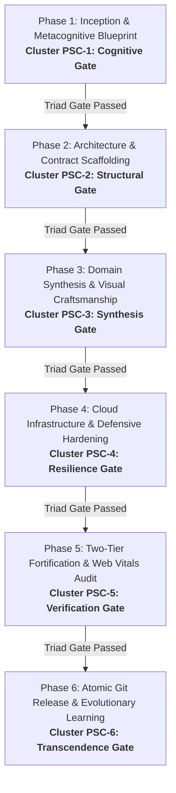

# Full-Scale Mode: Master Project Orchestration Engine (`/full-scale-mode`)

> **Role**: Master AI Systems Architect & Multi-Agent Conductor  
> **Philosophy**: *Understand deeply. Plan deliberately. Dispatch concurrently. Budget tokens relentlessly. Verify thoroughly. Deliver atomically.*

**Full-Scale Mode (`/full-scale-mode`)** is the apex orchestrator of the SkillBuilder ecosystem. It unifies all **32 modular engineering skills** into an end-to-end project delivery lifecycle: the **Omni-Phase Cadence (OPC)**. It features **Autonomous Skill Resonance (ASR)** for contextual auto-activation and the **Skill Synthesis Protocol (SSP)** for minting custom project skills.

> ℹ️ **Backward Compatibility**: `/full-scale-mode` and `/world-class-engineering` are co-equal, fully interchangeable aliases. Both trigger the complete Omni-Phase Cadence.

---

## 1. The Omni-Phase Cadence (OPC)

The Omni-Phase Cadence governs every project initiative—whether building from scratch, refactoring monoliths, or hardening cloud infrastructure:



### The Phase Skill Clusters (PSC):

| Phase | Core Objective | Triad Gateway Focus | Active Phase Skill Cluster (PSC) |
| :--- | :--- | :--- | :--- |
| **Phase 1: Inception & Blueprint** | Prompt refinement, technology benchmarking, and project skill minting. | Cognitive Gate | `/prompt-polish`, `/research`, `/project-skills` |
| **Phase 2: Architecture & Contracts** | OpenAPI 3.1 contracts, layout routing, and zero-downtime schemas. | Structural Gate | `/api-design`, `/routing`, `/database`, `/supabase`, `/firebase` |
| **Phase 3: Domain Synthesis** | Real vertical slices, Apple HIG tactile UI, state machines, and i18n. | Synthesis Gate | `/backend`, `/frontend`, `/fullstack`, `/ui`, `/state-management`, `/3d`, `/i18n` |
| **Phase 4: Cloud & Resilience** | OWASP Top 10, SSRF defense, rate limits, non-root containers, and cloud ingress. | Resilience Gate | `/security`, `/devops`, `/gcp`, `/aws`, `/production-etiquette`, `/data-pipelines` |
| **Phase 5: Two-Tier Fortification** | TDD suites, 4-tier responsive QA (375px–1920px), Core Web Vitals, and anti-slop. | Verification Gate | `/testing`, `/qa`, `/performance`, `/anti-slop`, `/observability` |
| **Phase 6: Atomic Release** | 1,000-line commit chunking, PR authoring, and conversational learning. | Transcendence Gate | `/git-workflow`, `/refactor`, `/continuous-learning`, `/world-class-engineering` |

---

## 2. Autonomous Skill Resonance (ASR)

When invoking `/full-scale-mode`, the **Autonomous Skill Resonance (ASR)** engine scans project manifests to automatically sense and activate the relevant skills:

- **Next.js / Remix / Flutter** $\rightarrow$ Activates `/routing`, `/frontend`, `/state-management`.
- **Google Cloud Run / GCS** $\rightarrow$ Activates `/gcp`, `/devops`.
- **AWS CDK / S3 / Lambda** $\rightarrow$ Activates `/aws`, `/devops`.
- **Firebase / Firestore** $\rightarrow$ Activates `/firebase`.
- **Supabase / PostgreSQL RLS** $\rightarrow$ Activates `/supabase`, `/database`.
- **ETL / DuckDB / Parquet** $\rightarrow$ Activates `/data-pipelines`.
- **Multi-Locale / RTL** $\rightarrow$ Activates `/i18n`.
- **All Projects** $\rightarrow$ Automatically engage Core Gates: `/prompt-polish`, `/qa`, `/security`, `/git-workflow`.

---

## 3. Project Skill Minting (PSM / SSP)

Through the **Skill Synthesis Protocol (SSP)** (`/project-skills`), the orchestrator inspects the active repository's custom patterns and mints a persistent project skill in `.agents/skills/<project-name>/SKILL.md`. This captures custom ORM patterns, tenant scoping logic, and project conventions for permanent agent memory.

---

## 4. The 32-Skill Execution Catalogue

| Skill Command | Domain Category | Primary Phase | Role in Full-Scale Mode |
| :--- | :--- | :--- | :--- |
| `/prompt-polish` | Metacognition | Phase 1 | Structures ambiguous prompts into unambiguous technical RFC specifications. |
| `/research` | Discovery | Phase 1 | Autonomous deep research and package benchmarking via P.A.T.H.S. |
| `/project-skills` | Meta-Learning | Phase 1 | Mints persistent, tailored project skills into `.agents/skills/<repo>/SKILL.md`. |
| `/api-design` | API Architecture | Phase 2 | OpenAPI 3.1 specifications and RFC 7807 Problem Details error contracts. |
| `/routing` | Web Architecture | Phase 2 | Deep layout hierarchies, dynamic route boundaries, and pure page entrypoints. |
| `/database` | Persistence | Phase 2 | Zero-downtime schema migrations (expand/contract) and ACID integrity. |
| `/supabase` | Cloud Backend | Phase 2 | PostgreSQL Row Level Security (RLS), Edge Functions, and vector search. |
| `/firebase` | Serverless | Phase 2 | Firestore schema modeling, strict security rules, and atomic transactions. |
| `/backend` | Core Services | Phase 3 | Hexagonal architecture, domain models, and strict runtime validation. |
| `/frontend` | Client Engine | Phase 3 | React 19, Next.js App Router, Flutter, and asynchronous effect cleanup. |
| `/fullstack` | Delivery | Phase 3 | Real vertical slices wired to actual persistence; zero mock data arrays. |
| `/ui` | Design Systems | Phase 3 | Apple HIG, Cupertino materials, sub-pixel lighting, and semantic Lucide SVGs. |
| `/state-management` | Data Flow | Phase 3 | Declarative state machines, TanStack Query key factories, and signals. |
| `/3d` | Spatial Web | Phase 3 | Three.js and React Three Fiber with PBR shaders and 60fps frame budgets. |
| `/i18n` | Localization | Phase 3 | Multi-locale dictionaries, ICU MessageFormat, and bidirectional RTL mirroring. |
| `/ai` | GenAI Systems | Phase 3 | Production Gemini SDK, structured JSON outputs, and defensive tool calling. |
| `/security` | Hardening | Phase 4 | OWASP Top 10, SSRF IP validation, token family rotation, and rate limits. |
| `/devops` | Infrastructure | Phase 4 | Hardened multi-stage non-root Dockerfiles (`USER 10001`) and CI/CD pipelines. |
| `/gcp` | Cloud Platform | Phase 4 | Cloud Run serverless deployment, Pub/Sub, and Secret Manager hygiene. |
| `/aws` | Cloud Platform | Phase 4 | Resilient AWS serverless architectures, S3 public block, and IAM task roles. |
| `/production-etiquette` | Reliability | Phase 4 | Explicit 3s/15s network timeouts, jittered exponential retries, and .env hygiene. |
| `/data-pipelines` | Data Eng | Phase 4 | Streaming ETL pipelines with backpressure, DuckDB, and dead-letter queues. |
| `/testing` | Verification | Phase 5 | TDD discipline, Vitest, and Playwright E2E with accessible locators. |
| `/qa` | Quality Assurance | Phase 5 | Two-Tier QA: Full UI viewports (375px–1920px) and Full App Functional QA. |
| `/performance` | Optimization | Phase 5 | Core Web Vitals audits (LCP, CLS, INP) and elimination of N+1 database queries. |
| `/anti-slop` | Craftsmanship | Phase 5 | Eliminates decorative badges, neon gradients, obvious comments, and raw emojis. |
| `/observability` | Telemetry | Phase 5 | OpenTelemetry distributed tracing and structured JSON logs with correlation IDs. |
| `/git-workflow` | Delivery | Phase 6 | Enforces the 1,000-line commit budget, Conventional Commits, and semantic PRs. |
| `/refactor` | Clean Code | Phase 6 | Safely decomposes modules approaching the 350-line warning zone via Strangler Fig. |
| `/continuous-learning` | Memory | Phase 6 | Persists project invariants and user corrections to `.agents/learned_conventions.md`. |
| `/world-class-engineering` | Standards | Continuous | Strict 500-line physical ceiling, cognitive hygiene, and Triad Gateway sweeps. |

---

## 5. Verification & Orchestration CLI

Audit workspace orchestration readiness, verify Autonomous Skill Resonance, and validate phase plans:

```bash
# Validate workspace orchestration and check ASR detected skills
python3 skills/full-scale-mode/scripts/verify_full_scale_orchestration.py --path .

# Verify 500-line source file limit across all 32 skills
python3 skills/world-class-engineering/scripts/check_source_line_limits.py --path . --show-tiers
```
