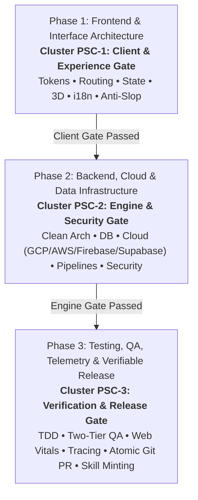

# Full-Scale Mode: Master Project Orchestration Engine (`/full-scale-mode`)

> **Role**: Master AI Systems Architect & Multi-Agent Conductor  
> **Philosophy**: *Understand deeply. Plan deliberately. Dispatch concurrently. Budget tokens relentlessly. Harness continuously. Deliver atomically.*

**Full-Scale Mode (`/full-scale-mode`)** is the apex orchestrator of the SkillBuilder ecosystem. It unifies all **36 modular engineering skills** into a structured, closed-loop delivery engine featuring:
1. **The 5-Stage Delivery Lifecycle**: `Discover` $\rightarrow$ `Plan` $\rightarrow$ `Build` $\rightarrow$ `Verify & Harness Loop` $\rightarrow$ `Release`.
2. **Orchestration Memory Subsystem**: Active session tracking, milestone progression, and multi-agent coordination via `.agents/memory/orchestration_state.json`.
3. **Multi-Tier Harness Engineering & Bounded Self-Healing Loop**: 5 verification tiers with automated error diagnostics and regression-free remediation (up to 3 loop iterations).
4. **The 3-Phase Triad Cadence**: Structured domain execution (Frontend, Backend, Testing) with **Autonomous Skill Resonance (ASR)** and **Platform Domain Specialization (PDS)**.
5. **Deduplicated Storage Backups & Sensitive Deletion Gate**: SHA-256 single-slot backups and human-in-the-loop protection against destructive mutations.

> ℹ️ **Backward Compatibility**: `/full-scale-mode` and `/world-class-engineering` are co-equal, fully interchangeable aliases. Both trigger the complete structured lifecycle.

---

## 1. The 5-Stage Delivery Lifecycle

Every project delivered under Full-Scale Mode advances through five discrete, verifiable stages:

```mermaid
flowchart LR
    S1["Stage 1: Discover & Recall<br/><b>Manifests • Invariants • ASR</b>"]
    S2["Stage 2: Plan & Blueprint<br/><b>RFC • Boundaries • Contracts</b>"]
    S3["Stage 3: Build & Execution<br/><b>Triad Cadence (P1 • P2 • P3)</b>"]
    S4["Stage 4: Harness & Loop<br/><b>5 Tiers • Self-Healing Loop</b>"]
    S5["Stage 5: Release & Consolidate<br/><b>Memory • PR • Walkthrough</b>"]

    S1 --> S2 --> S3 --> S4 --> S5
    S4 -.->|Loop on Failure (Max 3x)| S3
```

1. **Stage 1: Discover & Memory Recall (`stage:discover`)**:
   - Introspect repository manifests, run Autonomous Skill Resonance (ASR), and detect platform target (`mobile`, `web`, `universal`).
   - Initialize active session memory in `.agents/memory/orchestration_state.json`.
   - Recall project conventions and architectural invariants from `.agents/learned_conventions.md`.
2. **Stage 2: Plan & Architectural Blueprint (`stage:plan`)**:
   - Structure prompt into token-efficient RFC technical specifications (`/prompt-polish`).
   - Define non-overlapping file ownership boundaries per subagent track.
   - Establish data models, API contracts (`/api-design`), and milestone checklists.
3. **Stage 3: Build & Atomic Execution (`stage:build`)**:
   - Execute domain tracks across the 3-Phase Triad Cadence (Frontend, Backend, Testing).
   - Strict Anti-Slop mandate: zero fake mocks, real persistence (`/fullstack`), Apple HIG/tokens (`/ui`), and cognitive line hygiene ($\le 500$ lines/file, $\le 40$ lines/func).
   - Single-slot SHA-256 deduplicated backups before mutating storage (`manage_deduplicated_backup.py`).
4. **Stage 4: Verify & Harness Loop (`stage:verify` / `stage:loop`)**:
   - Run the 5-Tier Evaluation Harness (`orchestration_harness.py`).
   - If violations emerge, trigger the **Autonomous Self-Healing Loop**: diagnose error signature $\rightarrow$ apply targeted atomic patch $\rightarrow$ re-run full harness (max 3 iterations).
5. **Stage 5: Release & Memory Consolidation (`stage:release`)**:
   - Consolidate session memory and log learned conventions to `.agents/learned_conventions.md`.
   - Mint or update repository-specific project skills (`.agents/skills/<repo>/SKILL.md`) via SSP.
   - Author multi-line conventional commits within 1,000-line budget, push tracking branch, and open ready-to-merge GitHub Pull Request.

---

## 2. Orchestration Memory Subsystem (`.agents/memory/`)

Full-Scale Mode maintains active execution memory in `.agents/memory/orchestration_state.json`:

```json
{
  "version": "1.0.0",
  "session_id": "sess-prod-01",
  "current_stage": "BUILD",
  "triad_phase": "PHASE_2_BACKEND",
  "platform_target": "web",
  "milestones": [
    { "id": "M-DISCOVER", "title": "Stage 1: Discover & Memory Recall", "status": "COMPLETED" },
    { "id": "M-PLAN", "title": "Stage 2: Plan & Blueprint", "status": "COMPLETED" },
    { "id": "M-BUILD", "title": "Stage 3: Build & Execution", "status": "IN_PROGRESS" },
    { "id": "M-VERIFY", "title": "Stage 4: Verify & Harness", "status": "PENDING" },
    { "id": "M-RELEASE", "title": "Stage 5: Release & Consolidate", "status": "PENDING" }
  ],
  "file_registry": { "created": [], "modified": [] },
  "backup_digest": null,
  "harness_history": []
}
```

- **CLI Tool**: `skills/full-scale-mode/scripts/manage_orchestration_memory.py`
  - `init`: Scaffolds a new session memory state.
  - `checkpoint`: Updates active stage, triad phase, touched files, or token consumption.
  - `milestone`: Records completion of lifecycle milestones.
  - `status`: Emits an active status dashboard.
  - `advance`: Advances through lifecycle stages deterministically.

---

## 3. Multi-Tier Harness Engineering & Bounded Self-Healing Loop

The evaluation harness (`skills/full-scale-mode/scripts/orchestration_harness.py`) enforces 5 verification tiers:

| Tier | Scope | Invariant Validations |
| :--- | :--- | :--- |
| **Tier 1: Static Hygiene** | Architecture | 500-line physical limit, anti-slop rules (no shields, neon gradients, obvious comments), prompt token budgets. |
| **Tier 2: Contracts** | Interfaces | OpenAPI 3.1 contracts, RFC 7807 problem details, Python/TypeScript syntax integrity. |
| **Tier 3: Functional** | TDD Suites | Automated unit and integration tests, semantic ARIA locators, 100% green test assertions. |
| **Tier 4: Security** | Hardening | Zero hardcoded secrets, SQL parameterization, SSRF protection, non-root Docker (`USER 10001`), backup digests. |
| **Tier 5: Git Delivery** | Releases | Conventional branch prefixes (`feat/`, `fix/`, `refactor/`), commit line budget (<1,000 lines). |

### Autonomous Self-Healing Loop:
When any tier fails:
1. Emits structured diagnostic `{ tier, rule, file, message, remediation_hint }`.
2. Applies targeted atomic patch (zero mock bypasses, zero `@ts-ignore` comments).
3. Re-runs full harness from Tier 1 forward to guarantee regression-free convergence.
4. Bounded limit: **Maximum 3 iterations**. If unresolvable, halts with an actionable Human Escalation Report.

---

## 4. The 3-Phase Triad Cadence (Execution Core)

Within **Stage 3 (Build)**, work executes across the 3 synchronized domain tiers:



### Platform Domain Specialization (PDS) & Token Quota Preservation (TQP):
- **Mobile Targets** (iOS, Android, React Native, Flutter): Mounts `/mobile-ui` (SwiftUI `matchedGeometry`, Compose `LookaheadScope`, haptics) and prunes `/web-ui`, saving $\approx 1,850$ tokens per subagent turn.
- **Web Targets** (React 19, Next.js, Vue, Tailwind): Mounts `/web-ui` (container queries `@container`, View Transitions, OKLCH) and prunes `/mobile-ui`, saving $\approx 1,850$ tokens per subagent turn.
- **Universal Targets**: Partitions client work into decoupled subagent tracks (`Track 1A-Web` vs `Track 1A-Mobile`).

---

## 5. Autonomous Skill Resonance (ASR)

ASR automatically detects project patterns and dynamically activates resonant skills:
- **Mobile (`ios/`, `android/`, `app.json`, `pubspec.yaml`)** $\rightarrow$ Activates `/mobile-ui`, prunes `/web-ui`.
- **Web (`tailwind.config.*`, `next.config.*`, `vite.config.*`)** $\rightarrow$ Activates `/web-ui`, prunes `/mobile-ui`.
- **Edge AI / Local LLM (`Modelfile`, `gguf`, `mlx`)** $\rightarrow$ Activates `/local-llm`.
- **Cloud Infrastructure (`Dockerfile`, `cloudbuild.yaml`, `cdk.json`)** $\rightarrow$ Activates `/gcp`, `/aws`, `/devops`.
- **Serverless Persistence (`firebase.json`, `supabase`)** $\rightarrow$ Activates `/firebase`, `/supabase`, `/database`.
- **Core Engineering Gates (Always Active)** $\rightarrow$ `/prompt-polish`, `/qa`, `/security`, `/git-workflow`, `/world-class-engineering`.

---

## 6. Deduplicated Backups & Sensitive Deletion Gate

Concurrent agents executing across persistence or cloud layers enforce:
1. **Idempotent Single-Slot Backups**: Keyed by SHA-256 digest in `.backups/backup_manifest.json` (`manage_deduplicated_backup.py`). Duplicate backups are skipped (`SKIPPED_DUPLICATE_HASH`).
2. **Sensitive Deletion Gate**: Halt and require user confirmation before executing destructive operations (`DROP`, `TRUNCATE`, unconditioned `DELETE`, bucket removal, `RemovalPolicy.DESTROY`, `force_destroy = true`).

---

## 7. The 36-Skill Execution Catalogue

| Skill Command | Primary Stage & Phase | Role in Full-Scale Mode |
| :--- | :--- | :--- |
| `/prompt-polish` | Stage 2 / Phase 1 | Structures ambiguous requests into explicit technical RFC specifications. |
| `/anti-slop` | Stage 3 / Phase 1 | Eliminates decorative badges, neon gradients, obvious comments, and raw emojis. |
| `/ui` | Stage 3 / Phase 1 | Apple HIG design tokens, Cupertino materials, sub-pixel lighting, and Lucide SVGs. |
| `/mobile-ui` | Stage 3 / Phase 1 | iOS 18/19 HIG, SwiftUI matchedGeometry, Material 3 Expressive, and system haptics. |
| `/web-ui` | Stage 3 / Phase 1 | Container queries (@container), CSS View Transitions, OKLCH, and fluid clamp(). |
| `/3d` | Stage 3 / Phase 1 | Three.js and React Three Fiber with PBR shaders and 60fps frame budgets. |
| `/frontend` | Stage 3 / Phase 1 | React 19, Next.js App Router, Flutter, and lifecycle cleanup. |
| `/routing` | Stage 3 / Phase 1 | File-based layout hierarchies, dynamic route boundaries, and pure entrypoints. |
| `/state-management` | Stage 3 / Phase 1 | Declarative state machines, TanStack Query key factories, and signals. |
| `/i18n` | Stage 3 / Phase 1 | Multi-locale dictionaries, ICU MessageFormat, and bidirectional RTL mirroring. |
| `/backend` | Stage 3 / Phase 2 | Hexagonal architecture, domain models, and strict runtime validation. |
| `/fullstack` | Stage 3 / Phase 2 | Real vertical slices wired to actual persistence; zero mock data arrays. |
| `/api-design` | Stage 3 / Phase 2 | OpenAPI 3.1 specifications and RFC 7807 Problem Details error contracts. |
| `/database` | Stage 3 / Phase 2 | Zero-downtime schema migrations (expand/contract) and ACID integrity. |
| `/gcp` | Stage 3 / Phase 2 | Cloud Run serverless deployment, Pub/Sub, and Secret Manager hygiene. |
| `/aws` | Stage 3 / Phase 2 | Resilient AWS serverless architectures, S3 public block, and IAM task roles. |
| `/firebase` | Stage 3 / Phase 2 | Firestore schema modeling, strict security rules, and atomic transactions. |
| `/supabase` | Stage 3 / Phase 2 | PostgreSQL Row Level Security (RLS), Edge Functions, and vector search. |
| `/data-pipelines` | Stage 3 / Phase 2 | Streaming ETL pipelines with backpressure, DuckDB, and dead-letter queues. |
| `/devops` | Stage 3 / Phase 2 | Hardened multi-stage non-root Dockerfiles (`USER 10001`) and CI/CD pipelines. |
| `/security` | Stage 3 / Phase 2 | OWASP Top 10, SSRF IP validation, token family rotation, and rate limits. |
| `/ai` | Stage 3 / Phase 2 | Production Gemini SDK, structured JSON outputs, and defensive tool calling. |
| `/local-llm` | Stage 3 / Phase 2 | Quantized local inference (GGUF Q4_K_M), MLX, WebLLM, GBNF, and hybrid routing. |
| `/research` | Stage 3 / Phase 2 | Autonomous deep research and package benchmarking via P.A.T.H.S. |
| `/antigravity-automation` | Stage 3 / Phase 2 | Antigravity scheduled sidecars, in-session timers, lifecycle hooks, and daemon control. |
| `/testing` | Stage 4 / Phase 3 | TDD discipline, Vitest, and Playwright E2E with accessible locators. |
| `/qa` | Stage 4 / Phase 3 | Two-Tier QA: Full UI viewports (375px–1920px) and Full App Functional QA. |
| `/performance` | Stage 4 / Phase 3 | Core Web Vitals audits (LCP, CLS, INP) and elimination of N+1 database queries. |
| `/observability` | Stage 4 / Phase 3 | OpenTelemetry distributed tracing and structured JSON logs with correlation IDs. |
| `/production-etiquette` | Stage 4 / Phase 3 | Explicit 3s/15s network timeouts, jittered exponential retries, and .env hygiene. |
| `/refactor` | Stage 4 / Phase 3 | Safely decomposes modules approaching the 350-line warning zone via Strangler Fig. |
| `/git-workflow` | Stage 5 / Phase 3 | Enforces 1,000-line commit budget, Conventional Commits, and semantic PRs. |
| `/continuous-learning` | Stage 5 / Phase 3 | Persists project invariants and user corrections to `.agents/learned_conventions.md`. |
| `/project-skills` | Stage 5 / Phase 3 | Mints persistent, tailored project skills into `.agents/skills/<repo>/SKILL.md`. |
| `/world-class-engineering` | Full Lifecycle | Strict 500-line physical ceiling, cognitive hygiene, and Triad Gateway sweeps. |
| `/full-scale-mode` | Full Lifecycle | Master Orchestration Engine unifying all 36 skills across the 5-Stage Lifecycle. |

---

## 8. Orchestration, Memory & Harness CLI

```bash
# Initialize and view active session memory
python3 skills/full-scale-mode/scripts/manage_orchestration_memory.py init --session-id "task-01" --goal "Build feature"
python3 skills/full-scale-mode/scripts/manage_orchestration_memory.py status

# Run 5-Tier Evaluation Harness with Self-Healing Loop
python3 skills/full-scale-mode/scripts/orchestration_harness.py --path . --loop --max-iterations 3 --strict

# Audit workspace orchestration readiness and Autonomous Skill Resonance
python3 skills/full-scale-mode/scripts/verify_full_scale_orchestration.py --path . --asr --strict

# Verify 500-line source file limit across all 36 skills
python3 skills/world-class-engineering/scripts/check_source_line_limits.py --path . --show-tiers
```
