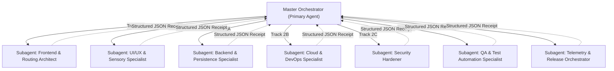
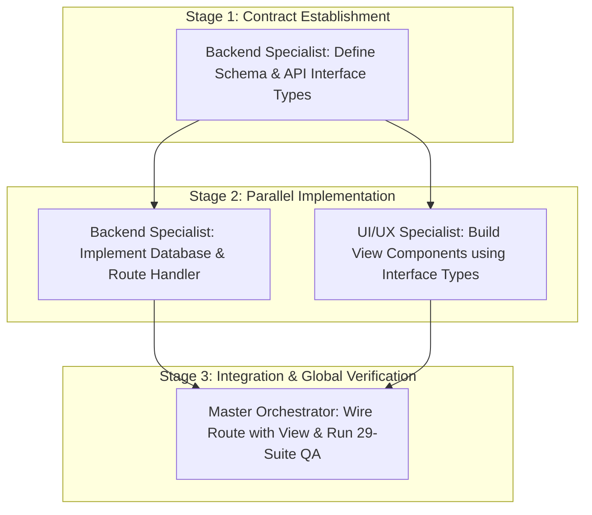

# Parallel Agent Orchestration & Subagent Swarm Architecture

> **Scope**: Protocols for dynamic subagent dispatching, parallel execution streams, file ownership boundaries, structured JSON handoffs, and deterministic parent synthesis in Full-Scale Mode (`/full-scale-mode`).

---

## 1. Master Conductor Philosophy & Authority

In Full-Scale Mode, the primary agent operates as the **Master Conductor**:
1. **Singular Accountability**: Subagents execute delegated tasks, but the primary orchestrator retains 100% accountability for overall system integrity, architecture alignment, and final delivery.
2. **Never Delegate Trivial Work**: Spawning subagents for single-line changes or minor edits incurs unnecessary context overhead. Subagents are reserved for parallelizable, decoupled work streams.
3. **Partitioned File Ownership**: Two concurrent subagents must **never** be assigned to modify the same file simultaneously. Work streams must follow strict domain boundaries.



---

## 2. Specialized Subagent Role Archetypes

| Archetype | Governing Phase | Primary Responsibilities & Tooling | Boundary Restrictions |
| :--- | :--- | :--- | :--- |
| **Frontend & Routing Architect** | Track 1A | Layout hierarchies, parallel/intercepting routes, state machines, i18n, typed params. | Owns `app/`, `routes/`, `stores/`, `locales/`. |
| **UI/UX & Sensory Specialist** | Track 1B | Apple HIG tokens, Cupertino materials, hairline lighting, 120Hz compositor, 3D WebGL. | Owns `components/`, `styles/`, `assets/`. Never modifies backend schemas. |
| **Backend & Persistence** | Track 2A | Clean architecture, database schemas, expand/contract migrations, Zod/Pydantic validation. | Owns `server/`, `api/`, `db/`, `models/`. Never touches UI components. |
| **Cloud & DevOps Specialist** | Track 2B | Multi-stage Dockerfiles (`USER 10001`), GCP Cloud Run, AWS S3/Lambda, Supabase RLS, pipelines. | Owns `Dockerfile`, `docker-compose.yml`, cloud manifests, ETL pipelines. |
| **Security Hardener** | Track 2C | OWASP Top 10 defense, SQL parameterization, secret hygiene (`.env.example`), DDoS rate limits. | Read & patch security surfaces across client and server. |
| **QA & Test Specialist** | Track 3A | TDD unit/integration tests, 4-tier viewports (375-1920px), safe areas, 44x44pt touch targets, Web Vitals. | Read-only verification via test suites and DevTools scripts. |
| **Release Orchestrator** | Track 3B | Convention recording, OpenTelemetry tracing, commit chunking (<1k lines), PR generation, skill minting. | Git tree operations, telemetry configs, and final walkthrough. |

---

## 3. Structured JSON Inter-Agent Handoff Schema

To prevent token waste and conversational ambiguity, subagents communicate findings, created assets, and test passes using a standardized JSON schema:

```json
{
  "$schema": "http://json-schema.org/draft-07/schema#",
  "title": "SubagentHandoffPayload",
  "type": "object",
  "required": ["subagent_role", "phase", "status", "files_created", "files_modified", "tests_passed"],
  "properties": {
    "subagent_role": { "type": "string" },
    "phase": { "type": "string" },
    "status": { "type": "string", "enum": ["SUCCESS", "FAILED", "BLOCKED"] },
    "files_created": {
      "type": "array",
      "items": { "type": "string" }
    },
    "files_modified": {
      "type": "array",
      "items": { "type": "string" }
    },
    "exported_symbols": {
      "type": "array",
      "items": { "type": "string" }
    },
    "tests_passed": { "type": "integer" },
    "tests_failed": { "type": "integer" },
    "blockers_or_risks": {
      "type": "array",
      "items": { "type": "string" }
    }
  }
}
```

### Example Subagent Handoff (Track 3A Backend):
```json
{
  "subagent_role": "BackendSpecialist",
  "phase": "Track 3A",
  "status": "SUCCESS",
  "files_created": [
    "src/db/schema/orders.ts",
    "src/api/routes/orders.ts"
  ],
  "files_modified": [
    "src/db/index.ts"
  ],
  "exported_symbols": [
    "orderSchema",
    "createOrderHandler",
    "OrderRepository"
  ],
  "tests_passed": 8,
  "tests_failed": 0,
  "blockers_or_risks": []
}
```

---

## 4. Concurrency Conflict Prevention & Dependency Ordering

When running parallel subagent streams, enforce a two-stage topological order:



### Conflict Prevention Rules:
1. **Contract-First Stabilization**: The backend/data contract (types, interfaces, DTOs) must be committed or written before the UI subagent begins consuming them.
2. **Zero Overlapping Edits**: Never permit Subagent A and Subagent B to write to the same file. If a file requires modifications from both domains (e.g. `App.tsx` or `index.ts`), the primary orchestrator performs the merge after both subagents finish.
3. **Sandbox Workspaces for Exploratory Work**: When a subagent performs deep research or prototype benchmarks, assign it a temporary branch or scratch workspace.

---

## 5. Synthesis & Reconciliation Protocol

Upon receiving handoff payloads from all concurrent subagents, the master orchestrator executes this 4-step reconciliation:
1. **File Limit Check**: Audit all created/modified files against the 500-line physical ceiling.
2. **Contract Alignment Verification**: Verify that symbol names and types exported by Track 3A match what Track 3B consumed.
3. **Global Test Sweep**: Execute `./scripts/verify_all_skills.sh` to confirm no cross-module regressions occurred.
4. **Consolidated Reporting**: Synthesize findings into the user-facing walkthrough without dumping raw intermediate logs.
