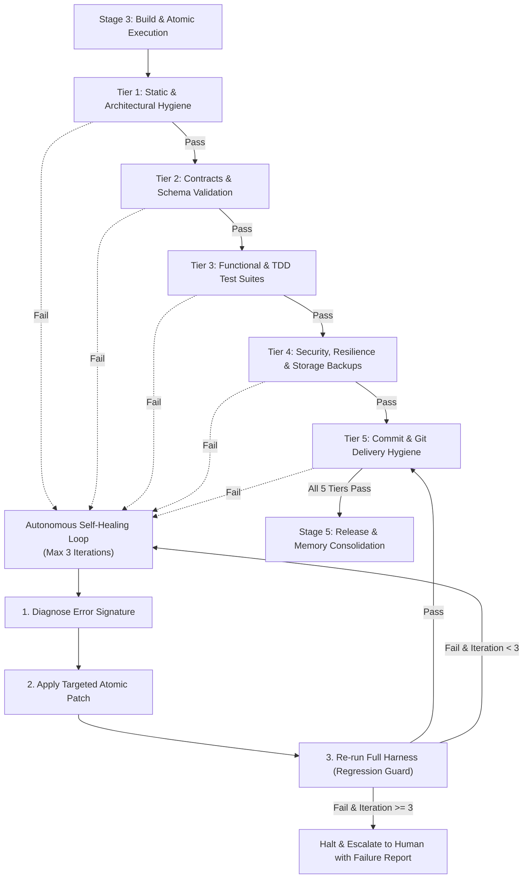

# Harness Engineering & Autonomous Self-Healing Loop Protocol

> **Scope**: Architecture, tier specifications, diagnostic schemas, and convergence policies for the Full-Scale Mode Evaluation Harness and Bounded Self-Healing Verification Loop.

---

## 1. Harness Engineering Philosophy

In modern agentic systems, code generation without rigorous verification harnesses leads to cumulative error compounding and context drift. **Harness Engineering** provides deterministic, multi-tiered test scaffolding that evaluates generated code against strict quality, architectural, and security invariants before any release is authorized.



---

## 2. The 5 Harness Evaluation Tiers

| Tier | Name | Target Validations | Failure Rules |
| :--- | :--- | :--- | :--- |
| **Tier 1** | **Static & Architectural Hygiene** | 500-line physical file ceiling, anti-slop patterns (shields, neon gradients, obvious comments), prompt token budgeting. | `SOURCE-LINE-LIMIT-EXCEEDED`, `AI-SLOP-DETECTED`, `SUBAGENT-TOKEN-BUDGET-EXCEEDED` |
| **Tier 2** | **Contracts & Schema Validation** | OpenAPI 3.1 specifications, RFC 7807 problem envelopes, Python/TypeScript syntax compilation. | `SYNTAX-ERROR`, `INVALID-API-CONTRACT`, `SCHEMA-DRIFT` |
| **Tier 3** | **Functional & TDD Test Suites** | Automated unit tests, integration tests, component previews, semantic ARIA locators, 100% green test assertions. | `UNIT-TEST-FAILURE`, `INTEGRATION-TEST-FAILURE`, `LOCATOR-HYGIENE-FAIL` |
| **Tier 4** | **Security & Storage Integrity** | Secret leak prevention, SQL parameterization, SSRF protection, non-root Docker (`USER 10001`), single-slot backup digest match. | `SECRET-LEAK-RISK`, `UNPARAMETERIZED-QUERY`, `UNLOCKED-STORAGE-MUTATION` |
| **Tier 5** | **Commit & Git Delivery Hygiene** | Conventional branch prefixes (`feat/`, `fix/`, `refactor/`), commit line budget (<1,000 lines), clean workspace. | `INVALID-BRANCH-PREFIX`, `COMMIT-BUDGET-EXCEEDED`, `DIRTY-RELEASE-TREE` |

---

## 3. Autonomous Self-Healing Loop Protocol

When any harness tier identifies violations, the orchestrator immediately transitions to `stage:loop`:

1. **Structured Failure Diagnostic**:
   - The harness emits a structured diagnostic detailing the failing tier, rule ID, offending file and line number, error message, and actionable remediation hint.
2. **Targeted Remediation Patch**:
   - The orchestrator or specialized subagent designs an atomic, minimal patch targeting solely the failing invariant.
   - Slop prohibition: Fixes must not introduce temporary mock bypasses, disabled tests, or ignore comments (`// @ts-ignore`, `eslint-disable`).
3. **Full Harness Regression Sweep**:
   - Every loop iteration re-evaluates all tiers from Tier 1 forward to guarantee that the patch did not introduce regressions in previously green tiers.
4. **Bounded Convergence Policy**:
   - Maximum iterations: **3**.
   - If convergence is achieved within 3 iterations, the loop advances to `stage:release`.
   - If violations persist beyond 3 iterations, execution halts and produces a structured Human Escalation Report.

---

## 4. CLI Execution Reference

```bash
# Run all 5 harness tiers
python3 skills/full-scale-mode/scripts/orchestration_harness.py --path .

# Run self-healing evaluation loop with strict exit code
python3 skills/full-scale-mode/scripts/orchestration_harness.py --path . --loop --max-iterations 3 --strict

# Run targeted tiers (e.g., Tier 1 and Tier 4)
python3 skills/full-scale-mode/scripts/orchestration_harness.py --path . --tier 1 --tier 4 --json
```
