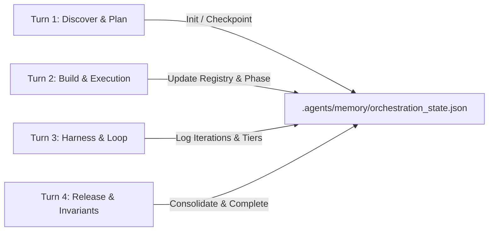

# Orchestration Memory & State Management Architecture

> **Scope**: Architecture, schema, checkpointing lifecycles, and multi-agent coordination protocols for active session memory in Full-Scale Mode (`.agents/memory/orchestration_state.json`).

---

## 1. Orchestration Memory Architecture

Autonomous agents require structured, deterministic memory across multi-turn interactions. While `.agents/learned_conventions.md` captures long-term cross-session invariants, the **Orchestration Memory Subsystem** (`.agents/memory/orchestration_state.json`) tracks active execution state, milestone progress, touched files, backup digests, and harness iteration histories.



---

## 2. Memory State Schema

```json
{
  "version": "1.0.0",
  "session_id": "session-unique-id",
  "goal": "Refined user prompt or engineering RFC",
  "timestamp_started": "2026-10-29T22:00:00Z",
  "timestamp_updated": "2026-10-29T22:15:00Z",
  "current_stage": "BUILD",
  "triad_phase": "PHASE_2_BACKEND",
  "platform_target": "web",
  "milestones": [
    { "id": "M-DISCOVER", "title": "Stage 1: Discover & Memory Recall", "status": "COMPLETED", "completed_at": "2026-10-29T22:02:00Z" },
    { "id": "M-PLAN", "title": "Stage 2: Plan & Architectural Blueprint", "status": "COMPLETED", "completed_at": "2026-10-29T22:05:00Z" },
    { "id": "M-BUILD", "title": "Stage 3: Build & Atomic Execution", "status": "IN_PROGRESS", "completed_at": null },
    { "id": "M-VERIFY", "title": "Stage 4: Verify & Harness Evaluation", "status": "PENDING", "completed_at": null },
    { "id": "M-RELEASE", "title": "Stage 5: Release & Memory Consolidation", "status": "PENDING", "completed_at": null }
  ],
  "file_registry": {
    "created": ["src/api/auth.ts"],
    "modified": ["package.json"]
  },
  "backup_digest": "e3b0c44298fc1c149afbf4c8996fb92427ae41e4649b934ca495991b7852b855",
  "harness_history": [],
  "invariants_learned": ["ARCH-001"],
  "token_usage_estimate": 1420
}
```

---

## 3. Lifecycle Stage State Machine

1. **`DISCOVER`**: Primary orchestrator scans manifests, triggers Autonomous Skill Resonance (ASR), identifies platform target (`mobile`, `web`, `universal`), and recalls relevant invariants from `.agents/learned_conventions.md`.
2. **`PLAN`**: Formulates RFC technical specifications, defines non-overlapping file boundaries per subagent track, and locks single-slot storage backups.
3. **`BUILD`**: Executes the 3-Phase Triad Cadence (Frontend, Backend, Testing), recording created and modified files into the memory registry.
4. **`VERIFY`**: Evaluates the 5-tier harness (`orchestration_harness.py`).
5. **`LOOP`**: If harness tests fail, transitions to `LOOP` for bounded self-healing (up to 3 iterations) before returning to `VERIFY`.
6. **`RELEASE`**: Persists new invariants via `record_learning.py`, updates milestone registry, pushes remote branch, and opens ready-to-merge GitHub Pull Request.

---

## 4. CLI Usage Reference

```bash
# Initialize active session memory
python3 skills/full-scale-mode/scripts/manage_orchestration_memory.py init --session-id "task-102" --goal "Build auth API" --platform web

# Inspect memory state dashboard
python3 skills/full-scale-mode/scripts/manage_orchestration_memory.py status

# Update checkpoint
python3 skills/full-scale-mode/scripts/manage_orchestration_memory.py checkpoint --stage BUILD --phase PHASE_2_BACKEND --created "src/api/auth.ts"

# Advance to next stage
python3 skills/full-scale-mode/scripts/manage_orchestration_memory.py advance
```
