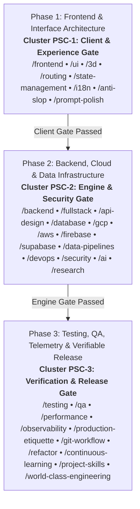

# Phased Project Execution Matrix: The 3-Phase Triad Cadence

> **Scope**: End-to-end phased delivery lifecycle for Full-Scale Mode (`/full-scale-mode` / `/world-class-engineering`), organizing all 35 SkillBuilder skills across three sequential, synchronized tiers with parallel subagent execution tracks.

---

## 1. Lifecycle Overview & Triad Phase Map

Every software engineering initiative executed under Full-Scale Mode advances through three discrete, synchronized phases. Advancing past each phase boundary requires satisfying the corresponding Triad Gateway:

---

## 2. Phase-by-Phase Execution Specifications

### Phase 1: Frontend & Interface Architecture (Client Tier)
- **Governing Skills**: `/frontend`, `/ui`, `/mobile-ui`, `/web-ui`, `/3d`, `/routing`, `/state-management`, `/i18n`, `/anti-slop`, `/prompt-polish`
- **Subagent Roles**: `Frontend & Routing Architect` (Track 1A) and `UI/UX & Sensory Specialist` (Track 1B).
- **Platform Domain Specialization (PDS)**:
  - **Mobile Workflows**: Mounts `/mobile-ui` and prunes `/web-ui`. Track 1B enforces SwiftUI `matchedGeometryEffect`, Jetpack Compose `LookaheadScope`, predictive back gestures, spring tokens, and system haptics.
  - **Web Workflows**: Mounts `/web-ui` and prunes `/mobile-ui`. Track 1B enforces Component-Level Container Queries (`@container`), CSS View Transitions, OKLCH color spaces, and fluid `clamp()` curves.
  - **Universal Workflows**: Partitions into parallel decoupled subagents (`Track 1A-Web` vs `Track 1A-Mobile`) to eliminate token quota bleed.
- **Entry Criteria**: User goal received and refined via `/prompt-polish` (PPE).
- **Track 1A (Layouts, Routing & State)**:
  - Scaffolds file-based layouts, parallel/intercepting routes, and typed search params (`/routing`).
  - Implements declarative client state machines, TanStack Query key factories, and signals (`/state-management`).
  - Sets up internationalization dictionaries, ICU MessageFormat, and RTL layout mirroring (`/i18n`).
  - Enforces React 19 / Next.js / Flutter lifecycle memory safety and AbortController cleanup (`/frontend`).
- **Track 1B (Design Systems, Materials & Motion)**:
  - Establishes Apple HIG tokens, Cupertino blur materials, and squircle corner radii (`/ui`).
  - Applies sub-pixel directional lighting (hairline borders, physical shadow falloff).
  - Enforces 120Hz GPU compositor compliance (`transform` and `opacity` only).
  - Eliminates AI slop: zero decorative shields, zero glowing borders, zero raw emojis in UI buttons (`/anti-slop`).
  - Integrates Three.js / R3F PBR shaders with Draco compression where 3D is requested (`/3d`).
- **Exit Gate (Client & Experience Gate)**: Layout renders responsively across 375px–1920px; 44x44pt touch targets; zero raw emojis; zero console layout errors.

---

### Phase 2: Backend, Cloud & Data Infrastructure (Engine Tier)
- **Governing Skills**: `/backend`, `/fullstack`, `/api-design`, `/database`, `/gcp`, `/aws`, `/firebase`, `/supabase`, `/data-pipelines`, `/devops`, `/security`, `/ai`, `/research`
- **Subagent Roles**: `Backend & Persistence Specialist` (Track 2A), `Cloud & DevOps Engineer` (Track 2B), and `Security Hardener` (Track 2C).
- **Entry Criteria**: Client architecture, route boundaries, and UI contracts established from Phase 1.
- **Track 2A (Core Services, Contracts & Persistence)**:
  - Builds Hexagonal clean architecture with strict domain boundaries and runtime validation (`/backend`).
  - Authors OpenAPI 3.1 contracts and RFC 7807 Problem Details envelopes (`/api-design`).
  - Wires up real persistence (PostgreSQL/SQLite) with zero-downtime expand/contract migrations (`/database`).
  - Anti-mock mandate: Builds complete vertical slices with zero fake static arrays (`/fullstack`).
  - Autonomously benchmarks novel dependencies using P.A.T.H.S. criteria (`/research`).
  - Implements Gemini SDK structured JSON outputs and token budgeting (`/ai`).
- **Track 2B (Cloud Platforms & Data Pipelines)**:
  - Provisions GCP Cloud Run containers, Pub/Sub, and Secret Manager (`/gcp`).
  - Hardens AWS serverless Lambda, S3 public access blocks, and DynamoDB single-table designs (`/aws`).
  - Configures Firebase Firestore security rules v2 and Auth (`/firebase`).
  - Implements Supabase Postgres Row-Level Security (RLS) and pgvector semantic search (`/supabase`).
  - Builds streaming batch ETL pipelines with backpressure flow control and DuckDB OLAP (`/data-pipelines`).
  - Produces multi-stage Dockerfiles running as unprivileged non-root user (`USER 10001`) (`/devops`).
- **Track 2C (Security Defense & Network Resilience)**:
  - Mitigates OWASP Top 10 vulnerabilities; parameterizes 100% of SQL queries and shell commands (`/security`).
  - Implements refresh token family rotation, constant-time auth comparisons, and SSRF post-DNS validation.
  - Enforces explicit 3s connection and 15s body timeouts, exponential backoff with jitter, and DDoS rate limits.
- **Exit Gate (Engine & Security Gate)**: Real database persistence verified; zero unhandled errors; non-root Docker builds succeed; cloud IAM least-privilege policies enforced.

---

### Phase 3: Testing, Quality Assurance, Telemetry & Verifiable Release (Verification & Release Tier)
- **Governing Skills**: `/testing`, `/qa`, `/performance`, `/observability`, `/production-etiquette`, `/git-workflow`, `/refactor`, `/continuous-learning`, `/project-skills`, `/world-class-engineering`
- **Subagent Roles**: `QA & Test Automation Specialist` (Track 3A) and `Release & Telemetry Orchestrator` (Track 3B).
- **Entry Criteria**: Functional client and backend infrastructure deployed from Phase 1 and Phase 2.
- **Track 3A (TDD, Two-Tier QA & Performance Audits)**:
  - Writes comprehensive unit and integration tests using semantic ARIA locators and MSW mocking (`/testing`).
  - Executes Two-Tier QA: Full UI viewports (375px SE to 1920px+ widescreen) and Full App Functional QA (`/qa`).
  - Logs defects into `master-error-catalog.md` using the List-an-Error (LaE) protocol.
  - Profiles Core Web Vitals ($\text{LCP} < 2.5\text{s}$, $\text{CLS} < 0.1$, $\text{INP} < 200\text{ms}$) and eliminates N+1 queries (`/performance`).
  - Enforces the strict 500-line physical ceiling across all source files; triggers `/refactor` on files $\ge 350$ lines.
- **Track 3B (Observability, Skill Minting & Release Delivery)**:
  - Instruments OpenTelemetry distributed tracing and structured JSON logs with correlation IDs (`/observability`).
  - Scaffolds `.env.example`, `.gitignore`, and verifies production secret hygiene (`/production-etiquette`).
  - Mints custom project skills under `.agents/skills/<repo>/SKILL.md` via Skill Synthesis Protocol (`/project-skills`).
  - Persists learned project invariants to `.agents/learned_conventions.md` (`/continuous-learning`).
  - Decomposes commits into cohesive diffs strictly under the 1,000-line review budget (`/git-workflow`).
  - Pushes remote tracking branch (`git push origin <branch>`) and authors ready-to-merge GitHub Pull Request (`gh pr create`).
- **Exit Gate (Verification & Release Gate)**: 100% green test suites across all 44 runners; 0 line limit violations; clean working tree pushed to remote; active PR ready to review.
