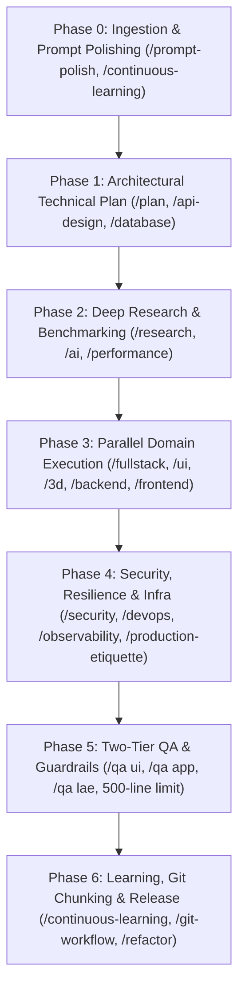

# Phased Project Execution Matrix

> **Scope**: End-to-end phased delivery lifecycle for Full-Scale Mode (`/full-scale-mode` / `/world-class-engineering`), integrating all 22 SkillBuilder skills across seven sequential phases and parallel subagent execution tracks.

---

## 1. Lifecycle Overview & Phase Map

Every non-trivial software engineering initiative must advance through seven discrete phases. Advancing to the next phase requires satisfying formal exit criteria:

---

## 2. Phase-by-Phase Execution Specifications

### Phase 0: Ingestion & Metacognitive Prompt Polishing
- **Governing Skills**: `/prompt-polish`, `/continuous-learning`
- **Subagent Role**: `Prompt Architect`
- **Entry Criteria**: Raw user prompt received.
- **Actions**:
  1. Check `.agents/learned_conventions.md` to load project-specific rules and avoid repeated errors.
  2. Parse the user request to extract implicit constraints, eliminate ambiguity, and strip conversational padding.
  3. Formulate an RFC-style specification matrix with explicit inputs, outputs, error conditions, and acceptance criteria.
  4. Estimate total token budget using the character heuristic ($chars / 3.8$).
- **Exit Criteria**: Polished engineering specification agreed upon; zero unstated assumptions.

---

### Phase 1: Phased Architectural Technical Plan & User Alignment
- **Governing Skills**: `/plan`, `/api-design`, `/database`
- **Subagent Role**: `System Architect`
- **Entry Criteria**: Polished specification from Phase 0.
- **Actions**:
  1. Author a structured implementation plan artifact in `<appDataDir>/brain/<conversation-id>/`.
  2. Map component boundaries, data flow, API contracts (OpenAPI 3.1 / RFC 7807), and database migrations (expand/contract).
  3. Include Mermaid diagrams for state machines and component relationships.
  4. Set `RequestFeedback: true` in artifact metadata and halt execution.
- **Exit Criteria**: User reviews the plan and clicks **Proceed** (or issues textual approval). Never modify project code before this gate passes.

---

### Phase 2: Autonomous Deep Research & Dependency Benchmarking
- **Governing Skills**: `/research`, `/ai`, `/performance`
- **Subagent Role**: `Research Engine`
- **Entry Criteria**: Approved implementation plan from Phase 1.
- **Actions**:
  1. When introducing any new library or tool, benchmark candidates using the **P.A.T.H.S.** rubric (Performance, Activity, Type safety, Hygiene, Size).
  2. If a package fails installation or is deprecated, autonomously locate and evaluate production drop-in replacements.
  3. Verify runtime compatibility against target node/python/go/swift runtime before importing.
- **Exit Criteria**: Dependency stack verified with working minimal POC; zero unvetted packages.

---

### Phase 3: Parallel Domain Execution (Subagent Swarm)
- **Governing Skills**: `/fullstack`, `/database`, `/backend`, `/api-design`, `/ui`, `/3d`, `/frontend`, `/anti-slop`
- **Subagent Roles**: `Backend Specialist` (Track 3A) and `UI/UX Specialist` (Track 3B) running concurrently.
- **Entry Criteria**: Research verified from Phase 2.
- **Track 3A (Backend & Persistence)**:
  - Wire up real database persistence (PostgreSQL, SQLite, Room, CoreData) with foreign key constraints.
  - Implement zero-downtime schema migrations.
  - Enforce strict runtime schema validation (Zod, Pydantic v2).
  - Anti-mock mandate: Zero static arrays simulating state.
- **Track 3B (UI/UX, 3D Canvas & Sensory Materials)**:
  - Implement Apple HIG design tokens and Cupertino blur materials.
  - Apply sub-pixel directional lighting (hairline borders, physical shadow falloff).
  - Enforce 120Hz GPU compositor compliance (`transform` and `opacity` only).
  - Use semantic Lucide SVG vector icons (`aria-hidden="true"`); zero raw emojis in buttons.
  - Integrate Three.js / R3F PBR shaders with Draco compression where 3D is requested.
- **Exit Criteria**: Both tracks complete, compile cleanly, and hand off compact JSON receipts to parent orchestrator.

---

### Phase 4: Parallel Security, Resilience & Infrastructure
- **Governing Skills**: `/security`, `/production-etiquette`, `/devops`, `/observability`
- **Subagent Roles**: `Security Hardener` (Track 4A) and `DevOps Specialist` (Track 4B).
- **Entry Criteria**: Core code implemented from Phase 3.
- **Track 4A (Security & Resilience)**:
  - Audit OWASP Top 10 vulnerabilities; parameterize 100% of SQL queries and shell commands.
  - Ensure zero hardcoded credentials; provide `.env.example` templates.
  - Configure resilient networking: explicit 3s connection and 15s execution timeouts, exponential backoff with full jitter, and 300ms input debouncing.
- **Track 4B (DevOps & Telemetry)**:
  - Generate hardened multi-stage Dockerfile running as non-root unprivileged user (`USER 10001`).
  - Provide `docker-compose.yml` with health checks.
  - Instrument distributed OpenTelemetry tracing and structured JSON logging with correlation IDs.
- **Exit Criteria**: Security audit passes with 0 critical findings; Docker build succeeds; telemetry operational.

---

### Phase 5: Two-Tier Quality Assurance & Guardrail Sweep
- **Governing Skills**: `/qa` (`/qa ui`, `/qa app`, `/qa lae`), `check_source_line_limits.py`, `sanitize_ai_slop.py`
- **Subagent Roles**: `UI Auditor` (Track 5A), `App Functional Auditor` (Track 5B), and `Guardrail Enforcer` (Track 5C).
- **Entry Criteria**: Hardening complete from Phase 4.
- **Track 5A (Full UI / Frontend QA)**:
  - Audit 4-tier viewports (375px SE to 1920px+ widescreen) and safe-area insets.
  - Verify minimum 44x44pt interactive touch targets.
  - Verify WCAG 2.2 AA contrast (4.5:1 body, 3:1 large text) and visible focus rings.
  - Verify tabular typography (`tabular-nums`) and layout stability ($\text{CLS} < 0.05$).
- **Track 5B (Full App Functional QA & Error Catalog)**:
  - Validate state machine exhaustiveness and race condition prevention.
  - Verify mobile OS lifecycle resilience (background state preservation, low-memory cache trimming, cold-start deep links).
  - Check for resource and memory leaks (uncleaned listeners, orphan timers).
  - Log any discovered defects into `master-error-catalog.md` (LaE protocol).
- **Track 5C (Physical Line Limits & Anti-Slop Audit)**:
  - Run `check_source_line_limits.py --path .`: Enforce strict 500-line physical limit across all source files.
  - Run `sanitize_ai_slop.py --strict`: Verify zero decorative shields, neon gradients, or marketing buzzwords.
- **Exit Criteria**: 100% test suites pass; 0 line limit violations; 0 anti-slop violations.

---

### Phase 6: Continuous Learning, Git Chunking & Delivery
- **Governing Skills**: `/continuous-learning`, `/refactor`, `/git-workflow`
- **Subagent Role**: `Release Orchestrator`
- **Entry Criteria**: All verification suites pass from Phase 5.
- **Actions**:
  1. Record any new project conventions or user corrections to `.agents/learned_conventions.md`.
  2. If any source file approaches 500 lines, execute the 7-step safe refactoring protocol.
  3. Run `analyze_git_commit_chunks.py`: Decompose changes into cohesive commits strictly below the **1,000-line review budget**.
  4. Author Conventional Commits with **mandatory Title AND structured Description body** explaining *Why*, *What*, and *Verification*. Zero lazy commits.
  5. **Always push to remote tracking branch**: Execute `git push origin <branch-name>`.
  6. **Always open or update GitHub Pull Request**: Author or update active PR via `gh pr create` / `gh pr edit` with complete architectural context, test receipts, and rollback instructions.
  7. Tag semantic release version (`vX.Y.Z`) and push tag (`git push origin vX.Y.Z`).
  8. Author comprehensive walkthrough artifact in the conversation directory.
- **Exit Criteria**: Working tree clean and synchronized with remote, active PR ready to merge, release tag pushed, walkthrough presented.
