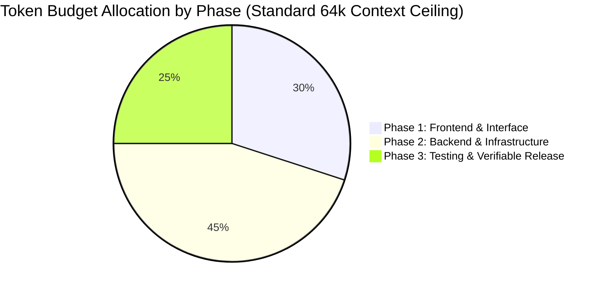

# Token Usage Awareness & Context Management Architecture

> **Scope**: Strict context window optimization, prompt payload compression, token budgeting formulas, and compaction triggers for high-density multi-agent orchestration in Full-Scale Mode (`/full-scale-mode`).

---

## 1. Context Window Physics & The Cost of Context Bloat

Large language model reasoning degrades as context windows fill with redundant logs, duplicated code files, and conversational padding:
- **Degradation Horizon**: Beyond 65% context capacity, models exhibit "lost-in-the-middle" attention decay, leading to forgotten constraints and dropped edge cases.
- **Token Inflation**: Re-reading entire files or passing raw conversational transcripts to subagents wastes thousands of tokens per turn.
- **The Invariant**: *Every token admitted to the context window must carry dense, actionable engineering signal.*

---

## 2. Phase-by-Phase Token Budget Allocation Model

Every non-trivial engineering task operates under a planned **Token Budget Allocation**:



| Project Phase | Budget Share | Target Token Range | Primary Token Deliverable |
| :--- | :--- | :--- | :--- |
| **Phase 1: Frontend & Interface** | 30% | 5,000 – 8,000 tokens | Layout contracts, UI components, state stores, i18n dictionaries. |
| **Phase 2: Backend & Infrastructure** | 45% | 8,000 – 14,000 tokens | Domain services, database schemas, cloud manifests, security hardening. |
| **Phase 3: Testing & Release** | 25% | 4,000 – 6,000 tokens | Test suites (TDD), Two-Tier QA logs, git chunk commits, and PR body. |

---

## 3. The 5 Core Token Guardrails

### Guardrail 1: Prompt Payload Compression
When dispatching subagents, omit all conversational formalities, flattery, and open-ended preambles. Frame directives with mathematical brevity:
- ❌ **Bloated Prompt (380 tokens)**: *"Hello Subagent! Could you please help me implement the backend order routes? Make sure to use TypeScript and write really clean code, and if you have any questions feel free to let me know! Thanks so much!"*
- ✅ **Compressed Directive (45 tokens)**: *"Implement `src/api/routes/orders.ts`. Contract: POST /orders, validate body via `orderSchema` (Zod), persist via `OrderRepository`. Enforce 500-line ceiling. Return structured JSON handoff."*

### Guardrail 2: Context Pruning & Targeted Slicing
Never dump whole directories or massive source files into a subagent's prompt:
- Provide **targeted line ranges** using URI fragments: `src/models/user.ts#L15-L42`.
- Provide **type definitions and interfaces only**, omitting underlying implementation bodies:
  ```ts
  // Pass this interface instead of the 400-line service implementation
  export interface IOrderService {
    create(dto: CreateOrderDTO): Promise<OrderRecord>;
    getById(id: string): Promise<OrderRecord | null>;
  }
  ```

### Guardrail 3: Structured JSON Inter-Agent Payloads
Subagents must return compact, schema-validated JSON receipts instead of explanatory essays. This saves up to 85% of generation tokens:
```json
{
  "status": "SUCCESS",
  "files_created": ["src/api/orders.ts"],
  "tests_passed": 4,
  "blockers": []
}
```

### Guardrail 4: Anti-Recomputation Symbol Cache
The primary orchestrator maintains an in-memory index of discovered models, file locations, and third-party package versions. Subagents query this memory index rather than executing duplicate `find`, `grep`, or web search rounds.

### Guardrail 5: Context Compaction Triggers (`/compact`)
- **Trigger Condition**: If the primary agent's cumulative context exceeds $60\%$ of the active model's context ceiling, initiate compaction.
- **Compaction Strategy**: Summarize completed Phase 0–3 execution steps into a permanent RFC state snapshot, purge ephemeral intermediate command outputs, and resume cleanly.

---

## 4. Token Estimation Formula & Heuristics

For rapid offline estimation in tooling and CI checks, SkillBuilder standardizes on the **Character-to-Token Heuristic**:

$$\text{Estimated Tokens} = \max\left(1,\, \left\lfloor \frac{\text{Character Count}}{3.8} \right\rfloor\right)$$

### Utility Command:
```bash
python3 skills/ai/scripts/calculate_token_budget.py --file src/components/TelemetryPill.tsx --budget 1500
```
This utility reports character count, estimated tokens, and percentage utilization against the assigned budget ceiling.

---

## 5. Token-Optimized Subagent Invocation Template

```markdown
Role: [Specific Subagent Archetype, e.g. UI/UX Specialist]
Task: [Exact 1-2 sentence engineering goal]
Inputs:
- Interfaces: [Compact snippet or file#L1-L20]
- Target Files: [Specific file paths to create or modify]
Constraints:
- 500-line physical limit per file
- No raw emojis in controls; Lucide SVGs only
- Tabular figures on all dynamic numbers
Handoff: Return compact SubagentHandoffPayload JSON only.
```
