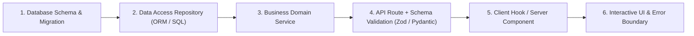

# Fullstack Rapid Delivery & Anti-Mock Mandate (`/fullstack`)

> **Philosophy**: *Zero static toy arrays pretending to be databases. Wire up real persistence, real validation, real routes, and real end-to-end integration.*

This skill governs fullstack feature implementation, ensuring every feature is delivered as a complete, functional vertical slice from database schema to UI interactivity.

---

## 1. The Anti-Mock Vertical Slice Architecture



### Rule 1: Zero Static In-Memory Toy Databases
- **Prohibited**: Creating `const mockUsers = [...]` or `const FAKE_PRODUCTS = [...]` inside application code and pretending persistent state works.
- **Mandate**: Provision real storage:
  - Local / CLI / Embedded: SQLite (`better-sqlite3`, `sqlite3`, `aiosqlite`) or structured JSON/file stores.
  - Production / Server: PostgreSQL, Cloud SQL, AlloyDB, or Supabase.

### Rule 2: Strict Boundary Schema Validation
- Never pipe untrusted HTTP body/query data directly into domain services or SQL queries.
- Parse and validate incoming requests using strict schemas (e.g., Zod in TypeScript, Pydantic in Python).

### Rule 3: End-to-End Interactivity
- Every UI button must wire to a real API endpoint.
- Every API endpoint must return standard status codes (`200 OK`, `201 Created`, `400 Bad Request`, `404 Not Found`, `500 Internal Error`).
- Optimistic updates must handle rollback gracefully if the server returns an error.

---

## 2. End-to-End Integration Auditor CLI

Audit your codebase for mock stubs and unpersisted API routes:
```bash
python3 skills/fullstack/scripts/verify_end_to_end_integration.py --path .
```
