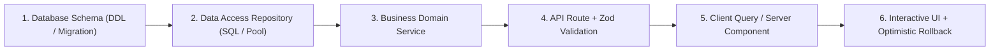

# Fullstack Rapid Delivery & Anti-Mock Mandate (`/fullstack`)

> **Philosophy**: *Zero static toy arrays pretending to be databases. Wire up real persistence, real validation, real routes, and real end-to-end integration.*

This skill governs fullstack feature implementation, ensuring every feature is delivered as a complete, functional vertical slice from database schema to UI interactivity.

---

## 1. The Anti-Mock Vertical Slice Architecture



### The 5 Vertical Slice Rules:
1. **Zero Mock Arrays**: Never ship `const mockUsers = [...]` or in-memory arrays pretending to be durable state. Wire SQLite, PostgreSQL, or structured file stores.
2. **End-to-End Type Safety**: Share or mirror validation schemas between frontend and backend contracts.
3. **Optimistic Rollback**: UI mutations must optimistically render the expected state, but roll back cleanly with a toast notification if the network or server rejects the transaction.
4. **Automated Integration Test**: Every slice must include an integration test verifying the full round-trip from HTTP POST to database persistence.
5. **Platform Domain Specialization**: In Tier 6 (Interactive UI), bind [`/mobile-ui`](../mobile-ui/SKILL.md) for mobile targets and [`/web-ui`](../web-ui/SKILL.md) for web targets. Never mix cross-platform styling instructions in a single feature slice to conserve token quota.

---

## 2. Complete Vertical Slice Blueprint

### Tier 1: Database Migration (PostgreSQL / SQLite)
```sql
-- migrations/001_create_tasks.sql
CREATE TABLE IF NOT EXISTS tasks (
  id TEXT PRIMARY KEY NOT NULL,
  title TEXT NOT NULL CHECK(length(title) >= 1 AND length(title) <= 200),
  completed BOOLEAN NOT NULL DEFAULT 0,
  created_at TIMESTAMP NOT NULL DEFAULT CURRENT_TIMESTAMP
);
CREATE INDEX IF NOT EXISTS idx_tasks_created_at ON tasks(created_at DESC);
```

### Tier 2: Repository with Real Parameterized Queries
```typescript
// src/repositories/taskRepository.ts
import Database from "better-sqlite3";

export interface TaskRecord {
  id: string;
  title: string;
  completed: boolean;
  created_at: string;
}

export class TaskRepository {
  constructor(private db: Database.Database) {}

  findAll(): TaskRecord[] {
    const stmt = this.db.prepare("SELECT id, title, completed, created_at FROM tasks ORDER BY created_at DESC");
    return stmt.all().map((row: any) => ({
      ...row,
      completed: Boolean(row.completed),
    }));
  }

  create(id: string, title: string): TaskRecord {
    const stmt = this.db.prepare("INSERT INTO tasks (id, title, completed) VALUES (?, ?, 0)");
    stmt.run(id, title);
    return { id, title, completed: false, created_at: new Date().toISOString() };
  }
}
```

### Tier 3: API Route with Strict Schema Validation
```typescript
// src/routes/tasks.ts
import { z } from "zod";
import { TaskRepository } from "../repositories/taskRepository";

const CreateTaskSchema = z.object({
  id: z.string().uuid(),
  title: z.string().trim().min(1, "Title cannot be empty").max(200),
});

export function createTaskHandler(repo: TaskRepository) {
  return async (req: Request): Promise<Response> => {
    try {
      const body = await req.json();
      const validated = CreateTaskSchema.safeParse(body);
      if (!validated.success) {
        return Response.json(
          {
            type: "https://api.example.com/errors/validation",
            title: "Validation Failed",
            status: 400,
            invalid_params: validated.error.errors,
          },
          { status: 400 }
        );
      }

      const task = repo.create(validated.data.id, validated.data.title);
      return Response.json(task, { status: 201 });
    } catch (err: unknown) {
      return Response.json({ status: 500, title: "Internal Server Error" }, { status: 500 });
    }
  };
}
```

---

## 3. End-to-End Integration Auditor CLI

Audit your codebase for mock stubs, hardcoded fake arrays, and unpersisted API routes:
```bash
python3 skills/fullstack/scripts/verify_end_to_end_integration.py --path .
```
This CLI verifies:
1. Zero in-memory mock datasets in service or route layers.
2. Verified database schema and migration files exist.
3. Every API mutation endpoint contains schema validation.
4. UI mutation forms include loading and error feedback states.
