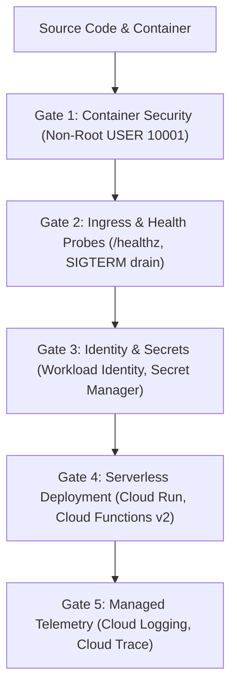

# Google Cloud Platform Architecture & Serverless Delivery (`/gcp`)

> **Philosophy**: *Zero static credentials. Containerized serverless by default. Workload Identity over service account keys. Non-root containers. Graceful SIGTERM drains. Exponential backoff on all cloud APIs.*

This skill establishes production engineering standards for deploying scalable, cost-efficient, and secure services onto **Google Cloud Platform (GCP)**.

---

## 1. The Core GCP Architecture Gates



1. **Gate 1: Container Hardening**: Cloud Run workloads must execute in multi-stage, scratch/distroless or alpine base containers running as non-root (`USER 10001`).
2. **Gate 2: Ingress & Health Check Probes**: Cloud Run services must expose `/healthz` or `/status` startup and liveness probes.
3. **Gate 3: Secret & Identity Hygiene**: Prohibit static service account JSON keys. Enforce **Workload Identity Federation** and retrieve sensitive runtime secrets from **GCP Secret Manager**.
4. **Gate 4: Graceful Drainage**: Handle `SIGTERM` signals cleanly with a 10-second drain window before Cloud Run instance scale-down.
5. **Gate 5: Managed Telemetry**: Emit structured JSON logs with `logging.googleapis.com/trace` correlation fields for Cloud Logging.

---

## 2. Cloud Run & Serverless Deployment Standards

### 2.1 Multi-Stage Cloud Run Dockerfile
```dockerfile
# Build stage
FROM node:20-alpine AS builder
WORKDIR /app
COPY package*.json ./
RUN npm ci
COPY . .
RUN npm run build

# Production runner stage
FROM node:20-alpine AS runner
WORKDIR /app
ENV NODE_ENV=production
ENV PORT=8080

RUN addgroup -g 10001 -S nonroot && adduser -u 10001 -S nonroot -G nonroot
COPY --from=builder /app/dist ./dist
COPY --from=builder /app/node_modules ./node_modules
COPY --from=builder /app/package.json ./package.json

USER 10001
EXPOSE 8080

CMD ["node", "dist/server.js"]
```

### 2.2 Graceful SIGTERM Shutdown in Node.js / Express
```typescript
import express from "express";

const app = express();
const port = parseInt(process.env.PORT || "8080", 10);

app.get("/healthz", (_req, res) => {
  res.status(200).send("OK");
});

const server = app.listen(port, () => {
  console.log(`Cloud Run service running on port ${port}`);
});

process.on("SIGTERM", () => {
  console.log("SIGTERM received. Draining connections before shutdown...");
  server.close(() => {
    console.log("HTTP server closed. Exiting process.");
    process.exit(0);
  });

  // Force shutdown after 10s timeout
  setTimeout(() => {
    console.error("Forced process termination after timeout.");
    process.exit(1);
  }, 10_000).unref();
});
```

---

## 3. Secret Manager & Workload Identity

Never commit GCP service account keys (`credentials.json`). In Cloud Run or GKE, Application Default Credentials (ADC) seamlessly authenticate against GCP services:

```python
from google.cloud import secretmanager

def get_secret(project_id: str, secret_name: str, version: str = "latest") -> str:
    """Retrieves secret payload securely using Application Default Credentials (ADC)."""
    client = secretmanager.SecretManagerServiceClient()
    resource_name = f"projects/{project_id}/secrets/{secret_name}/versions/{version}"
    response = client.access_secret_version(request={"name": resource_name})
    return response.payload.data.decode("UTF-8")
```

---

## 4. GCP Architecture Verification CLI

Audit your repository for GCP misconfigurations, exposed service account keys, and missing Cloud Run health probes:

```bash
python3 skills/gcp/scripts/verify_gcp_hygiene.py --path . --strict
```

Audited Rules:
- `GCP-EXPOSED-SERVICE-ACCOUNT-KEY`: Detects committed service account private keys (`"type": "service_account"`).
- `GCP-MISSING-HEALTH-CHECK`: Warns if service entrypoints lack `/healthz` or liveness probes.
- `GCP-CONTAINER-ROOT-USER`: Flags Dockerfiles missing non-root `USER` directives.
- `GCP-HARDCODED-PROJECT-ID`: Detects hardcoded GCP project numbers or IDs in code.
