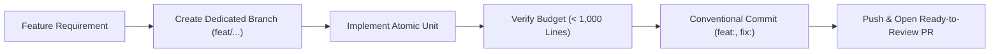

# Git Branching, Commit Chunking & Releases (`/git-workflow`)

> **Philosophy**: *Small commits are reviewable commits. Never dump massive multi-thousand-line changes. Chunk atomically under 1,000 lines. Document every release.*

This skill establishes version control discipline, branching strategies, commit size limits, semantic version tagging, and automated Pull Request authoring.

---

## 1. The Git Discipline Workflow



### Rule 1: The 1,000-Line Commit Budget
- Every single Git commit must contain **fewer than 1,000 changed lines** (insertions + deletions).
- If a major feature or refactor touches 2,500 lines, decompose it logically into 3–4 cohesive commits:
  1. Schemas, interfaces, and database migrations.
  2. Domain logic, service implementation, and unit tests.
  3. API endpoints, routes, and integration tests.
  4. UI presenter components and documentation.

### Rule 2: Conventional Commits Specification
All commit messages must follow the structured format:
`type(scope): concise imperative subject`
- `feat`: New user-facing capability or skill.
- `fix`: Bug fix, error remediation, or security patch.
- `refactor`: Code reorganization with zero behavior change.
- `perf`: Performance optimization.
- `test`: Adding or updating test suites.
- `docs`: Documentation, guides, or specifications.
- `chore`: Tooling, build config, or dependency updates.

### Rule 3: Branching & Release Tagging
- Work on descriptive branches (`feat/feature-name`, `fix/issue-description`).
- Tag releases using semantic versioning (`git tag v3.0.0` && `git push --tags`).
- Author ready-to-merge Pull Requests with automated test summaries and checklists.

---

## 2. Commit Chunk Analyzer CLI

Audit your current uncommitted or staged changes against the 1,000-line budget:
```bash
python3 skills/git-workflow/scripts/analyze_git_commit_chunks.py
```
