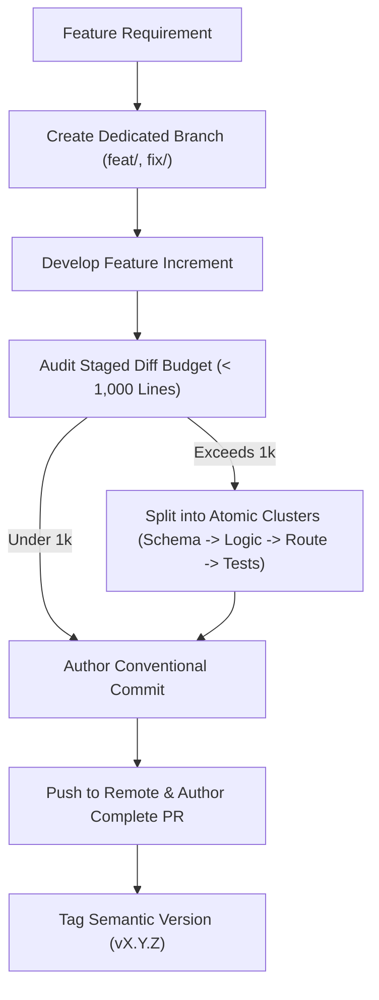

# Git Branching, Commit Chunking & Releases (`/git-workflow`)

> **Philosophy**: *Small commits are reviewable commits. Never dump massive multi-thousand-line changes. Chunk atomically under 1,000 lines. Document every release. Author ready-to-merge Pull Requests.*

This skill establishes version control discipline, branching strategies, commit size limits, semantic version tagging, and automated Pull Request authoring.

---

## 1. The Git Discipline Workflow



---

## 2. Core Git Workflow Guardrails

### 2.1 The 1,000-Line Commit Budget
- **Hard Ceiling**: No single commit may contain more than **1,000 changed lines** (insertions + deletions), excluding generated lockfiles or vendor assets.
- **Decomposition Heuristic**: When a feature requires substantial code additions:
  1. **Commit 1 (Schema & Contracts)**: Migration SQL, Drizzle/Prisma schema, TypeScript interfaces, and API type definitions.
  2. **Commit 2 (Business Logic & Repository)**: Domain services, database access methods, and automated unit tests.
  3. **Commit 3 (Controllers & Routes)**: HTTP handlers, Zod request validators, error serialization, and integration tests.
  4. **Commit 4 (UI & Documentation)**: Client components, CSS tokens, documentation updates, and E2E tests.

### 2.2 Conventional Commits Standard
Commit messages must strictly adhere to the Conventional Commits format:
`<type>(<optional-scope>): <imperative subject>`

| Type | Purpose | Example |
| :--- | :--- | :--- |
| `feat` | New feature or modular skill | `feat(3d): add Three.js WebGL product showcase skill` |
| `fix` | Bug fix, error remediation | `fix(qa): resolve layout overflow regex in token auditor` |
| `refactor` | Code restructuring with zero behavior change | `refactor(backend): decompose monolithic route into controller and repository` |
| `docs` | Documentation, guides, or specifications | `docs(skills): update master matrix table with 21 skills` |
| `test` | Adding or updating test suites | `test(devops): add non-root user verification test` |
| `perf` | Performance or bundle size optimization | `perf(ui): optimize glassmorphism backdrop blur repaint cost` |
| `chore` | Tooling, build config, or dependency updates | `chore: update release tag to v3.2.0` |

### 2.3 Ready-to-Review PR Authoring
Every Pull Request must provide complete context so reviewers can evaluate and merge safely:
1. **Title**: Conventional commit format matching the primary change.
2. **Context & Motivation**: Why the change is needed and what problem it solves.
3. **Key Architectural Changes**: Bulleted list of modified subsystems and newly introduced patterns.
4. **Verification Evidence**: Shell output demonstrating all test suites passing.
5. **Rollback Plan**: Exact command or deployment procedure to revert if issues emerge in production.

---

## 3. Automation Tool: Commit Chunk Analyzer CLI

Audit working tree diffs and cluster changed files into atomic commits within the 1,000-line budget:
```bash
python3 skills/git-workflow/scripts/analyze_git_commit_chunks.py --path .
```
Audits:
- Uncommitted or staged line count against the 1,000-line threshold.
- Categorizes modified files by subsystem (schema, service, route, test, doc).
- Generates structured commit message suggestions.
