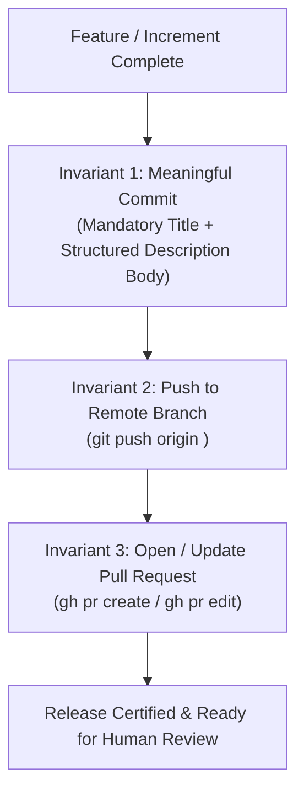

# Git Delivery Etiquette: Commits, Branch Pushing & Pull Requests

> **Scope**: Non-negotiable version control standards across Full-Scale Mode (`/full-scale-mode`) and all 22 SkillBuilder skills: meaningful multi-line commits (title + description), remote branch synchronization, and automated GitHub Pull Request authoring.

---

## 1. The Three Non-Negotiable Delivery Invariants

Every software development session, feature increment, refactoring cycle, or bug remediation must strictly adhere to three delivery invariants:



1. **Meaningful Commits with Title + Description**: Every commit must feature a Conventional Commit title AND a structured description body explaining *Why*, *What*, and *Impact*. Single-line or lazy commits (`"fix"`, `"update"`) are strictly prohibited.
2. **Always Push to the Remote Branch**: Local unpushed commits or dangling work branches are unacceptable. Work must be pushed to `origin <branch>` before concluding any phase.
3. **Always Open or Update a Pull Request**: Every deliverable must culminate in authoring a new GitHub Pull Request or updating an existing active PR with complete context, test evidence, and rollback plans.

---

## 2. Conventional Commit Structure: Title + Description

A commit message is permanent architectural documentation. It must satisfy this exact structure:

```text
<type>(<scope>): <imperative subject line under 72 chars>

- Context / Why: Problem statement, user requirement, or bug motivation driving the change.
- Key Changes / What: Specific, bulleted breakdown of components, files, and contracts modified.
- Verification / Impact: Exact automated test commands executed, line limits verified, and guardrail receipts.
```

### Required Fields Breakdown:

| Component | Format & Constraints | Example |
| :--- | :--- | :--- |
| **Title** | `<type>(<scope>): <imperative summary>` (< 72 chars) | `feat(qa): implement two-tier QA architecture and verification engine` |
| **Context / Why** | 1–2 sentences describing the motivation and requirement | `- Context / Why: Resolves user request to split QA into Full UI and Full App Functional domains.` |
| **Key Changes / What** | 2–6 bullet points detailing affected subsystems | `- Key Changes / What:<br/>  * Created full-ui-frontend-qa-manual.md (213 lines).<br/>  * Implemented verify_app_functionality.py CLI tool.<br/>  * Expanded master-error-catalog.md with mobile lifecycle entries.` |
| **Verification / Impact** | Concrete proof of tests run and line limit compliance | `- Verification / Impact: 28/28 test suites passed cleanly; all 76 files under 500 lines.` |

### Commit Anti-Patterns vs. Production Standards:

| Anti-Pattern | Violation | Mandatory Production Standard |
| :--- | :--- | :--- |
| **Lazy Single-Line Message** | `git commit -m "update files"` | Conventional title + structured body explaining *Why*, *What*, and *Verification*. |
| **Generic Verb Subject** | `git commit -m "fix: bug fixes"` | Specific scope and action: `fix(auth): prevent race condition during cold-start token rehydration`. |
| **Missing Description Body** | `git commit -m "feat(api): add routes"` | Multi-line message with `- Context / Why:` and `- Key Changes / What:` bullet points. |
| **Unchunked Mega-Commit** | 3,500 lines changed in 1 commit | Decompose into atomic commits strictly under the **1,000-line budget**. |

---

## 3. Remote Branch Push Protocol

Code that exists only on a local developer machine is vulnerable to loss and invisible to collaborators. Enforce remote synchronization:

### 1. Branch Naming Discipline
All work must be conducted on purpose-driven feature or fix branches:
- `feat/<feature-slug>`: New features, skills, or capabilities.
- `fix/<defect-slug>`: Bug fixes and regression remedies.
- `refactor/<module-slug>`: Restructuring with zero behavioral changes.
- `perf/<optimization-slug>`: Performance or bundle size improvements.
- `chore/<task-slug>`: Tooling, dependency, or configuration updates.

### 2. Immediate Remote Push
Immediately after committing, publish changes to the remote tracking branch:
```bash
# Push and set upstream tracking if branch is new:
git push -u origin <branch-name>

# Subsequent commits on the branch:
git push origin <branch-name>
```

### 3. Pre-Delivery Synchronization Check
Before declaring any task or phase complete, run:
```bash
git status
```
The output **must** verify:
- `nothing to commit, working tree clean`
- `Your branch is up to date with 'origin/<branch-name>'`

---

## 4. Ready-to-Review Pull Request Authoring

A Pull Request is the primary gateway for human code review and continuous delivery. Every delivery must author or update an active PR using the GitHub CLI (`gh`):

### PR Lifecycle Commands:

```bash
# For a newly created feature branch:
gh pr create \
  --title "<type>(<scope>): <clear title matching commit>" \
  --body "<structured markdown body>" \
  --base main \
  --head <branch-name>

# When updating an existing active PR with new commits:
gh pr edit <pr-number> \
  --title "<type>(<scope>): <updated title>" \
  --body "<updated structured markdown body>"
```

### Mandatory Pull Request Body Schema:

```markdown
## Summary
1–3 paragraphs explaining high-level purpose and user requirements delivered.

## Key Architectural Changes
- **Component A**: Specific breakdown of changes, new files, and contracts.
- **Component B**: Modified functions, database migrations, or schemas.

## Verification Evidence
\`\`\`bash
./scripts/verify_all_skills.sh
\`\`\`
- [PASS] Gate 1: 500-Line Source File Policy verified across all N files.
- [PASS] Gates 2-30: All 30 verification suites passed cleanly.
- [PASS] Anti-AI-Slop & Quality CLI: 0 violations.

## Rollback Plan
Specific git or deployment procedure to safely revert if regressions emerge.
```

---

## 5. Delivery Etiquette Verification Tooling

SkillBuilder provides an automated auditor to verify delivery compliance:

```bash
# Audit repository commit log, body presence, and remote synchronization:
python3 skills/git-workflow/scripts/verify_git_delivery_etiquette.py --path .
```
This utility verifies:
1. Latest commit contains a valid Conventional Commit title.
2. Latest commit contains a non-empty, structured description body (> 40 characters).
3. Commit does not use prohibited lazy keywords (`fix`, `update`, `wip`, `test`).
4. Working tree is clean and synchronized with the remote tracking branch.
