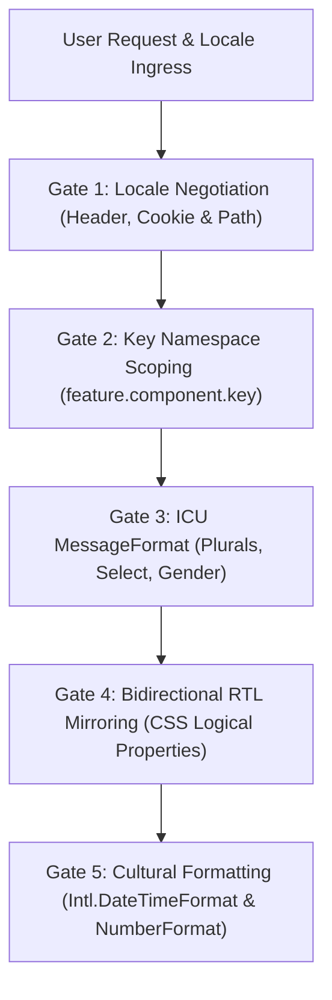

# Internationalization, RTL Mirroring & Cultural Localization (`/i18n`)

> **Philosophy**: *Zero hardcoded natural language strings in UI code. Layouts must be bidirectional by design. Enforce CSS logical properties over physical left/right. ICU syntax for plurals and gender. Native Intl formatters for dates and currencies.*

This skill establishes production architecture for global applications across **Next-intl**, **react-i18next**, **formatjs**, and **Flutter Intl/l10n**.

---

## 1. Quick Navigation & Progressive Disclosure

| Resource Type | Document | Description |
| :--- | :--- | :--- |
| **Reference** | [references/icu-messageformat-guide.md](references/icu-messageformat-guide.md) | ICU plural categories, parameter interpolation, number and date formatting. |
| **Reference** | [references/rtl-layout-mirroring.md](references/rtl-layout-mirroring.md) | CSS logical properties matrix, directional icon flipping, RTL typography. |
| **Utility** | [scripts/verify_i18n_hygiene.py](scripts/verify_i18n_hygiene.py) | Scans UI code for hardcoded English strings, physical CSS left/right properties, and broken plural syntax. |

---

## 2. The Core i18n Architecture Gates



1. **Gate 1: Resilient Locale Negotiation**: Detect user preference via URL path (`/en/`, `/ar/`, `/ja/`), cookies, or `Accept-Language` headers, with explicit fallback to default locale.
2. **Gate 2: Zero Hardcoded UI Text**: All user-visible strings must reference translation keys via `t('namespace.key')`.
3. **Gate 3: ICU Syntax for Pluralization**: Prohibit manual ternary string concatenation (`count === 1 ? '1 item' : '${count} items'`). Use ICU MessageFormat: `{count, plural, one {# item} other {# items}}`.
4. **Gate 4: Bidirectional CSS Logical Properties**: Use `margin-inline-start`, `margin-inline-end`, `padding-inline`, and `inset-inline` instead of physical `left`/`right` properties.
5. **Gate 5: Native Currency & Date Localization**: Always format numbers, currencies, and dates with native `Intl` APIs (`Intl.NumberFormat`, `Intl.DateTimeFormat`).

---

## 2. Bidirectional Component Architecture (TypeScript / React)

```tsx
import { useTranslations, useLocale } from "next-intl";

interface OrderSummaryProps {
  itemCount: number;
  totalAmount: number;
  currency: string;
}

export function OrderSummary({ itemCount, totalAmount, currency }: OrderSummaryProps) {
  const t = useTranslations("orders");
  const locale = useLocale();

  const formattedPrice = new Intl.NumberFormat(locale, {
    style: "currency",
    currency
  }).format(totalAmount);

  return (
    <div className="rounded-xl border border-border p-6 start-aligned">
      <h2 className="text-xl font-bold tracking-tight text-foreground">
        {t("summary_title")}
      </h2>
      <p className="mt-2 text-sm text-muted-foreground">
        {t("item_count_label", { count: itemCount })}
      </p>
      <div className="mt-4 flex items-center justify-between border-t border-border pt-4">
        <span className="font-medium text-foreground">{t("total_label")}</span>
        <span className="font-mono text-lg font-bold text-foreground">{formattedPrice}</span>
      </div>
    </div>
  );
}
```

---

## 3. ICU MessageFormat Dictionary (`messages/en.json` & `messages/ar.json`)

```json
// messages/en.json
{
  "orders": {
    "summary_title": "Order Summary",
    "item_count_label": "{count, plural, =0 {No items selected} one {1 item ready for checkout} other {{count} items ready for checkout}}",
    "total_label": "Total Amount"
  }
}
```

---

## 4. Internationalization Hygiene Verification CLI

Audit your repository for hardcoded UI strings and non-logical physical CSS properties:

```bash
python3 skills/i18n/scripts/verify_i18n_hygiene.py --path . --strict
```

Audited Rules:
- `I18N-HARDCODED-UI-STRING`: Flags raw natural language text literals rendered inside JSX tags.
- `I18N-PHYSICAL-CSS-DIRECTION`: Flags `margin-left`, `padding-right`, or `text-align: left` in bidirectional code.
- `I18N-TERNARY-PLURALIZATION`: Flags ternary string concatenations instead of ICU plurals.
