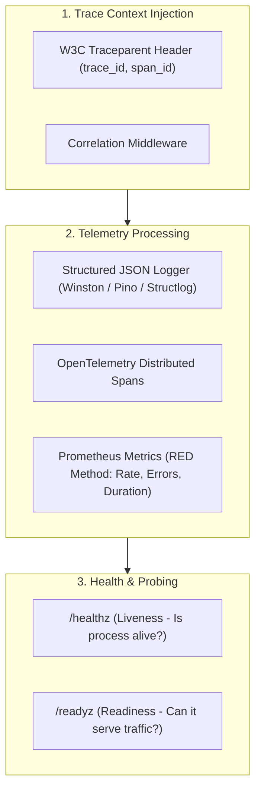

# Observability & Distributed Telemetry (`/observability`)

> **Philosophy**: *If it cannot be observed in production, it cannot be debugged. Correlate every log with a trace ID. Instrument every RPC boundary. Never emit unredacted PII.*

This skill establishes production observability standards across backend microservices, serverless functions, background workers, and containerized platforms.

---

## 1. Quick Navigation & Progressive Disclosure

| Resource Type | Document | Description |
| :--- | :--- | :--- |
| **Reference** | [references/opentelemetry-semantic-conventions.md](references/opentelemetry-semantic-conventions.md) | W3C traceparent headers, span semantic attributes for HTTP/DB/RPC. |
| **Reference** | [references/structured-json-logging.md](references/structured-json-logging.md) | JSON log schemas, correlation IDs, PII redaction rules. |
| **Utility** | [scripts/verify_telemetry_standards.py](scripts/verify_telemetry_standards.py) | Audits services for console.log statements, missing correlation IDs, and uninstrumented endpoints. |

---

## 2. The Three Pillars of Telemetry



---

## 2. Structured JSON Logging Specification

Every log line in production must be a single-line valid JSON object. Multi-line plain text strings cause ingestion errors in Datadog, Google Cloud Logging, and Loki.

### Mandatory JSON Schema:
```json
{
  "timestamp": "2026-10-25T14:30:00.123Z",
  "level": "INFO",
  "service": "billing-service",
  "trace_id": "4bf92f3577b34da6a3ce929d0e0e4736",
  "span_id": "00f067aa0ba902b7",
  "message": "Payment intent processed successfully",
  "http": {
    "method": "POST",
    "route": "/v1/charges",
    "status_code": 201,
    "duration_ms": 42.5
  },
  "customer_id": "cus_99182"
}
```

### PII Redaction Guardrail:
Never emit passwords, API keys, bearer tokens, or full credit card numbers in logs. Implement an automated redaction serializer for keys matching `/(password|token|secret|authorization|card_number|cvv)/i`.

---

## 3. The Golden Signals & RED Method

Instrument every service boundary with RED metrics:
- **Rate**: Requests processed per second (`http_requests_total`).
- **Errors**: Number of failed requests by status code (`http_requests_failed_total{status=~"5.."}`).
- **Duration**: Latency distribution histogram (`http_request_duration_seconds_bucket`).

### Prometheus Histogram Bucket Guidelines:
Use geometric buckets: `[0.005, 0.01, 0.025, 0.05, 0.1, 0.25, 0.5, 1, 2.5, 5, 10]`.

---

## 4. Discrete Health & Readiness Probes

Every web service must expose `/healthz` and `/readyz`:

```typescript
// Production Probe Endpoints
app.get("/healthz", (req, res) => {
  // Liveness: Is the node event loop responsive?
  res.status(200).json({ status: "alive", uptime_seconds: process.uptime() });
});

app.get("/readyz", async (req, res) => {
  // Readiness: Can downstream databases and caches respond?
  try {
    await db.query("SELECT 1");
    await redis.ping();
    res.status(200).json({ status: "ready" });
  } catch (err: unknown) {
    res.status(503).json({
      status: "degraded",
      error: err instanceof Error ? err.message : "Subsystem unreachable",
    });
  }
});
```

---

## 5. Telemetry Standards Auditor CLI

Audit your codebase for structured logging patterns, unredacted tokens, and health probe endpoints:
```bash
python3 skills/observability/scripts/verify_telemetry_standards.py --path .
```
Audits:
- Replacement of raw `console.log` with structured loggers.
- Presence of `/healthz` and `/readyz` route declarations.
- Propagation of trace IDs in request contexts.
