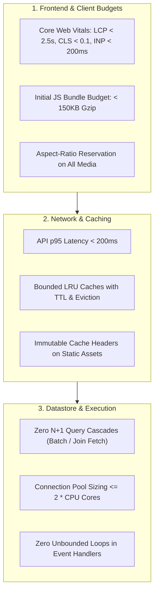

# Performance Profiling & Optimization (`/performance`)

> **Philosophy**: *Measure with evidence, not intuition. Eliminate N+1 query cascades, bound memory allocations, and enforce strict Core Web Vitals budgets. If it is not measured, it will degrade.*

This skill establishes performance optimization standards across frontend client bundles, Core Web Vitals, API latency budgets, memory leaks, and database query executions.

---

## 1. Performance Guardrails & Budgets



---

## 2. Core Web Vitals (CWV) Optimization Guide

| Metric | Target Budget | Optimization Strategies | Failure Anti-Pattern |
| :--- | :--- | :--- | :--- |
| **LCP (Largest Contentful Paint)** | `< 2.5s` | Preload hero image (`fetchpriority="high"`), inline critical CSS, server-side render text content | Lazy-loading the hero image (`loading="lazy"` on above-the-fold content) |
| **CLS (Cumulative Layout Shift)** | `< 0.1` | Explicit `width` and `height` or `aspect-ratio: 16/9`, reserved skeleton blocks for ads/banners | Dynamic insertion of content above existing content without reserved space |
| **INP (Interaction to Next Paint)** | `< 200ms` | Debounce inputs (200-300ms), break long tasks via `scheduler.yield()`, move heavy compute to Web Workers | Synchronous regex or sorting of 10,000 items on main thread |

---

## 3. JavaScript Memory Safety & Leak Prevention

Avoid the 3 most common Node.js / React memory leaks:
1. **Unbounded Global Maps / Caches**:
   ```typescript
   // ❌ LEAK: Map grows indefinitely until OOM crash
   const cache = new Map();

   // ✅ PRODUCTION: LRU cache with strict entry cap
   import { LRUCache } from "lru-cache";
   const cache = new LRUCache({ max: 500, ttl: 1000 * 60 * 5 }); // 5 minutes TTL
   ```
2. **Dangling Event Listeners**:
   ```typescript
   // Always remove listeners in cleanup function
   useEffect(() => {
     const handler = () => handleResize();
     window.addEventListener("resize", handler);
     return () => window.removeEventListener("resize", handler);
   }, []);
   ```
3. **Uncleared Timers / Intervals**:
   Store timer references and clear them in component unmount or error handlers.

---

## 4. Input Debouncing & Rate Limiting

Never trigger network requests on every raw keystroke. Debounce input changes:

```typescript
export function useDebounce<T>(value: T, delayMs: number = 300): T {
  const [debounced, setDebounced] = useState<T>(value);

  useEffect(() => {
    const timer = setTimeout(() => setDebounced(value), delayMs);
    return () => clearTimeout(timer);
  }, [value, delayMs]);

  return debounced;
}
```

---

## 5. Performance Budget Auditor CLI

Scan your repository for bundle size violations, missing media dimensions, and N+1 query patterns:
```bash
python3 skills/performance/scripts/audit_performance_budgets.py --path .
```
Audits:
- Presence of explicit dimensions or aspect ratios on image/video tags.
- Nested loop database queries in backend controllers.
- Unbounded in-memory collections without eviction policies.
- Client bundles exceeding size budgets.
