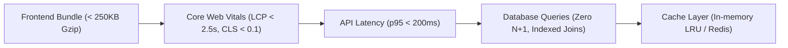

# Performance Profiling & Optimization (`/performance`)

> **Philosophy**: *Measure with evidence, not intuition. Eliminate N+1 query cascades, bound memory allocations, and enforce strict Core Web Vitals budgets.*

This skill establishes performance optimization standards across frontend client bundles, API latency budgets, and database query executions.

---

## 1. Performance Guardrails & Budgets



### Budget 1: Core Web Vitals (CWV)
- **Largest Contentful Paint (LCP)**: Under `2.5s`. Optimize hero images (`priority`, `fetchpriority="high"`), inline critical CSS.
- **Cumulative Layout Shift (CLS)**: Under `0.1`. Always declare explicit `width` and `height` (or aspect ratio) on images, videos, and embedded iframes.
- **Interaction to Next Paint (INP)**: Under `200ms`. Offload heavy compute tasks to Web Workers or chunk work using `scheduler.yield()`.

### Budget 2: Database Query & N+1 Prevention
- **Strict Rule**: Never execute database queries inside iterative loops (`for item in items: db.query(...)`).
- **Standard**: Batch loads using `WHERE id IN (...)` or eager relationship loading (`include: { profile: true }`, `joinedload(User.profile)`).

### Budget 3: Asset Caching & Bundle Size
- Chunk client bundles dynamically using dynamic imports (`React.lazy()`, Next.js `dynamic()`).
- Serve immutable static assets with: `Cache-Control: public, max-age=31536000, immutable`.

---

## 2. Performance Budget Auditor CLI

Scan your repository for bundle size violations and N+1 query patterns:
```bash
python3 skills/performance/scripts/audit_performance_budgets.py --path .
```
