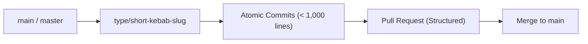

# Git Branching, Commit Chunking, and Pull Request Standards

This reference governs branch lifecycle management, atomic commit chunking (the 1,000-line diff budget), and automated Pull Request preparation so that users and reviewers can review and merge with minimal friction.

---

## 1. Branch Naming Strategy

Every piece of work—whether starting a project from scratch or modifying an existing codebase—must occur on an explicitly named, purpose-driven branch.



### Standard Branch Prefixes

| Prefix | When to Use | Example Branch Name |
| :--- | :--- | :--- |
| `feat/` | Introducing a new capability, user flow, or endpoint. | `feat/jwt-auth-refresh`, `feat/stripe-checkout` |
| `fix/` | Resolving a bug, defect, or unexpected runtime crash. | `fix/cart-item-deduplication`, `fix/db-timeout-leak` |
| `refactor/` | Structural improvements without altering observable behavior. | `refactor/modularize-billing`, `refactor/extract-tax-calc` |
| `perf/` | Targeted optimizations for latency, queries, or memory. | `perf/composite-query-indexes`, `perf/bundle-tree-shaking` |
| `docs/` | Updating documentation, API specs, or ADR records. | `docs/openapi-contracts`, `docs/setup-guide` |
| `test/` | Adding test coverage, regression fixtures, or benchmarks. | `test/checkout-e2e-suite`, `test/token-replay-fixtures` |
| `chore/` | Tooling, dependency upgrades, Docker, or CI/CD changes. | `chore/upgrade-typescript-5`, `chore/docker-compose-setup` |

### Starting from Scratch (Bootstrap Branches)
When initializing a brand new project, use:
- `chore/initial-scaffolding` or `feat/project-bootstrap`
- Establish `.gitignore`, `.env.example`, `Dockerfile`, and CI workflow in the initial PR before adding sprawling feature code.

---

## 2. Commit & Push Analysis (The 1,000-Line Diff Budget)

> *Mega-diffs (> 1,000 lines) result in rubber-stamp reviews, high defect rates, and painful merge conflicts. Keep diffs reviewable.*

### The Chunking Discipline
Before staging or committing code, analyze the diff across modified files:
- **Target Size**: 100 to 500 lines per commit.
- **Hard Upper Limit**: Never push a single commit or unreviewed diff exceeding **1,000 physical lines** of human-authored code (excluding lockfiles, generated assets, and migrations).

### Logical Chunk Separation
When a feature requires multiple layers, decompose the work into sequential, cohesive commits:

```text
Commit 1 (Schema & Models):
  - db/migrations/001_create_invoices.sql
  - src/models/invoice.ts
  - Message: feat(billing): add invoice database schema and domain entity

Commit 2 (Business Logic & Repositories):
  - src/repositories/invoice_repository.ts
  - src/services/invoice_calculator.ts
  - tests/unit/invoice_calculator.test.ts
  - Message: feat(billing): implement invoice tax calculation and repository

Commit 3 (API Controller & Route Wiring):
  - src/routes/invoice_routes.ts
  - src/validators/invoice_validator.ts
  - tests/integration/invoice_routes.test.ts
  - Message: feat(billing): attach validated invoice endpoints
```

### The "Green State" Commit Rule
Every individual commit must:
1. Compile or pass type checking (`tsc --noEmit`, `mypy`, `go vet`).
2. Pass relevant automated test suites.
3. Pass linter checks.
Never commit broken, half-implemented code with the promise of "fixing it in the next commit."

---

## 3. Pull Request Etiquette: Ready-to-Review Format

Always prepare Pull Requests with a complete title and comprehensive description so the user/reviewer can review with confidence and merge immediately.

### Conventional PR Title Format
```text
<type>(<scope>): <clear imperative description>
```
*Examples*:
- `feat(auth): implement JWT refresh rotation with cookie revocation`
- `fix(billing): resolve concurrency race condition in payment webhook`
- `refactor(database): extract repository layer from monolithic controller`

### Required PR Description Structure

Every PR description must include these 6 core sections:

```markdown
## 1. Summary & Objective
[What problem does this PR solve? Why is this change necessary? Reference issue/ticket if applicable.]

## 2. Architectural & Technical Decisions
- [Decision 1: e.g., Utilized Argon2id for password hashing with cost factor t=3, m=64MB]
- [Decision 2: e.g., Isolated database access behind an explicit Repository interface]

## 3. Modified & Created Files
- `[NEW]` `src/services/auth_service.ts`: Core token issuance and verification.
- `[NEW]` `tests/unit/auth_service.test.ts`: 12 isolated unit test cases.
- `[MODIFY]` `src/routes/api.ts`: Mount refresh endpoint.

## 4. Verification Evidence & Test Results
- **Automated Tests Executed**:
  ```bash
  npm test
  # 18 passing, 0 failing (100% pass rate)
  ```
- **Line Limit & Hygiene Audit**:
  ```bash
  python3 scripts/check_source_line_limits.py --path src
  # [PASS] All checked source files comply with the 500-line guardrail.
  ```

## 5. Environment Variables & Migrations
- **New Environment Variables**: Added `JWT_REFRESH_SECRET` to `.env.example`.
- **Database Migrations**: Migration `002_add_refresh_tokens.sql` must be executed.

## 6. Rollback / Contingency Plan
[If this PR introduces an unexpected defect in production, what is the exact rollback procedure? e.g., Revert commit and rollback migration 002.]
```
