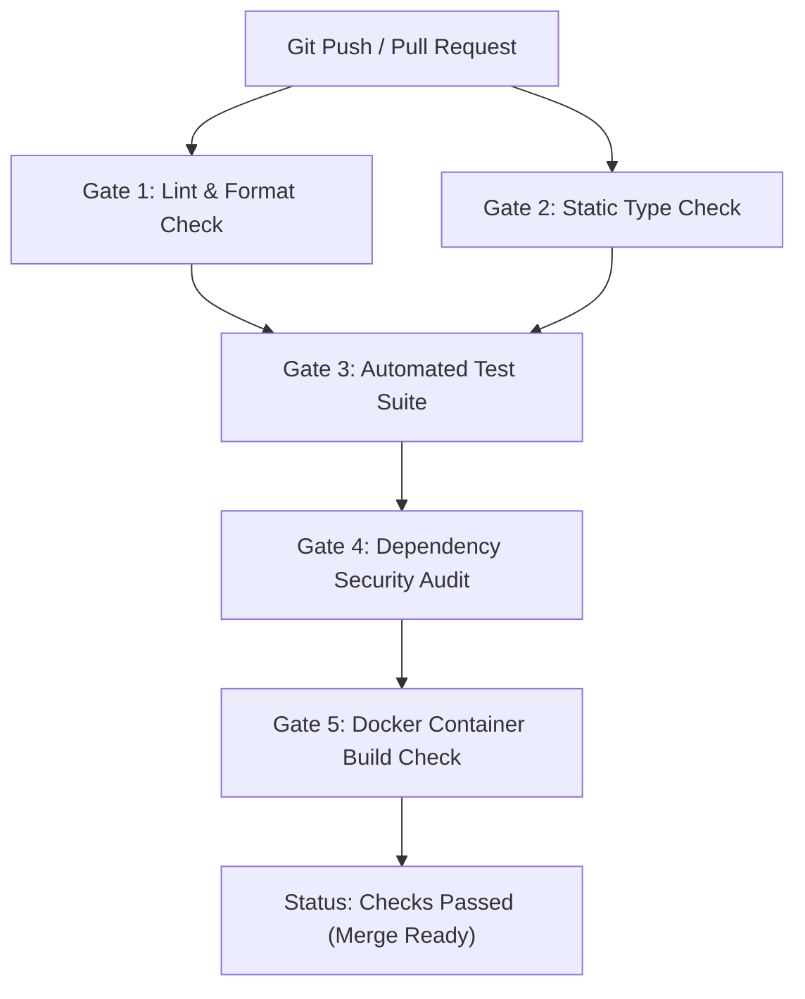

# Continuous Testing and CI/CD Standards

This reference governs automated testing practices, test coverage discipline, and automated CI/CD pipeline authoring.

---

## 1. The Continuous Testing Mandate

> *Untested code is broken code.*

Every pull request, feature branch, or bug fix must include automated test coverage. A task is never complete until tests have been written, executed, and confirmed passing.

### Test Coverage Expectations
- **Domain Business Rules**: 100% unit test coverage of business invariants, calculations, and state machines.
- **API Endpoints**: Integration tests verifying request validation, status codes, payload formatting, and error envelopes.
- **Database Repositories**: Integration tests verifying queries, transaction rollbacks, constraints, and migrations.

---

## 2. Standardized CI/CD Workflow Architecture

Every repository must contain a standardized GitHub Actions workflow (placed in `.github/workflows/ci.yml`) enforcing 5 automated gates:



### The 5 Automated CI Gates
1. **Gate 1 — Linting & Style**: Enforces clean code conventions (`eslint`, `biome`, `ruff`, `golangci-lint`, `cargo clippy`).
2. **Gate 2 — Type Checking**: Enforces strict typing with zero compiler errors (`tsc --noEmit`, `mypy --strict`, `pyright`, `go vet`).
3. **Gate 3 — Test Execution**: Runs all unit and integration test suites in isolated test runners.
4. **Gate 4 — Security Audit**: Scans dependencies for known CVEs (`npm audit --audit-level=high`, `pip-audit`, `govulncheck`).
5. **Gate 5 — Docker Build Verification**: Verifies that the production `Dockerfile` builds cleanly without warnings or missing dependencies.

---

## 3. Pre-Push Local Verification Script

Engineers and agents should run the exact same verification locally before pushing changes:

```bash
# Example local verification sequence:
npm run lint
npm run typecheck
npm test
npm audit
docker build -t app:test .
```
