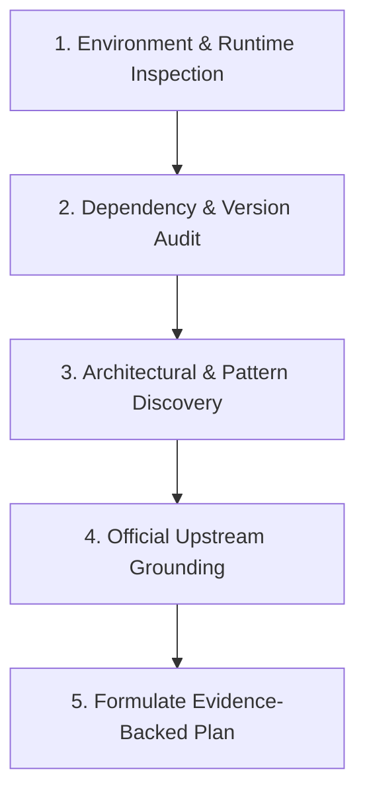

# Deep Pre-Planning Research Protocol

This reference establishes the mandatory research protocol that must be executed *before* formulating an implementation plan or proposing code changes.

---

## 1. The Principle of Empirical Discovery

> *Never assume. Never guess. Inspect the reality of the repository.*

Hallucinated library capabilities, incorrect framework versions, and invented CLI options occur when an agent plans based on training memory instead of empirical discovery. The Deep Research Protocol enforces a structured investigation of the project environment before any plan is authored.

---

## 2. The 5-Step Deep Research Workflow

### Step 1: Environment & Runtime Inspection
- Locate package manifests: `package.json`, `pyproject.toml`, `requirements.txt`, `go.mod`, `Cargo.toml`.
- Identify the exact runtime version (e.g., Node 18 vs 22, Python 3.10 vs 3.12).
- Inspect test runners, linters, and formatters (`jest`, `vitest`, `pytest`, `eslint`, `biome`, `ruff`).

### Step 2: Dependency & Version Audit
- Read lockfiles (`package-lock.json`, `poetry.lock`, `Cargo.lock`) to verify the installed versions of key packages.
- Check whether an abstraction or utility already exists in the project before considering adding a new dependency.

### Step 3: Architectural & Pattern Discovery
- Inspect existing directory structures, naming conventions, and file organization.
- Read existing unit tests to understand established mocking practices and fixture conventions.
- Locate existing database schemas, migration files, and configuration parsers.

### Step 4: Official Upstream Grounding
- When using external APIs, SDKs, or cloud services, look up official documentation or tool schemas.
- Verify exact method signatures, required header formats, and error codes rather than assuming parameters.

### Step 5: Evidence-Backed Planning
- Ground every step in the implementation plan on specific file paths, line ranges, and verified dependencies.
- If a requirement is ambiguous, either state a grounded assumption explicitly or ask a single focused question.

---

## 3. Pre-Planning Research Checklist

Before creating an implementation plan, confirm:

- [ ] Have I inspected the actual repository tree and verified file paths?
- [ ] Have I identified the exact language version, build tool, and test runner?
- [ ] Have I confirmed which dependencies are already installed?
- [ ] Have I checked for uncommitted changes in the working tree (`git status`)?
- [ ] Have I verified that the proposed library methods exist in the installed version?
