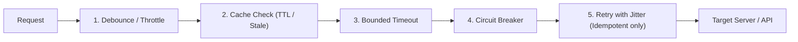

# Network Resilience and Request Etiquette

This reference governs client and server-side request techniques, defensive HTTP patterns, caching, rate limiting, and failure mitigation.

---

## 1. The 5 Defensive Request Techniques

Every HTTP client, API integration, and network communication layer must employ:



---

## 2. Technique 1: Explicit Bounded Timeouts

**Rule**: Never make a network request without an explicit timeout. Unbounded requests cause socket pool exhaustion and thread starvation during network latency spikes.

- **Connection Timeout**: Maximum time to establish TCP/TLS handshake (Default: 2,000–3,000ms).
- **Execution / Read Timeout**: Maximum time to wait for the complete response payload (Default: 10,000–30,000ms).
- **Implementation**:
  - In TypeScript/JavaScript: Use `AbortController` with `setTimeout` or `AbortSignal.timeout(ms)`.
  - In Python: Set `timeout=(3.0, 15.0)` in `httpx` or `requests`.
  - In Go: Wrap calls in `context.WithTimeout(ctx, 10*time.Second)`.

---

## 3. Technique 2: Caching with Deliberate Invalidation

- **Cache Keys**: Derive cache keys deterministically from the HTTP method, endpoint, and sorted query parameters:
  `cache_key = "GET:/api/v1/products?category=electronics&page=1"`
- **Stale-While-Revalidate**: Serve cached stale content immediately while asynchronously refreshing the cache in the background.
- **Cache Invalidation on Mutation**: When a `POST`, `PUT`, `PATCH`, or `DELETE` succeeds, invalidate all related read cache keys immediately:
  ```typescript
  // Mutation invalidates collection and item cache
  await db.updateProduct(id, updates);
  cache.delete(`GET:/api/v1/products/${id}`);
  cache.deletePattern(`GET:/api/v1/products?*`);
  ```

---

## 4. Technique 3: Debouncing & Throttling

- **Debouncing**: Delays invoking a function until a specified idle period has passed (e.g., 300ms) since the last event.
  - *Mandatory on*: Search input fields, typeahead suggestions, auto-saving drafts.
- **Throttling**: Guarantees a function is called at most once per time window (e.g., once every 250ms).
  - *Mandatory on*: Window resize handlers, scroll listener callbacks, telemetry event emissions.

---

## 5. Technique 4: Bounded Exponential Backoff with Jitter

When retrying transient network errors (HTTP 429, 502, 503, 504, connection reset):
- **Full Jitter Formula**:
  $$\text{sleep} = \text{random}(0, \min(\text{max\_backoff}, \text{base} \times 2^{\text{attempt}}))$$
- **Max Retries**: Limit retries to 3 attempts.
- **Strict Idempotency Guard**:
  - Safe to retry: `GET`, `HEAD`, `PUT`, `DELETE` (or `POST` with a verified `Idempotency-Key` header).
  - **Never blindly retry non-idempotent `POST` requests** without confirmation that the server did not process the payload.

---

## 6. Technique 5: Circuit Breakers

When a downstream service suffers an outage, continuous retries exacerbate the failure (stampede effect). A circuit breaker transitions between three states:

1. **Closed (Normal)**: Requests flow normally. Failures are counted.
2. **Open (Failing)**: If failure rate exceeds threshold (e.g., 50% over 20 requests), trip the breaker. Immediate fast-fail without making network calls.
3. **Half-Open (Testing)**: After a cooldown period (e.g., 30s), allow a single canary request through. If it succeeds, reset to Closed; if it fails, return to Open.
